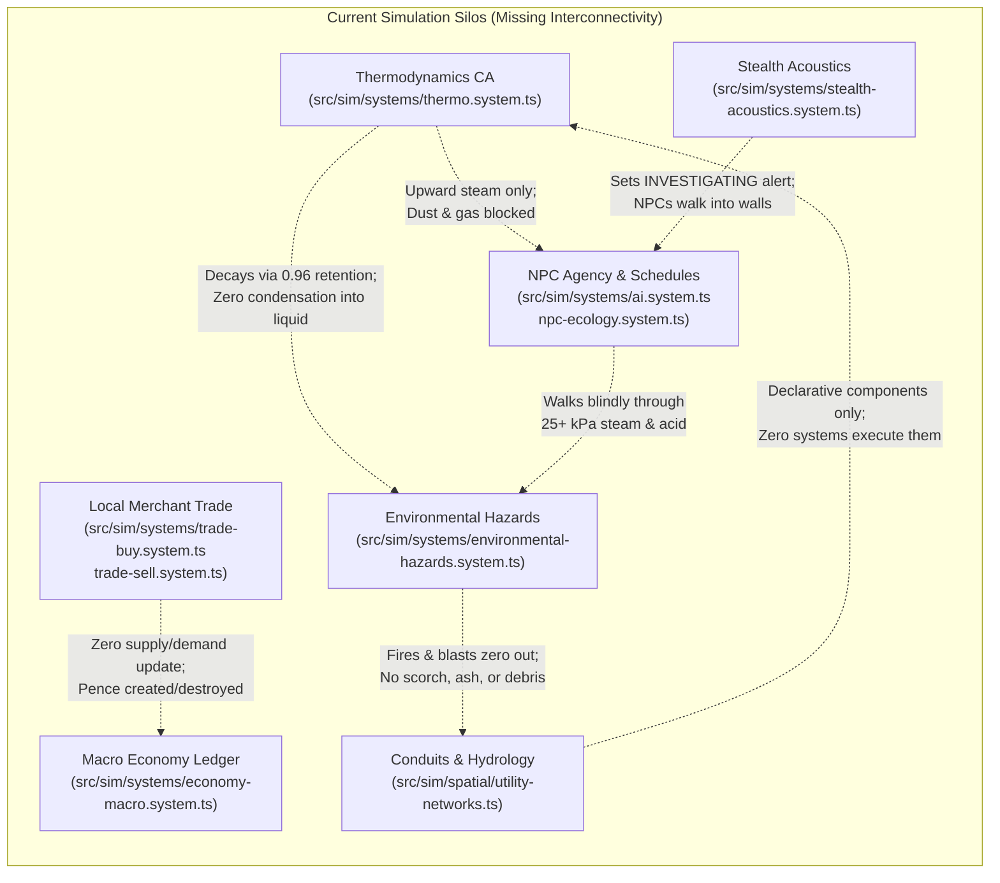

# Systemic Interconnectivity & Simulation Critique
**Target Codebase**: *Aether & Soot* (Headless Simulation Core `src/sim/`, Contracts `src/schemas/`)  
**Evaluation Perspective**: Headless ECS Causality, Multi-Agent Emergence, and Environmental Storytelling  
**Tone**: Clinical, Critical, Strictly Objective  

---

## 1. Executive Summary & Simulation Topology

*Aether & Soot* specifies a deterministic, headless, turn-based Victorian steampunk simulation designed to run bit-exact headless playtests in Node.js. The codebase enforces strict separation between the simulation core (`src/sim/`) and presentation layer (`src/client/`), backed by typed Zod contracts (`src/schemas/`).

However, an exhaustive architectural audit of the live simulation core reveals severe systemic compartmentalization. While individual systems execute localized calculations with high mathematical precision (e.g., cellular automata diffusion of steam pressure, discrete limb HP tables, xoshiro128** PRNG determinism), the causal feedback loops connecting these systems are largely fractured or non-existent. Mechanics operate in functional silos:
- Environmental hazards dissipate into mathematical voids without leaving physical debris, condensation, or persistent soot.
- Micro-level market transactions with merchants do not ripple into macro-economic quotes, and currencies exist in infinite faucets or deletion voids.
- NPC diurnal schedules freeze for half the 24-hour cycle and rely on naive coordinate subtraction that causes permanent path blockage.
- Declared infrastructure schemas (utility conduits, hydrology sluices, cross-stratum shafts, district graph nodes) exist as dead data models devoid of runtime simulation systems.



---

## 2. Domain 1: Spatial Strata Transitions & Vertical Layering

### 2.1 One-Way, Steam-Only Atmospheric Bleeding
- **Observed Implementation**: `src/sim/systems/thermo.system.ts` (lines 104–142).
- **Mechanism**: The thermodynamics tick scans entities with `portal.conductsGas: true` and transfers 30% of `steamPressureKpa` strictly upward (`toElev > fromElev`) between strata (`CATACOMBS` -> `UNDERCROFT` -> `STREET` -> `SPIRE`).
- **Defects & Limitations**:
  1. **Gas Discrimination**: Only `steamPressureKpa` is transferred upward. Neither coal dust (`coalDustDensity`, lines 64–70) nor toxic smoke/soot particulates (`smokePpm`, `grid.ts:13`) transfer through open portals. An inferno producing 500 ppm smoke in the Undercroft leaves the Street above pristine.
  2. **Zero Downward Drainage**: Gravity does not apply to atmospheric or liquid elements. Denser gases (carbon dioxide, chloroform, heavy coal dust) and surface liquids (`NITRIC_ACID`, `WHALE_OIL`, `SLUICE_SLUDGE`, `BLOOD`) cannot seep, drain, or drip downward through grates or shafts into the Undercroft.
  3. **Elevation Model Rigidity**: Elevation is hardcoded as a static 4-tier index (`CATACOMBS: -1`, `UNDERCROFT: 0`, `STREET: 1`, `SPIRE: 2`). Complex multi-level districts with split-level terraces or mezzanines cannot be represented.

### 2.2 Blind Gravity Drop Destination
- **Observed Implementation**: `src/sim/systems/physics-traps.system.ts` (lines 65–112).
- **Mechanism**: When an actor on `SPIRE` is displaced into an `ABYSS_DROP` terrain tile, `resolveKnockbackAndGravityFall` forcibly shifts the entity to `STREET` at identical coordinates `(nx, ny)`.
- **Defects & Limitations**:
  1. **No Spatial Validation on Landing**: Line 86 sets `position: { ...actor.position, stratum: 'STREET', x: nx, y: ny }` without checking if coordinate `(nx, ny)` on `STREET` is a solid wall (`SOOT_BRICK_WALL`), an impassable machine, or a void. An actor can plummet from the Spire directly into the interior of a brick wall and become permanently trapped.
  2. **Asymmetric Strata Fall Physics**: Falling only exists from `SPIRE` to `STREET`. There is no mechanism for falling from `STREET` into `UNDERCROFT` (e.g., through street grates, collapsed floorboards, or sewer holes).

### 2.3 NPC Stratum Confinement
- **Observed Implementation**: `src/sim/systems/ai.system.ts` (lines 53, 67, 82), `src/sim/systems/npc-ecology.system.ts` (lines 21, 38, 157, 180).
- **Mechanism**: All AI checks and ecological anchor pathing explicitly filter targets by `position.stratum === npc.position.stratum`.
- **Defects & Limitations**:
  - Autonomous NPCs are strictly unable to perceive, path toward, or use portals (`PORTAL_TRANSIT`).
  - If an NPC's `restAnchor` or `workAnchor` is placed on a different stratum (or if an NPC is displaced to another stratum via knockback/fall), `if (actor.position.stratum === restAnchor.stratum)` permanently evaluates to `false`. The NPC enters an unhandled state, standing motionless for the remainder of the simulation.

### 2.4 Active Stratum Hazard Simulation Silo
- **Observed Implementation**: `src/sim/core/simulation-pipeline.ts` (lines 42–45).
- **Mechanism**:
  ```typescript
  const activeStratum = workingState.entities['actor_player' as EntityId]?.position?.stratum ?? 'STREET';
  const hazardTick = advanceEnvironmentalHazards(workingState, activeStratum);
  ```
- **Defects & Limitations**:
  - `advanceEnvironmentalHazards` (soot cloud drift and acid drips) executes exclusively on the single stratum where the player is currently located.
  - When the player descends into the Undercroft or ascends to the Spire, all Street-level acid drips and soot dispersion completely halt. The world ceases to physically simulate outside the player's stratum slice.

### 2.5 Dead Infrastructure Data Models
- **Observed Implementation**: `src/schemas/world-components.schema.ts` (lines 130–188), `src/sim/spatial/utility-networks.ts` (lines 4–50).
- **Mechanism**: Components `UtilityConduitComponent`, `CrossStratumShaftComponent`, `HydrologyChannelComponent`, and `DistrictGraphNodeComponent` are defined with rich schema fields (`operatingPressureKpa`, `flowRateUnitsPerTick`, `sluiceOpen`, `drainsIntoStratum`).
- **Defects & Limitations**:
  - A search across `src/sim/systems/` yields **zero references** to `utilityConduit`, `crossStratumShaft`, `hydrologyChannel`, or `districtGraphNode`.
  - Conduits never carry pressure, never rupture, and do not connect boilers to consumers. Sluices cannot be opened or closed. Shafts do not transfer fluid or cargo. They exist purely as static visual markers placed during procedural generation.

---

## 3. Domain 2: Industrial Hazards, Thermodynamics & Acoustic Ecology

### 3.1 Mathematical Evaporation vs. Absent Condensation
- **Observed Implementation**: `src/sim/systems/thermo.system.ts` (lines 58, 78).
- **Mechanism**: Steam pressure decays across open neighbors via `retainedSteam * STEAM_RETENTION_FACTOR (0.96)`. If `rawSteam < 0.05`, it is clamped to `0`.
- **Defects & Limitations**:
  - Thousands of kilopascals of superheated industrial steam vent into enclosed Victorian rooms, cool down, and vanish into mathematical non-existence.
  - There is zero phase-change condensation into surface moisture or water puddles (`liquidType: 'WATER'` or `'SLUICE_SLUDGE'`).
  - There is no moisture tracking on walls or machinery, no electrical short-circuiting on clockwork/pneumatic limbs, and no rust degradation caused by prolonged steam exposure.

### 3.2 Non-Persistent Hazard Disappearance (Zero Physical Residue)
- **Observed Implementation**: `src/sim/systems/environmental-hazards.system.ts` (lines 48–54), `src/sim/systems/pyrotechnics.system.ts` (lines 75–80).
- **Mechanism**:
  - Whale oil ignition sets `liquidType: 'NONE'` and `liquidVolumeMl: 0`, adding steam and smoke.
  - Coal dust ignition sets `coalDustDensity: 0` and adds steam.
- **Defects & Limitations**:
  - Neither oil infernos nor coal dust deflagrations leave physical residue. No ash entities are spawned, no soot stains are applied to the tile, and the underlying floor terrain remains pristine cobblestone.
  - Sizzling nitric acid drips (`environmental-hazards.system.ts:187`) repeatedly pool and damage actors, but never corrode or etch the floor tiles.
  - Wall breaches (`physics-traps.system.ts:33`) turn `SOOT_BRICK_WALL` into `RUBBLE_PILE`, but high-explosive pressure vessel detonations deposit zero debris, dust, or shrapnel on surrounding tiles.

### 3.3 Acoustic Investigation Brittleness & Path Failure
- **Observed Implementation**: `src/sim/systems/stealth-acoustics.system.ts` (lines 61–112), `src/sim/systems/ai.system.ts` (lines 80–89).
- **Mechanism**:
  - `emitAcousticPulse` alerts NPCs within `decibels / 8` Chebyshev distance, setting `alertState: 'INVESTIGATING'` and recording `lastKnownTargetPos`.
  - `decideNpcIntent` directs the investigating NPC toward `lastKnownTargetPos` using `spatial.getDirectionToward()`.
- **Defects & Limitations**:
  1. **Instant Forgetting Upon Arrival**: The instant an NPC steps onto the exact coordinate (`npc.position.x === nextLastKnownTargetPos.x && npc.position.y === nextLastKnownTargetPos.y`), line 84 immediately resets `nextAlertState = 'IDLE'` and clears `nextLastKnownTargetPos`. The NPC does not look around, scan the room, query recent footprints, or hold an alert posture.
  2. **Wall Sticking via Naive Direction**: `spatial.getDirectionToward` performs simple delta sign arithmetic (`Math.sign(target.x - origin.x)`). If a wall or closed door intervenes between the NPC and the sound origin, `resolveMoveStep` returns `MOVEMENT_BLOCKED`. The NPC has no recovery heuristic, no A* search, and repeatedly attempts to walk into the obstacle until another trigger occurs.
  3. **No Acoustic Sound Occlusion**: Noise propagates using raw Chebyshev distance without checking intervening walls. A 100 dB explosion behind three 1-meter solid soot-brick walls alerts an NPC on the other side identically to an explosion in an open courtyard.

### 3.4 Absolute Environmental Blindness in AI Pathing
- **Observed Implementation**: `src/sim/systems/ai.system.ts` (lines 76, 86), `src/sim/systems/movement.system.ts` (lines 101–153).
- **Mechanism**: AI movement queries `resolveMoveStep`, which only validates `isWithinBounds`, `blocksMovement` (terrain), and `findBlockingEntityAtPoint`.
- **Defects & Limitations**:
  - NPCs have zero awareness of environmental tile hazards.
  - An NPC in pursuit of the player or investigating a sound will march straight through 90 kPa superheated steam (`THERMAL_SCALD`), ignited whale oil flame cascades, or nitric acid puddles, taking catastrophic limb damage without attempting to path around the lethal tiles.

---

## 4. Domain 3: Physical Trade, Commodity Flow & Macroeconomic Severance

### 4.1 Microeconomic Trade vs. Macroeconomic Ledger Severance
- **Observed Implementation**: `src/sim/systems/trade-buy.system.ts` (lines 15–145), `src/sim/systems/trade-sell.system.ts` (lines 13–124), `src/sim/systems/economy.system.ts` (lines 32–73), `src/sim/systems/economy-macro.system.ts` (lines 7–36).
- **Mechanism**:
  - Buying and selling items adjusts `state.economy.playerTreasuryPence` and moves items between inventories.
  - Macro-tick economy adjusts `marketQuotes[commodity].supplyUnits` and `currentPricePence` every 100 turns via mean reversion.
- **Defects & Limitations**:
  1. **Zero Market Impact from Player Trade**: When the player buys 50 units of Anthracite Coal from a merchant, `marketQuotes['ANTHRACITE_COAL'].supplyUnits` is **unaffected**. When the player sells 100 Phosphor Bronze Ingots, supply does not rise and prices do not drop. Micro-trade and macro-quotes operate in completely severed universes.
  2. **Static Demand Constants**: In `economy.system.ts`, `demandUnits` for each commodity is a fixed constant (`ANTHRACITE_COAL: 100`, `PHOSPHOR_BRONZE: 60`, `AETHER_VIAL: 40`, `CLOCKWORK_MAINSPRING: 75`). Demand never increases during harsh weather, war, or shortages, nor does it decrease during surpluses.
  3. **Absence of Physical Commodity Production**: No physical structures (foundries, blast furnaces, mines, refineries) actually produce commodities. Commodities are never extracted, hauled, or transformed. Supply simply reverts toward static demand via the formula `reversionStep = (demand - supply) * 0.18 + jitter`.

### 4.2 Disconnected Pedestal Implementations & Dangling Pointers
- **Observed Implementation**: `src/sim/systems/trade-pedestal.ts` (lines 7–118) vs `src/sim/systems/npc-ecology.system.ts` (lines 33–95).
- **Mechanism**:
  - `resolveStockPedestal` (invoked by player command) removes items from satchel and appends a record to `state.economy.storefrontListings` array. It does not reference any spatial entity.
  - `restockAdjacentPedestal` (invoked during NPC ecology) searches for physical entities in `state.entities` with a `tradePedestal` component.
- **Defects & Limitations**:
  1. **Dual Incompatible Architectures**: Player pedestal trading is an abstract ledger list without physical location. NPC pedestal trading is an in-world spatial entity interaction. The two systems do not share data or mechanics.
  2. **Dangling Entity Pointer Bug**: In `npc-ecology.system.ts` (lines 56–58, 75), when a merchant stocks the last unit of an item on a pedestal, `delete nextEntities[itemId]` purges the item entity from the world. Line 76 then sets `tradePedestal: { itemEntityId: itemId, ... }`. The pedestal now references an entity ID that has been completely deleted from `state.entities`, causing subsequent item lookups to fail or crash.

### 4.3 Arbitrary Currency Sinks and Infinite Liquidity Faucets
- **Observed Implementation**: `src/sim/systems/trade-buy.system.ts` (line 121), `src/sim/systems/trade-sell.system.ts` (line 100).
- **Mechanism**:
  - `resolveBuyFromMerchant`: `state.economy.playerTreasuryPence -= totalCost`.
  - `resolveSellToMerchant`: `state.economy.playerTreasuryPence += totalPayout`.
- **Defects & Limitations**:
  - NPCs have no currency or wallet component. When the player buys an item, the money is not transferred to the merchant; it is erased from existence.
  - When the player sells an item, money is minted out of thin air. Merchants have infinite purchasing power. A player can sell 50,000 pence worth of scrap metal to a destitute street peddler, and the peddler will pay every penny without exhausting any reserve.

### 4.4 Broken Supply Escort Delivery Invariant (Destination Disregard)
- **Observed Implementation**: `src/sim/systems/supply-escort.system.ts` (lines 126–184).
- **Mechanism**: `processDropItemDelivery` triggers whenever the player drops an item that matches an active convoy's `cargoItemId`.
- **Defects & Limitations**:
  ```typescript
  const matchingConvoy = Object.values(state.convoys).find(
    (c) => c.cargoItemId === itemEntityId && (c.stage === 'PREPARATION' || c.stage === 'ESCORT_ASSIGNED' || c.stage === 'IN_TRANSIT'),
  );
  if (!matchingConvoy) return { state, events: [] };
  // Immediately completes delivery:
  const updatedConvoy: EscortConvoyRecord = { ...matchingConvoy, stage: 'DELIVERED', completedTurn: turn };
  ```
  - `processDropItemDelivery` **never inspects** `dropPos` or `destinationDistrictId` against `matchingConvoy.destinationPos`.
  - If a player accepts an escort convoy contract to deliver high-explosive munitions to the Spire, drops the munitions 1 step away inside the starting safehouse on Foundry Street, the convoy immediately resolves as `'DELIVERED'`, awarding full reputation and pence payout.
  - Convoys have no physical wagons, no cargo mass limits, and escort NPCs never path toward the destination.

---

## 5. Domain 4: NPC Diurnal Schedules, Agency & Social Ecology

### 5.1 The 50% Schedule Void (Dawn & Curfew Inaction)
- **Observed Implementation**: `src/sim/core/world.ts` (lines 32–38), `src/sim/systems/npc-ecology.system.ts` (lines 148–191).
- **Mechanism**: A day is 100 turns, split into 4 phases of 25 turns:
  1. Turns 0–24: `DAWN_WHISTLE`
  2. Turns 25–49: `FOUNDRY_SHIFT`
  3. Turns 50–74: `GASLIGHT_CURFEW`
  4. Turns 75–99: `GRAVEYARD_WATCH`
- **Defects & Limitations**:
  - In `resolveNpcEcologyAction`:
    ```typescript
    if (shift === 'GRAVEYARD_WATCH' && !isGuard) { /* move to restAnchor */ }
    if (shift === 'FOUNDRY_SHIFT') { /* move to workAnchor */ }
    return { state, events: [], apSpent: 0, handled: false };
    ```
  - `DAWN_WHISTLE` and `GASLIGHT_CURFEW` contain zero logic branches. For exactly 50 turns out of every 100 turns, every scheduled civilian NPC in the game returns `handled: false`.
  - In `ai.system.ts` (line 181), an unhandled ecology action results in the NPC standing frozen, consuming its AP without formulating a command, wandering, or speaking.

### 5.2 Inert Sleeping and Working (No-Op Needs)
- **Observed Implementation**: `src/sim/systems/npc-ecology.system.ts` (lines 164, 187).
- **Mechanism**: When an NPC reaches `restAnchor` during Graveyard Watch or `workAnchor` during Foundry Shift:
  ```typescript
  return { state: workingState, events: [], apSpent: STANDARD_ACTION_AP, handled: true };
  ```
- **Defects & Limitations**:
  - Arriving at `restAnchor` does not trigger `resolveRestAtBed` (`furniture.system.ts:91`). NPCs do not restore limb HP, do not regenerate blood volume, and do not clear fatigue.
  - Arriving at `workAnchor` does not consume raw materials, does not stoke boilers, and does not manufacture items.
  - NPCs possess no hunger, thirst, or biological needs. "Eating" and "drinking" exist only as reactive health triggers when `bloodVolumePct <= 60%`.

### 5.3 Naive Cardinal Stepping Without Pathfinding
- **Observed Implementation**: `src/sim/systems/npc-ecology.system.ts` (lines 159–162, 182–185).
- **Mechanism**:
  ```typescript
  const dx = Math.sign(restAnchor.x - actor.position.x);
  const dy = Math.sign(restAnchor.y - actor.position.y);
  const moveRes = resolveMoveStep(workingState, actor.id, dx, dy);
  ```
- **Defects & Limitations**:
  - Schedule transit relies on sign differences without path search.
  - If a wall, closed metal door, counter, or another entity obstructs the direct line between an NPC and its bed, `resolveMoveStep` returns `MOVEMENT_BLOCKED`. The NPC cannot route around a 1-tile pillar and remains stuck indefinitely.

### 5.4 Dormant Behavior Goals & Dead Code
- **Observed Implementation**: `src/schemas/world-components.schema.ts` (line 101), `src/sim/systems/politics-audit.system.ts` (line 54).
- **Mechanism**:
  - `NpcScheduleComponentSchema` defines `currentGoal: z.enum(['WORK', 'REST', 'PATROL', 'SEEK_MEDICAL'])`.
  - `resolveAuditSafehouseDeed` emits `NPC_GOAL_CHANGED` with `nextGoal: passed ? 'PATROL' : 'REPORT_UNSAFE_WORKSHOP'`.
- **Defects & Limitations**:
  - `PATROL` is completely unhandled in `npc-ecology.system.ts`. Guards never patrol waypoints or walk sector boundaries.
  - `'REPORT_UNSAFE_WORKSHOP'` is not even in the schema enum for `NpcScheduleComponent`. Inspectors that issue citations freeze in place.

### 5.5 Siloed Witness Mechanics (Intra-Faction Only)
- **Observed Implementation**: `src/sim/systems/squad-witness.system.ts` (lines 104–106).
- **Mechanism**:
  ```typescript
  const witnessCandidates = Object.values(state.entities)
    .filter((e) => e.id !== perpetratorId && e.aiController?.factionId === victimFactionId && e.position?.stratum === perp.position!.stratum && e.actor && !e.actor.isPlayer)
  ```
- **Defects & Limitations**:
  - Witnessing is strictly restricted to entities whose `factionId === victimFactionId`.
  - If the player assaults an `IRONMONGERS_CARTEL` laborer in broad daylight directly in front of three `CROWN_CONSTABULARY` guards, the constabulary guards ignore the crime entirely because their `factionId` is `CROWN_CONSTABULARY`.
  - Neutral citizens, rival factions, and law enforcement do not react to public violence unless the victim belongs to their exact faction.

### 5.6 Dormant Enforcement & NPC Turf Blindness
- **Observed Implementation**: `src/sim/core/spatial-actions.ts` (line 36), `src/sim/systems/skirmish-turf.system.ts` (lines 61, 183), `src/sim/systems/ai.system.ts` (lines 57–87).
- **Defects & Limitations**:
  1. **Player-Only Turf Contestation**: `processActorTurfMovement` is only called inside `spatial-actions.ts:36` when the player moves. NPCs moving via `resolveMoveStep` never invoke turf checks. Rival gangs can march armies through enemy turf without contesting ownership.
  2. **Dormant Tariff Enforcement**: `resolveEnforceTurfAuthority` exists in code, but `ai.system.ts` only emits `ATTACK_ACTOR` and `MOVE_STEP`. Guards never demand tariffs from intruders; the command is completely dormant.
  3. **Dormant Trespass Crime**: `'TRESPASS'` exists across crime schemas, but is never invoked by any system in the entire codebase.

---

## 6. Matrix of Systemic Silos & Architectural Disconnects

| Source System | Emitted Signal / State Mutation | Expected Causal Consumer | Actual Codebase Reality | Architectural Impact |
| :--- | :--- | :--- | :--- | :--- |
| `thermo.system.ts` | Steam pressure decay (0.96 retention factor) | `liquids.system.ts` (surface condensation, dampness) | Dissipates to 0 kPa when < 0.05 | Thousands of kPa of steam vanish without leaving condensation or puddle traces |
| `pyrotechnics.system.ts` | Coal dust cloud ignition (flood-fill) | `environmental-hazards.system.ts` (ash, soot, fire damage) | Resets `coalDustDensity: 0`; adds steam | Deflagration produces no direct thermal damage or soot residue |
| `stealth-acoustics.system.ts` | `emitAcousticPulse` (120 dB vessel explosion) | `ai.system.ts` (investigation, tactical sweep) | Sets alert state; resets to IDLE upon arrival coordinate | AI walks into walls or instantly forgets noise after reaching epicenter |
| `trade-buy.system.ts` / `trade-sell.system.ts` | Hundreds of commodity units bought/sold | `economy-macro.system.ts` (`marketQuotes` supply/price) | Quotes never updated by merchant trades | Micro-commerce has zero impact on macro-economic equilibrium |
| `trade-buy.system.ts` | Player spends pence | Merchant inventory / wallet | Pence deducted from player, destroyed from world | Infinite economic currency sink; merchants have no balance sheets |
| `trade-sell.system.ts` | Player sells salvage | Merchant wallet / liquidity | Pence created out of thin air | Infinite economic faucet; merchants possess limitless wealth |
| `supply-escort.system.ts` | `processDropItemDelivery` on `DROP_ITEM` | Spatial destination check (`destinationPos`) | Resolves delivery regardless of coordinate or district | Convoy quest completes immediately upon dropping cargo in the spawn room |
| `squad-witness.system.ts` | Crime committed (Theft, Assault) | Law enforcement (`CROWN_CONSTABULARY`) | Filtered by `factionId === victimFactionId` | Police ignore violent crimes occurring before their eyes if victim is of another faction |
| `npc-ecology.system.ts` | Diurnal shift transitions | NPC activity during Dawn Whistle and Curfew | Logic returns `handled: false` for 50% of the cycle | NPCs spend half of every 24-hour cycle completely frozen in place |
| `utility-networks.ts` | Conduits, shafts, hydrology channels spawned | Pipeline / fluid simulation systems | No systems query or mutate these components | Declared infrastructure is dead graphical geometry |

---

## 7. Prioritized Remediation Roadmap & Schema Expansion Specifications

To transition *Aether & Soot* from a collection of isolated subsystems into a truly emergent, reactive simulation, the following sequenced architectural interventions are required:

### Priority 1: Environmental Feedback & Persistence Loop
1. **Condensation & Drainage CA**:
   - In `thermo.system.ts`, calculate decayed steam pressure. If enclosed and `steamPressureKpa > 20`, deposit `liquidType: 'WATER'` (or `'SLUICE_SLUDGE'`) with volume proportional to pressure loss.
   - Expand `thermo.system.ts` portal transfer to include downward liquid/sludge drainage through portals and `CrossStratumShaftComponent` entities with `shaftType: 'SEWER_SIPHON' | 'GRAVITY_CHUTE'`.
2. **Hazard Residue & Debris Layer**:
   - Update `resolveWhaleOilCascade` and `resolveEmitSpark` to mutate tile terrain into `SCORCHED_STONE` or spawn an item entity (`mat_ash_soot_pile`, `mat_slag_cinder`).
   - Ensure wall breaches deposit `debrisDensity` that impacts movement cost and cover.

### Priority 2: Economic Closed-Circuit Integration
1. **Micro-Macro Transaction Bridge**:
   - When `resolveBuyFromMerchant` or `resolveSellToMerchant` executes with an item possessing a `commodityId`, apply `supplyDelta = -quantity` (for buys) and `+quantity` (for sells) directly into `state.economy.marketQuotes[commodityId].supplyUnits`.
   - Recompute `currentPricePence` via `computeBoundedPricePence` upon transaction completion.
2. **Merchant Wallets & Physical Pedestal Fix**:
   - Add `walletPence: z.number().int().nonnegative()` to `MerchantComponent` or `AiControllerComponent`. Restrict sales if the merchant lacks funds.
   - Refactor `resolveStockPedestal` to require an adjacent entity with `TradePedestalComponent`. Eliminate the dangling pointer bug in `restockAdjacentPedestal` by creating a distinct detached item entity when displayed on a pedestal.
3. **Escort Convoy Spatial Validation**:
   - In `processDropItemDelivery`, strictly verify `dropPos.stratum === matchingConvoy.destinationPos.stratum` and Chebyshev distance `dist(dropPos, matchingConvoy.destinationPos) <= 2`.

### Priority 3: NPC Agency, Pathfinding & Social Ecology
1. **A* Pathfinding & Obstacle Bypass**:
   - Replace naive `Math.sign` stepping in `npc-ecology.system.ts` with a bounded A* pathfinder (reusing `hasWalkablePath` in `src/sim/spatial/generator.ts` or extending `src/sim/spatial/fov.ts`).
   - Add hazard cost weighting: pathfinding weights tiles with `steamPressureKpa >= 25` or `liquidType === 'NITRIC_ACID'` with heavy path penalties (+50 cost) so NPCs naturally avoid scalding and corrosion.
2. **Complete 24-Hour Schedule Spectrum**:
   - Implement `DAWN_WHISTLE` (transition phase: NPCs travel to work, merchants open storefronts) and `GASLIGHT_CURFEW` (patrols intensified, civilians socialize in taverns/mess halls or return home).
   - Implement `PATROL` for guards: define cyclic waypoints on `NpcScheduleComponent` (`patrolWaypoints: Point3D[]`).
3. **Universal Crime & Law Enforcement Witnessing**:
   - Refactor `processCrimeWitnesses` so that any NPC with `role === 'GUARD'` or `factionId === 'CROWN_CONSTABULARY'` acts as a witness regardless of victim faction.
   - Implement active `'TRESPASS'` detection when an unauthorized actor occupies private or safehouse bounds.
