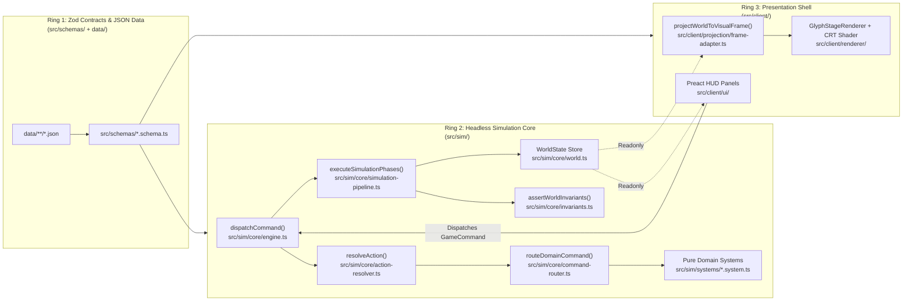

# ARCHITECTURE.md — AI-Optimized System Map (Aether & Soot)

> **PURPOSE FOR AI AGENTS**: Read this file BEFORE planning or writing code. It defines the exact file locations, data contracts, state-mutation pipeline, and architectural invariants of *Aether & Soot*. For world, setting, player experience pillars, and design heuristics, read [docs/DESIGN_INTENT.md](./docs/DESIGN_INTENT.md). Do not invent parallel stores, event buses, or untyped helpers.

---

## 1. System Boundaries & The "Why"

The codebase is strictly divided into three rings. Violations cause `npm run check:boundaries` to fail with exit code `1`.

### Why Headless Separation (`src/sim/` vs `src/client/`) Exists:
1. **Sub-Second Automated Verification**: Because `src/sim/` has zero browser, DOM, WebGL, `pixi.js`, or `preact` dependencies, Vitest (`npm run test:sim`) executes 100-turn replays, 50-seed map generation checks, and 500-macro-tick economic simulations in **<300ms** in Node.js without launching a headless browser.
2. **Bit-Exact Determinism & Save/Load Integrity**: Every random roll uses `SeededRNG` (`src/sim/core/rng.ts`), whose 4-integer state tuple (`rngState`) lives inside `WorldState`. Calling `serializeWorld(state)` at Turn 50 and `deserializeWorld(json)` guarantees the exact same state hash at Turn 100 as an uninterrupted run.
3. **Zero UI-Induced State Corruption**: `src/client/` only receives `Readonly<WorldState>`. It cannot mutate entity HP, inventory, or tiles directly; it can only emit a Zod-validated `GameCommand` to `dispatchCommand()`.

---

## 2. State Management & Unidirectional Turn Lifecycle

### Single Source of Truth: `WorldState` (`src/sim/core/world.ts`)
All game state lives in a single flat, JSON-serializable object validated by `WorldStateSchema`:
- `version`: Literal `1`
- `seed`: Initial integer seed
- `rngState`: `[number, number, number, number]` (`xoshiro128**` state tuple)
- `turnCount`: Global turn counter (increments by `1` per command)
- `macroTickCount`: Increments by `1` every `100` turns (`MACRO_TICK_INTERVAL`)
- `strata`: `Record<StratumId, StratumGrid>` — 2D tile grids for `'UNDERCROFT'`, `'STREET'`, and `'SPIRE'`
- `entities`: `Record<string, EntityRecord>` — Flat ECS entity table keyed by branded `EntityId`. **Never nest entity objects inside other entities**; always reference via `EntityId` (e.g., `installedProstheticEntityId` or `containedEntityIds`).
- `economy`: `DistrictEconomyLedger` — Player treasury (`playerTreasuryPence`), faction standings (`factionReputation`), commodity quotes (`marketQuotes`), and storefront listings (`storefrontListings`).
- `eventLog`: `SimEvent[]` — Append-only chronological log of every state mutation.

### Exact Execution Order of a Turn (`dispatchCommand` in `src/sim/core/engine.ts`)
When a command is dispatched via `dispatchCommand(currentState, rawCommand)`:
1. **Runtime Validation & Hydration**: `GameCommandSchema.parse(rawCommand)` validates the command payload, and `new SeededRNG(currentState.rngState)` restores the deterministic PRNG.
2. **Action Resolution (`resolveAction` in `src/sim/core/action-resolver.ts`)**: Checks actor mortality via `isActorFatal()`. Routes spatial actions (`MOVE_STEP`, `USE_PORTAL`, `WAIT_TURN`) via `src/sim/core/spatial-actions.ts` and all domain commands via `routeDomainCommand()` in `src/sim/core/command-router.ts` to pure systems in `src/sim/systems/*.system.ts`, returning a `CommandResolution` (`applied` or `rejected`).
3. **Three-Phase Simulation Pipeline (`executeSimulationPhases` in `src/sim/core/simulation-pipeline.ts`)**:
   - *Phase 1: Environment & NPC AI (`advanceWorldEnvironment`)*: Runs autonomous NPC AI turns (`advanceNpcTurns`), double-buffered cellular automata for steam and coal dust (`advanceThermodynamicsTick`), and active hazards (`advanceEnvironmentalHazards`).
   - *Phase 2: Temporal & Scheduling (`advanceTemporalState`)*: Decrements prosthetic cooldowns (`decrementProstheticCooldowns`), deducts `apSpent` from initiative energy, recovers speed energy, increments `turnCount`, and triggers periodic macro-ticks (`advanceTurnSchedule` in `scheduler.ts` calling `advanceDistrictEconomyMacroTick` every 100 turns).
   - *Phase 3: Perception & Exploration (`advancePerception`)*: Computes player sensory field-of-view (`computeVisibleTiles` in `src/sim/spatial/fov.ts` + prosthetic bonuses) and updates explored stratum tiles (`markExploredTiles`).
4. **Relational Invariant Verification (`assertWorldInvariants` in `src/sim/core/invariants.ts`)**: In development and test runs, asserts relational ECS consistency (entity coordinates, limb HP bounds, non-negative resources, schema integrity).
5. **Client Projection (Browser Only)**: `src/client/main.tsx` passes the new `WorldState` to `projectWorldToVisualFrame(worldState)` (`src/client/projection/frame-adapter.ts`), which computes 8-octant shadowcasting FOV and updates `GlyphStageRenderer` and Canvas UI / Preact overlays.

---

## 3. Component & System Registry (Where Everything Lives)

> **LIVE ARCHITECTURE MAP**: For an automated, real-time module list with exact line counts, exports, and modularity watchlist, consult [docs/architecture-map.md](./docs/architecture-map.md) (regenerated via `npm run generate:arch-map`).

Use this lookup table to locate existing logic before writing any code.

### A. Schemas & Contracts (`src/schemas/`)
| File | Exports & Responsibility |
| :--- | :--- |
| `src/schemas/primitives.schema.ts` | `EntityIdSchema`, `BlueprintIdSchema`, `StratumIdSchema` (`UNDERCROFT` \| `STREET` \| `SPIRE`), `FactionIdSchema`, `CommodityIdSchema`, `ItemCategorySchema`, `ItemUseEffectSchema`, `HexColorSchema`, `ShaderFlagSchema`, `Point2DSchema`, `Point3DSchema`, `VisualGlyphSpecSchema`, `LimbSlotIdSchema`, `SocketTypeSchema` |
| `src/schemas/blueprint.schema.ts` | Declarative JSON schemas: `ProstheticBlueprintSchema`, `CommodityBlueprintSchema`, `GasFluidBlueprintSchema`, `DistrictBlueprintSchema`, `ItemBlueprintSchema`, `CraftingRecipeBlueprintSchema` |
| `src/schemas/components.schema.ts` | ECS components on `EntityRecord`: `position`, `actor`, `portal`, `anatomy` (`limbs`, `bloodVolumePct`, `steamReserveKpa`), `inventory`, `prostheticSpec`, `pressureVessel`, `item`, `districtGate`, `workbench`, `aiController`, `combatStats` |
| `src/schemas/commands.schema.ts` | `GameCommandSchema` discriminated union (62 command variants across spatial, domain, combat, safehouse, transit, witness, and lore schemas) |
| `src/schemas/domain-events.schema.ts` | Extracted domain event schemas for inventory, district transit, crafting, salvage, limb repair, combat, and merchant trading |
| `src/schemas/events.schema.ts` | `SimEventSchema` discriminated union (108 event variants emitted by systems and formatted in `EventFormatter.ts` / `HudLayout.tsx`) |

### B. Headless Simulation Core (`src/sim/`)
The headless simulation core comprises **12 core engine/infrastructure files** in `src/sim/core/` (`engine.ts`, `action-resolver.ts`, `command-router.ts`, `simulation-pipeline.ts`, `invariants.ts`, `scheduler.ts`, `rng.ts`, `world.ts`, `world-factory.ts`, `world-migration.ts`, `spatial-actions.ts`, `command-resolution.ts`), **65 pure domain systems** in `src/sim/systems/`, **45 procgen/spatial/survey files** in `src/sim/spatial/`, and **2 catalog loaders** in `src/sim/data/`.

| File | Current Lines | Exports & Responsibility |
| :--- | :---: | :--- |
| `src/sim/core/rng.ts` | 76 | `SeededRNG` (`nextUint32`, `nextFloat`, `nextInt`, `getState`), `RNGStateSchema` |
| `src/sim/core/world.ts` | 190 | `WorldStateSchema`, `createInitialWorld`, `serializeWorld`, `deserializeWorld` |
| `src/sim/core/scheduler.ts` | 66 | `STANDARD_ACTION_AP` (100), `MACRO_TICK_INTERVAL` (100), `advanceTurnSchedule` |
| `src/sim/core/engine.ts` | 105 | `dispatchCommand(currentState, rawCommand)` — central command router |
| `src/sim/spatial/grid.ts` | 150 | `TileCellSchema`, `StratumGridSchema`, `createStratumGrid`, `isWithinBounds`, `getTileCell`, `setTileCell`, `findEntitiesAtPoint`, `findBlockingEntityAtPoint` |
| `src/sim/spatial/portals.ts` | 14 | `findPortalAtPoint(entities, point)` |
| `src/sim/spatial/fov.ts` | 141 | `computeVisibleTiles(grid, originX, originY, radius)`, `isPointVisible`, `pointKey` |
| `src/sim/spatial/generator.ts` | 162 | `generateVictorianDistrict(state)` — 8-stage district orchestrator, `hasWalkablePath(grid, start, goal)` |
| `src/sim/spatial/district-pipeline.ts` | 185 | Stages 1–5 district pipeline (thoroughfare skeletization, plot zoning, CDDA urban blocks, typologies) |
| `src/sim/spatial/district-pipeline-late.ts` | 169 | Stages 6–8 district pipeline (multi-stratum dungeons, border seam application, connectivity & orphan door sanitization) |
| `src/sim/spatial/district-boundaries.ts` | 191 | `computeDistrictBoundarySeams`, `applyBoundarySeamsToGrid`, `isEdgeSeamTraversable`, `getEdgeNeighbor` |
| `src/sim/spatial/building-templates.ts` | 217 | CDDA-style ASCII building templates (`BUILDING_TEMPLATES`, `getBuildingTemplate`) |
| `src/sim/spatial/building-templates-expanded.ts` | 206 | District-tailored CDDA templates (*Bessemer Foundry*, *Dockside Warehouse*, *Clockwork Salon*) |
| `src/sim/spatial/template-instantiator.ts` | 173 | `instantiateBuildingTemplate` — stamps ASCII templates, doors, interior zones, furniture & loot |
| `src/sim/spatial/urban-parcels.ts` | 189 | `subdivideProceduralParcels` — hierarchical block & parcel subdivision for `48x36` and `64x48` districts |
| `src/sim/spatial/spatial-survey-sheet.ts` | 196 | `generateSpatialSurveySheet`, `formatSurveySheetMarkdown` — *Fallout: New York* 6-layer diagnostic sheets |
| `src/sim/spatial/spatial-anomaly-detector.ts` | 195 | `runSpatialAnomalyAudit` — detects blocked doorways, unreachable rooms, severed thoroughfares |
| `src/sim/spatial/spatial-anomaly-district.ts` | 216 | `runDistrictSurveyAudit`, `detectSealedDistrictEdges`, `detectUnreciprocatedSeams`, `detectOrphanDoors`, `sanitizeOrphanDoors` |
| `src/sim/spatial/spatial-self-corrector.ts` | 216 | `applySpatialSelfCorrection`, `clearDoorwayObstacles`, `flipOrRelocateDoorway`, `stitchDisconnectedPathways` |
| `src/sim/spatial/catacombs.ts` | 228 | Procedural infinite delve chalk catacombs & relic clockwork vault generation |
| `src/sim/spatial/strata-dungeons.ts` | 228 | Undercroft sewers and Spire catwalks layout generation |
| `src/sim/data/item-catalog.ts` | 156 | `ITEM_CATALOG`, `PROSTHETIC_CATALOG`, `COMMODITY_CATALOG`, `RECIPE_CATALOG`, `getItemBlueprint`, `getRecipeBlueprint`, `createItemEntity`, `createEntityFromBlueprint` |
| `src/sim/systems/continuous-transit.system.ts` | 196 | `continuousTransitSystem` — seamless coordinate translation & companion preservation across open district borders |
| `src/sim/systems/inventory-utils.ts` | 126 | `getCarryProfile`, `computeCarriedVolumeMl`, `isInstalledOnActor`, `findMergeableStack`, `allocateSplitId`, `createInventoryFailureResult`, `MAX_OVERLOAD_RATIO` |
| `src/sim/systems/inventory.system.ts` | 243 | `resolvePickupItem`, `resolveDropItem`, `resolveUseItem` |
| `src/sim/systems/item-spawner.ts` | 71 | `spawnDistrictItems` — deterministic seeded ground-item scatterer |
| `src/sim/systems/crafting.system.ts` | 126 | `resolveCraftRecipe`, `resolveSalvageItem`, `resolveRepairLimb` |
| `src/sim/systems/combat.system.ts` | 199 | `computeEffectiveCombatStats`, `resolveAttackActor` |
| `src/sim/systems/ai.system.ts` | 211 | `createDefaultNpcAnatomy`, `spawnDistrictNpcs`, `advanceNpcTurns` |
| `src/sim/systems/movement.system.ts` | 202 | `computeMovementMechanics`, `resolveMoveStep`, `resolveUsePortal` |
| `src/sim/systems/transit.system.ts` | 238 | `resolveToggleDoor`, `resolveTravelDistrict`, `VALID_DISTRICT_IDS` |
| `src/sim/systems/trade.system.ts` | 9 | `resolveBuyFromMerchant`, `resolveSellToMerchant`, `resolveStockPedestal` |
| `src/sim/systems/anatomy.system.ts` | 78 | `resolveDamageLimb`, `computeProstheticFovBonus` |
| `src/sim/systems/prosthetics.system.ts` | 249 | `resolveActivateProsthetic`, `resolveHarvestCorpse`, `resolveInstallProsthetic`, `resolveRemoveProsthetic`, `resolveRefillSteam` |
| `src/sim/systems/metabolism.system.ts` | 231 | `advanceMetabolismTick`, `resolveDrinkTonic`, `applyToxicityEffects`, `processAddictionWithdrawal` |
| `src/sim/systems/momentum.system.ts` | 163 | `resolveSetPosture`, `applyMomentumVector`, `computeKnockbackCollisions` |
| `src/sim/systems/weapon-mods.system.ts` | 226 | `resolveInstallWeaponMod`, `resolveUninstallWeaponMod`, `resolveLoadAmmo` |
| `src/sim/systems/liquids.system.ts` | 99 | Surface fluid pools, slip hazards, stain mechanics, flammable ignition |
| `src/sim/systems/squad-witness.system.ts` | 177 | `resolveSquadCallout`, `evaluateWitnessCrimes`, `recordFactionGrudge` |
| `src/sim/systems/monorail.system.ts` | 211 | `resolveRideMonorail`, `resolveMonorailTransit`, pneumatic car movement |
| `src/sim/systems/thermo.system.ts` | 177 | `advanceThermodynamicsTick`, `SCALD_PRESSURE_THRESHOLD_KPA` |
| `src/sim/systems/pressure.system.ts` | 161 | `resolvePressurizeVessel`, `resolveEmitSpark`, `COAL_DUST_IGNITION_THRESHOLD` |
| `src/sim/systems/economy.system.ts` | 197 | `createInitialEconomyLedger`, `computeBoundedPricePence`, `resolveTriggerSupplyShock`, `advanceDistrictEconomyMacroTick` |

### C. Presentation & UI Shell (`src/client/`)
The presentation shell comprises **62 files across 7 subdirectories** (`audio/`, `canvas-ui/`, `input/`, `persistence/`, `projection/`, `renderer/`, `ui/`), housing the PixiJS canvas console UI with analog Bourdon gauges and vernier scanner (`src/client/canvas-ui/`), WebAudio procedural soundscape synth (`src/client/audio/`), keyboard and modal navigation routers (`src/client/input/`), save-state persistence (`src/client/persistence/`), and Preact HUD layouts (`src/client/ui/`).

| File | Exports & Responsibility |
| :--- | :--- |
| `src/client/projection/frame-adapter.ts` | `projectWorldToVisualFrame(state, focusActorId, baseFovRadius)` -> `VisualGridFrame` |
| `src/client/projection/continuous-projection.ts` | `resolveContinuousLookaheadCell` — projects neighboring district cells across open border seams (`0.65` alpha) |
| `src/client/renderer/glyph-stage.ts` | `GlyphStageRenderer` — PixiJS v8 canvas renderer with dual-color glyph pulsing and steam overlay |
| `src/client/renderer/oxidized-iron-palette.ts` | `OXIDIZED_IRON_PALETTE`, `checkWcagContrastRatio` — high-contrast Victorian metallic color tokens |
| `src/client/renderer/presentation-mode-store.ts` | `PresentationMode` (`ASCII` \| `ENHANCED_GLYPHS` \| `TILESET`) state & `[F2]` mode switcher |
| `src/client/renderer/tileset-atlas.ts` | `TILESET_SPRITE_DEFINITIONS`, `resolveCellLayeredSprites` — 3-layer graphical tile compositing |
| `src/client/renderer/crt-filter.ts` | `createCrtPostFilter()` — GLSL scanlines, chromatic aberration, and vignette filter |
| `src/client/ui/EventFormatter.ts` | `formatEventMessage(ev: SimEvent)` — pure chronicler formatting all 34 SimEvent variants |
| `src/client/ui/HudLayout.tsx` | Main Preact sidebar with 5-tab drawer navigation (`TELEMETRY`, `INVENTORY`, `SURGERY`, `WORKBENCH`, `EXCHANGE`) |
| `src/client/ui/InventoryPanel.tsx` | Artificer's satchel: mass/volume bars, item use/drop/socket actions, and ground item pick-up |
| `src/client/ui/CraftingPanel.tsx` | Schematics checklist, steam pressure cost check, recipe craft buttons, and item scrap salvage |
| `src/client/ui/TileInspectorPanel.tsx` | Live canvas tile hover/click inspector: terrain, steam kPa, coal dust, entities, and context actions |
| `src/client/ui/SystemMenuModal.tsx` | Victorian system overlay (`[Esc]`): Seed generation, LocalStorage save/load, and JSON save import/export |
| `src/client/ui/SatchelPanel.tsx` | Quick satchel view: carried items volume, Use, Drop, and ground Take actions |
| `src/client/ui/AnatomyDoll.tsx` | Limb HP/amputation/prosthetic paperdoll and steam/sanguine telemetry |
| `src/client/ui/MarketLedger.tsx` | Commodity ticker, faction standing table, and storefront controls |
| `src/client/main.tsx` | Client bootstrap, canvas pointer hover/click listeners, keyboard listener (wasd/arrows, portals, wait, pickup [G], drawer shortcuts [I, C, M, A, Esc]), and `window.__DEBUG_SIM__` |

---

## 4. Recipe: How to Add a New Gameplay Mechanic Safely

Follow this exact 6-step sequence whenever adding a new command or system:
1. **Schema First (`src/schemas/`)**:
   - Add any new component fields to `src/schemas/components.schema.ts`.
   - Add the new command variant to `GameCommandSchema` in `src/schemas/commands.schema.ts`.
   - Add the resulting `SimEvent` variant(s) to `SimEventSchema` in `src/schemas/events.schema.ts`.
2. **Pure System Function (`src/sim/systems/`)**:
   - Check the line count of the target `.system.ts` file (`wc -l`). **If it is over 220 lines, create a new `<domain>.system.ts` file** instead of bloating the existing file past the 300-line hard limit.
   - Implement a pure function `(state: WorldState, ...) => { state: WorldState, events: SimEvent[], apSpent: number }`.
3. **Wire Command Routing (`src/sim/core/command-router.ts` & `src/sim/core/action-resolver.ts`)**:
   - `dispatchCommand()` in `src/sim/core/engine.ts` delegates execution through `resolveAction()` (`src/sim/core/action-resolver.ts`). Spatial actions (`MOVE_STEP`, `USE_PORTAL`, `WAIT_TURN`) are routed to `src/sim/core/spatial-actions.ts`, while all other domain commands are dispatched through `routeDomainCommand()` in `src/sim/core/command-router.ts`. Add a `case` for the new `command.type` in `src/sim/core/command-router.ts` (or `action-resolver.ts` for spatial actions).
4. **Update Event Formatter (`src/client/ui/EventFormatter.ts`)**:
   - Add a `case` for the new `SimEvent['type']` in `formatEventMessage()` (or run `npm run hermes:chronicler`) so exhaustive TypeScript checks pass.
5. **Write Deterministic Unit Test (`tests/sim/`)**:
   - Create or extend a `.test.ts` file using `createInitialWorld({ seed: <fixed_int> })` and assert both the emitted `SimEvent` and resulting `WorldState`.
6. **Run `npm run verify`**:
   - Confirm `typecheck`, `check:boundaries`, `validate:data`, and `test:sim` all exit with `0`.

---

## 5. Tooling: Autonomous Headless LLM Playtester Pipeline

Located in `tests/scripts/`, this suite exercises end-to-end emergence by driving the headless engine with local LLMs or rule-based mock agents.

| File | Lines | Responsibility |
| :--- | :---: | :--- |
| `tests/scripts/playtester-serializer.ts` | 250 | Formats relative 11x11 ASCII FOV, vitals, acoustic history, contextual menus, and parses LLM outputs into `GameCommand`. |
| `tests/scripts/playtester-scenarios.ts` | 166 | Injects isolated test setups (`explore`, `combat`, `economy`, `transit`) and scenario-specific directives. |
| `tests/scripts/playtest-report.ts` | 82 | Formats comprehensive telemetry markdown reports in `tests/artifacts/playtest-report.md`. |
| `tests/scripts/llm-playtester.ts` | 211 | Main CLI entry point. Executes turn loops against Ollama / Hermes endpoints or deterministic mock agents. |
| `tests/scripts/hermes-content-generator.ts` | 225 | Offloads bulk declarative JSON blueprint generation (materials, consumables, recipes) to local Hermes with Zod validation. |
| `tests/scripts/hermes-scout.ts` | 173 | Local codebase scout & AST impact analyzer for pre-flight checklist (`npm run hermes:scout`). |
| `tests/scripts/hermes-testgen.ts` | 281 | Self-healing deterministic unit test generator with anti-tautological protection (`npm run hermes:testgen`). |
| `tests/scripts/hermes-chronicler.ts` | 191 | Exhaustive `SimEvent` chronicler synchronizing events with `EventFormatter.ts` (`npm run hermes:chronicler`). |
| `tests/scripts/hermes-split.ts` | 272 | AST-guided modularity ceiling splitter for near-cap files >= 240 lines (`npm run hermes:split`). |
| `tests/scripts/hermes-critic.ts` | 239 | Whole-game emergence & architectural audit engine generating P1/P2/P3 prescriptions and handoff prompts (`npm run hermes:critic`). |
| `tests/scripts/survey-world.ts` | 76 | Multi-district, multi-seed 6-layer spatial survey & anomaly auditor (`npm run survey:world`). |
| `tests/scripts/local-llm-ledger.ts` | 183 | Local LLM inference token & cloud API cost-avoidance ledger (`getInferenceLedgerSummary`, `computeCloudSavings`). |
| `tests/scripts/update-state.ts` | 78 | State synchronizer embedding recent commits, next roadmap priority, critic prescriptions, and prompt handoff into `STATE.md` (`npm run sync:state`). |
| `tests/sim/playtester-harness.test.ts` | — | Unit tests verifying that action payloads serialize and resolve into valid simulation commands. |
| `tests/sim/hermes-content.test.ts` | — | Unit tests verifying CLI parsing, mock content generation, and blueprint schema validation. |
