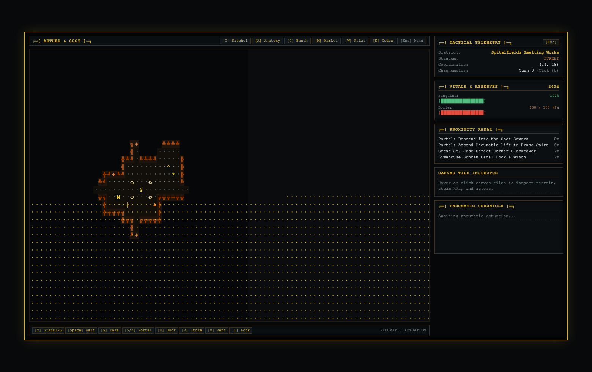
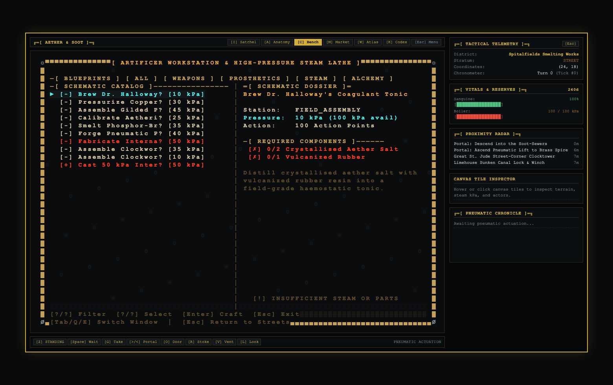
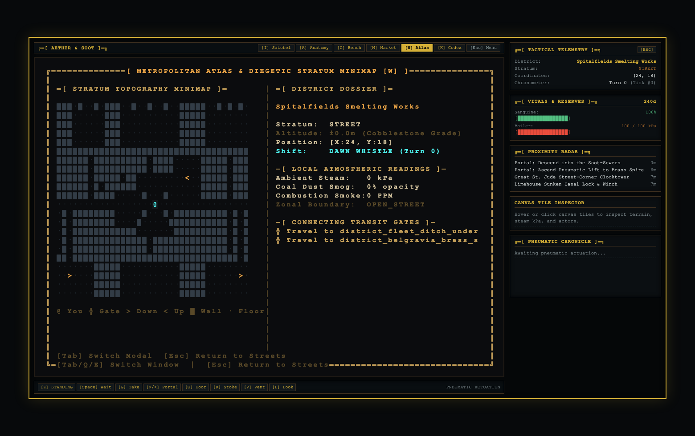
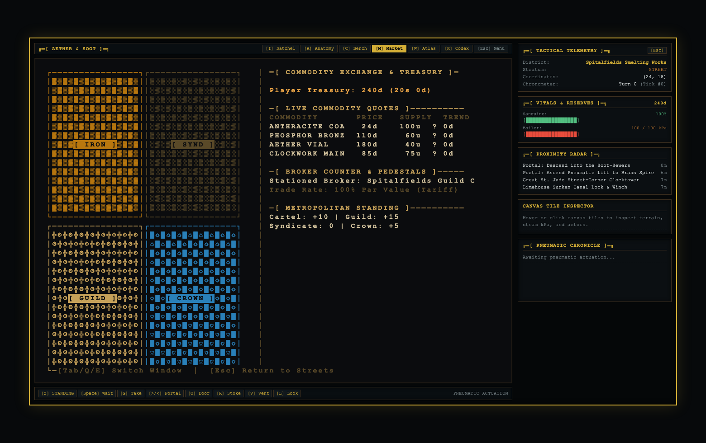
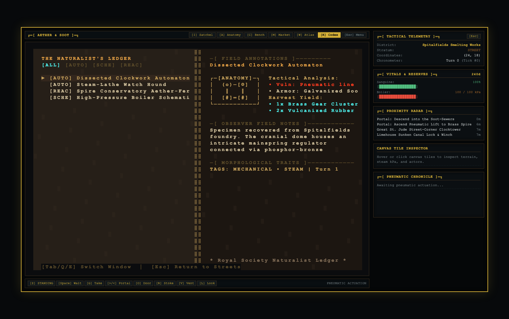
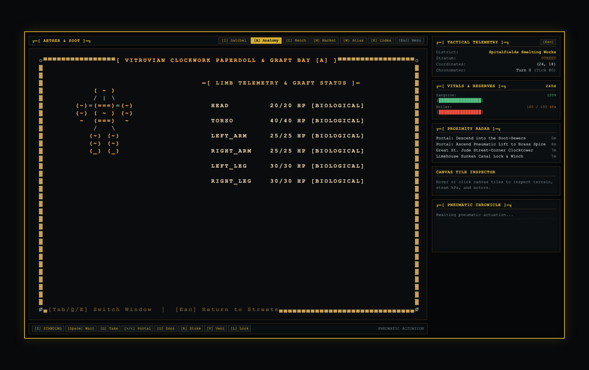
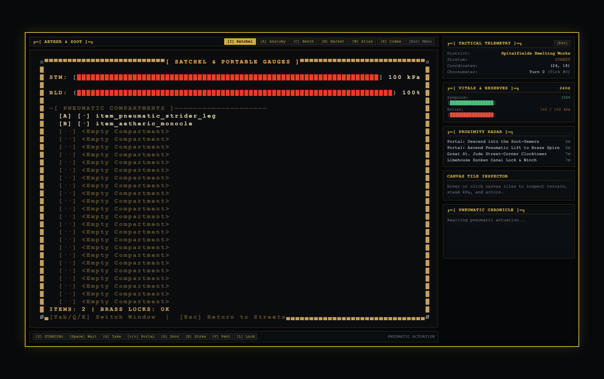
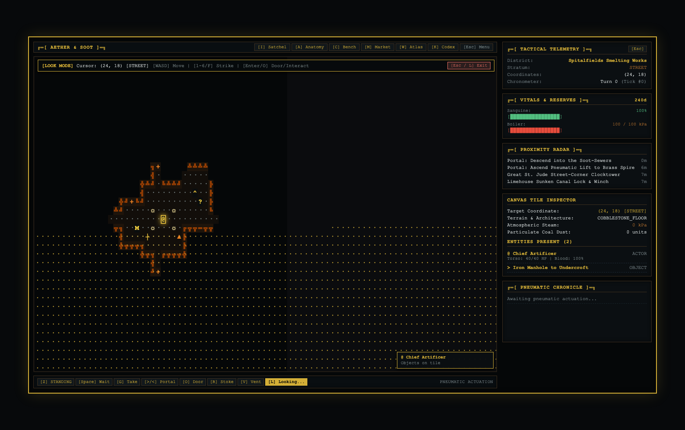
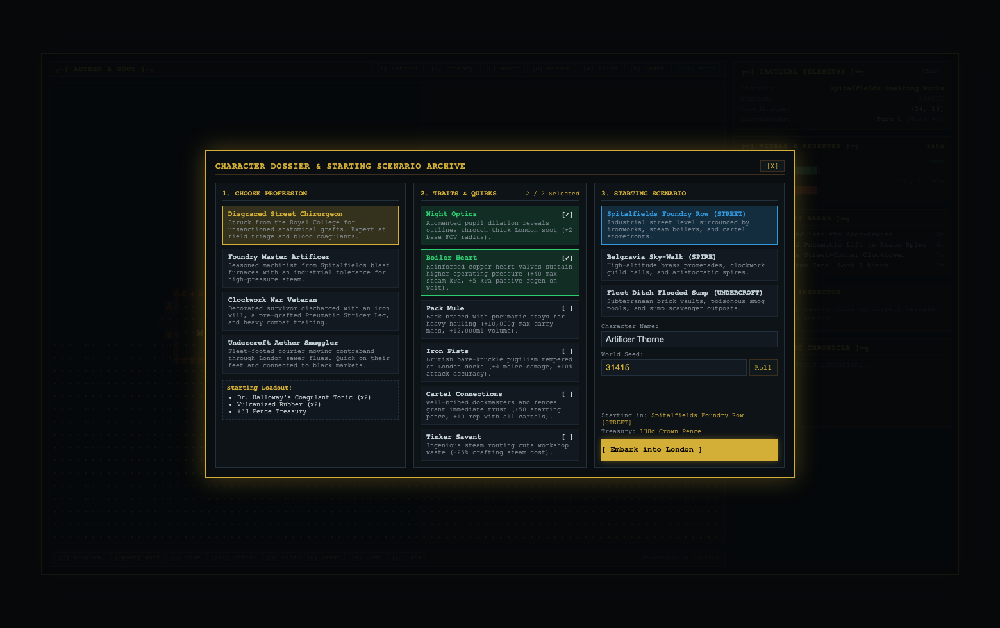
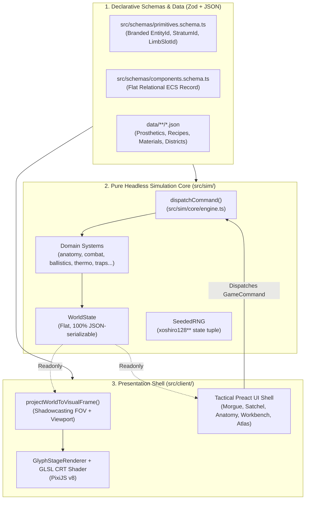

# Aether & Soot (Victorian Steampunk 2D Roguelike)

> **Autonomous AI Engineering Context**: This document serves as the comprehensive architectural and systemic dossier for *Aether & Soot*. It explains every implemented gameplay mechanic, the rationale behind architectural invariants, the reality of current scope and limitations, and a complete technical reference for AI agents and human developers alike.

---

## 1. Executive Summary & Vision

*Aether & Soot* is a deterministic, 2D turn-based Victorian Steampunk roguelike set in an alternate 1888 subterranean London. The game combines the deep anatomical conditions, systemic material interactions, and survival mechanics of ***Cataclysm: Dark Days Ahead (CDDA)*** with the evocative CRT scanline shaders, glyph-based art direction, and tactile modal window ergonomics of ***Caves of Qud***.

The player navigates an urban sprawl stratified into three vertical planes:
1. **The Spire** (`SPIRE`): Elevated brass catwalks, steam towers, high-society conservatories, and Clockwork Guild workshops.
2. **The Cobblestone Street** (`STREET`): Ground-level industrial wards, sovereign storefronts, public houses, and smog-choked alleys.
3. **The Undercroft** (`UNDERCROFT`): Brick sewer corridors, sluice vaults, cartel smuggling dens, and hazardous gas pockets.

---

## 2. Visual Interface Showcase

*Aether & Soot* renders through a widescreen 88×36 CP437 character-cell grid backed by PixiJS v8 and custom GLSL scanline CRT shaders. Tactical modals and instrument bezels feature double-line brass borders, segmented character-cell telemetry meters, and pneumatic ticker chronicles.

| Victorian Street Overworld & Main HUD | CDDA-Style Artificer Workstation |
| :---: | :---: |
|  |  |
| **Metropolitan Stratum Atlas** | **Borough Turf & Commodity Exchange** |
|  |  |
| **Naturalist Philosophy Codex** | **Vitruvian Anatomy & Graft Bay** |
|  |  |
| **Satchel Inventory & Dial Gauges** | **Look Mode Tactical Inspector** |
|  |  |
| **Character Creation & Vocation Embarkation** | |
|  | |

> See [docs/screenshots/README.md](docs/screenshots/README.md) for individual high-resolution screenshots and detailed interface breakdowns.

---

## 3. Architectural Invariants ("Why Things Are The Way They Are")

The codebase is engineered specifically for **reliable autonomous AI pair programming** and **reproducible headless simulation**. Every rule is validated automatically on every commit via `npm run verify`.



### Why Headless Core / Presentation Shell Separation Exists
- **Zero Browser Dependencies in Core (`src/sim/` and `src/schemas/`)**: No imports from `pixi.js`, `preact`, `window`, `document`, or DOM globals are permitted.
- **Sub-Second Test Execution**: 26 test suites (112 tests) covering 5-district procgen, cellular automata, ballistics, stealth acoustics, NPC diurnal shifts, and trap physics run in **<900ms** in Node.js without spinning up headless browser overhead.
- **Strict Unidirectional Mutability**: The presentation shell (`src/client/`) only holds `Readonly<WorldState>`. State mutations can only happen by dispatching a validated `GameCommand` to `dispatchCommand()`.

### Why Deterministic PRNG & Flat Relational ECS Are Non-Negotiable
- **No Non-Deterministic Calls**: `Math.random()` and `Date.now()` are forbidden and blocked by automated boundary scanners.
- **Bit-Exact Replays & Saves**: `WorldState` stores the 4-element `xoshiro128**` tuple (`rngState`). Serializing `WorldState` at Turn 50 and restoring it guarantees identical simulation outcomes down to the exact damage roll.
- **No Circular Object References**: All entities live in a flat table `state.entities[entityId]`. Items in inventories or socketed cybernetics are stored as branded `EntityId` arrays and never as nested entity trees, ensuring clean JSON serialization.

### Why The Hard Modularity Ceiling (<= 250 Lines per File) Exists
- Long source files cause LLMs to drop context, hallucinate imports, or produce truncated edit blocks.
- Every `.ts` and `.tsx` file is bounded to **<= 250 lines** (hard automated ceiling: 300 lines enforced by `tests/scripts/check-boundaries.ts`). When a domain system grows, logic is proactively extracted into dedicated sibling modules (e.g. `stealth-acoustics.system.ts`, `npc-ecology.system.ts`, `physics-traps.system.ts`).

### Why Event Sourcing (`SimEvent`) Is Used
- Every state change emits a strongly-typed `SimEvent` into `state.eventLog`.
- Decouples simulation rules from UI feedback: headless tests assert event causality, the HUD action chronicle displays formatted prose, and client audio/vfx hooks trigger without inspecting raw diffs.

---

## 3. Comprehensive Mechanics & Systems Catalog

### 3.1. Vitruvian Anatomy & Cybernetics
- **Limb Topology**: Actors have 8 discrete limb slots: `HEAD`, `TORSO`, `LEFT_ARM`, `RIGHT_ARM`, `LEFT_LEG`, `RIGHT_LEG`, `OCULAR_MOUNT`, and `CHASSIS_CORE`.
- **Targeted Damage & Amputation**: Attacks specifically target limb slots. When limb HP hits 0, the limb is amputated.
  - Arm amputation/damage reduces melee damage and combat accuracy.
  - Leg amputation increases movement action point (AP) costs from 100 to 160 AP.
  - Ocular Mount destruction blinds the actor, clamping FOV vision radius to 1 unless restored with an optic prosthetic.
  - Torso or Head destruction results in immediate defeat.
- **Haemodynamic Blood System**: Actors track `bloodVolumePct` (0–100%). Wounds cause bleeding; amputations cause severe acute haemorrhage. Falling to 0% blood volume results in fatal exsanguination.
- **Coagulant Tonics**: Consuming Dr. Halloway's Coagulant Tonic stops active blood loss and restores blood volume.
- **Pneumatic Cybernetic Prosthetics**: Amputated or augmented slots can receive socketed steam prosthetics:
  - `prosthetic_pneumatic_leg_mk1`: Restores locomotion, grants -15 AP movement speed, and provides 50% fall shock absorption.
  - `prosthetic_clockwork_ocular_lens`: Restores vision and expands FOV radius through soot and smog.
  - `prosthetic_pneumatic_piledriver_arm`: Heavy hydraulic arm for high-impact melee trauma and structural wall breaching.
  - `prosthetic_boiler_core_furnace`: Thoracic internal boiler boosting heat stability and max steam reservoir.
  - `prosthetic_clockwork_gyrostabilizer_leg`: Silent counter-rotating flywheels for brisk locomotion without acoustic noise.
- **Surgical Context & Sterile Bonuses**: Installing or removing prosthetics in the field inflicts 15–20% blood loss shock. Performing surgery while adjacent to a `SURGICAL_TABLE` or having the `DISGRACED_CHIRURGEON` profession reduces surgical blood loss to 0%.

### 3.2. Cellular Automata Thermodynamics & Pyrotechnics
- **Double-Buffered Gas Grids**: Each stratum grid cell simulates:
  - `steamPressureKpa`: Compressed steam expanding and dissipating across open tiles.
  - `coalDustDensity`: Suspended particulate coal dust.
- **Vertical Gas Portals**: Rising steam naturally vents upward from `UNDERCROFT` to `STREET` through portals marked `conductsGas: true` (manholes, floor grates).
- **Thermal Scald Hazards**: Actors standing in tiles with `steamPressureKpa >= 25 kPa` suffer thermal scald damage to their torso every turn. Insulated clothing (e.g. Asbestos Foundry Coat) provides steam resistance.
- **Foundry Boilers & Ruptures**: Pressure vessels accumulate steam. Exceeding `maxPressureKpa` causes explosive vessel rupture, breaching adjacent soot brick walls, venting hundreds of kPa into surrounding tiles, and inflicting blast trauma.
- **Pyrotechnic Dust Explosions**: Emitting a spark (`EMIT_SPARK`) into a contiguous cloud of coal dust (`density >= 0.25`) ignites the cloud in a chain-reaction explosion that consumes the dust and flashes it into high-pressure steam.
- **Steam Reserves & Stoking**: High-tier prosthetics and weapons consume steam from `anatomy.steamReserveKpa`. Players stoke steam for free when adjacent to an active boiler, or consume portable steam canisters and anthracite coal briquettes.

### 3.3. Acoustic Propagation, Smog Occlusion Stealth & Sensory AI
- **Decibel Sound Propagation**: Physical actions emit acoustic pulses (`SOUND_EMITTED`) with inverse-distance falloff:
  - Smashing glass windows: `85 dB`
  - Pneumatic gunfire: `95 dB`
  - Boiler ruptures: `120 dB`
  - Movement footsteps: Base `10 dB`, increased by heavy/pneumatic prosthetics (`noiseDb`) or reduced by silent clockwork flywheels.
- **Sensory NPC State Machine**: NPCs transition dynamically through `IDLE`, `INVESTIGATING`, and `COMBAT`. Sounds lure out-of-sight guards to inspect `lastKnownTargetPos`.
- **Smog & Steam Occlusion**: High-density particulate clouds (`steamPressureKpa >= 20 kPa` or `coalDustDensity >= 0.3`) completely block line of sight, allowing players to vent steam or stir coal dust to break pursuit and evade enemy gunfire.
- **Ocular Blindness**: Actors whose `OCULAR_MOUNT` is amputated (without an installed optic prosthetic) are clamped to a visual radius of 1 tile, requiring acoustic cues or touch to navigate.

### 3.4. Diurnal Shift Clocks, Autonomous Ecology & District Catch-Up
- **100-Turn Victorian Shift Clocks**: Districts cycle through 4 distinct 25-turn shift phases:
  - `DAWN_WHISTLE` (Turns 0–24)
  - `FOUNDRY_SHIFT` (Turns 25–49)
  - `GASLIGHT_CURFEW` (Turns 50–74)
  - `GRAVEYARD_WATCH` (Turns 75–99)
- **Autonomous NPC Schedules**: During `FOUNDRY_SHIFT`, workers and shopkeepers pathfind to their `workAnchor` and restock trade pedestals. During `GRAVEYARD_WATCH`, citizens retire to their `restAnchor`.
- **Ecology & Medical Triage**: Wounded NPCs (`bloodVolumePct <= 60%`) carry and self-administer Coagulant Tonics. If critically injured (`bloodVolumePct <= 50%`) with no tonics, their goal transitions to `SEEK_MEDICAL` as they seek out the nearest Chirurgeon or Surgical Table.
- **Deterministic District Catch-Up**: Cached districts in `state.savedDistricts` fast-forward elapsed turns upon re-entry, decaying suspended steam and coal dust and snapping scheduled NPCs to their active shift coordinates.

### 3.5. Structural Breaching, Multi-Strata Gravity Falls & Traps
- **Destructible Architecture**: High-magnitude concussive forces (boiler ruptures or pneumatic piledriver strikes) breach rigid `SOOT_BRICK_WALL` structures into traversable `RUBBLE_PILE` debris, venting trapped steam clouds and opening new infiltration routes.
- **Multi-Strata Gravity Falls**: Pushing or knocking an actor into an `ABYSS_DROP` on the `SPIRE` catwalk causes a multi-strata plunge down to the `STREET` below. Falls inflict 20 HP blunt trauma to both legs; socketed pneumatic leg prosthetics absorb 50% of fall impact.
- **Deployable Clockwork Traps**: Players and artificers craft and place hidden mechanical traps:
  - `SPARK_TRIPWIRE`: Emits a friction spark when stepped on, detonating flammable coal dust pockets.
  - `SPRING_JAW`: Snaps shut on unsuspecting limbs, inflicting heavy bone and tissue damage.
  - `STEAM_MINE`: High-pressure pneumatic mine that blasts intruders with concussive scalding steam.

### 3.6. Tactical Combat & Ballistics
- **Turn Scheduling**: Actions spend Action Points (AP). Standard turn is 100 AP. Speed modifications alter turn frequency relative to the global clock.
- **Targeted Melee**: Attackers target specific limbs (`1`–`6` hotkeys in Look Mode or contextual click), calculating damage against targeted armor reduction.
- **Pneumatic Ballistics**: Ranged weapons (e.g. Pneumatic Harpoon Rifle) consume compressed steam reserve, trace 8-octant Bresenham line-of-sight and range, verify lack of intervening obstacles, and apply targeted impact damage.

### 3.7. Unified Mortality & Victorian Coroner's Morgue
- **Unified Mortality Pipeline**: Fatal conditions (`TORSO.hp <= 0`, `HEAD.hp <= 0`, or `bloodVolumePct <= 0`) uniformly resolve through `resolveActorDefeatIfFatal()` across melee, ranged fire, steam scalds, falls, and boiler explosions.
- **Loot & Economy Drops**: Defeated NPCs drop all carried satchel inventory, installed prosthetics, and a minted Crown Pence pouch on their coordinate before being removed from the simulation.
- **Player State Preservation**: Upon player death, `actor_player` is preserved in `WorldState.entities` rather than purged.
- **Coroner's Inquest (Morgue Screen)**: Triggers an obituary screen presenting autopsy findings (thoracic rupture, decapitation, exsanguination), turn count, death coordinate, and inventory effects, with a `[New Character / Re-Embark (N)]` restart loop.

### 3.8. Dynamic Cartel Economy, Trade & Dialogue
- **Macro-Tick Simulation**: Every 100 turns, an economic macro-tick updates supply and demand across factions (`IRONMONGERS_CARTEL`, `CLOCKWORK_GUILD`, `UNDERCROFT_SYNDICATE`, `CROWN_CONSTABULARY`).
- **Dynamic Commodity Pricing**: Market prices for Anthracite Coal, Brass Gears, Rubber, and Aether Salt fluctuate based on local district scarcity and supply shocks.
- **Grounded Storefront Pedestals**: Merchants stock physical `tradePedestal` entities in shops. Players interact with pedestals or NPCs directly to buy and sell.
- **Interactive Dialogue & Procedural Contracts**: NPCs feature tree-based dialogue providing:
  - Faction contracts (`SLAY_HOSTILE`, `DELIVER_ITEM`, `PRESSURIZE_BOILER`) offering Crown Pence and reputation.
  - Companion recruitment for hired muscle.
  - Chirurgeon medical services to suture amputated limbs and replenish blood volume.

### 3.9. Artificer Crafting & Scrap Salvage
- **Schematic Workbenches**: Adjacent Artificer Benches and Alchemical Stills enable crafting tonics, steam canisters, commodities, traps, and cybernetics.
- **Equipped Gear Drop & Salvage Stat Fix**: Dropping or salvaging wielded weapons or worn armor automatically unequips them first, cleanly reversing `meleeDamageBonus`, `armorBonus`, and `storageVolumeBonusMl` without leaving ghost stat bonuses.
- **Manuals & Knowledge**: Schematic Manuals found in libraries or bookshelves permanently unlock high-tier recipes when read.

### 3.10. Procedural World Generation & District Biomes
- **5 Overworld Districts**:
  1. `spitalfields_works`: Industrial foundry district with heavy boilers, smog, and Ironmongers' workshops.
  2. `fleet_ditch`: Canal slums with high sewage, black-market fixers, and Undercroft Syndicate outposts.
  3. `belgravia_spires`: High-society spires with Clockwork Guild laboratories and Constabulary checkpoints.
  4. `whitechapel_ward`: Quarantined hospital ward with chirurgeons, operating tables, and medical caches.
  5. `limehouse_docks`: Fog-shrouded riverfront with cargo crates, fuel barges, and maritime smuggling.
- **Multi-Room Strata Dungeons (`48x36`)**:
  - `UNDERCROFT`: Carved subterranean sewer mazes with sluice corridors, brick chambers, Syndicate dens, and steam vents.
  - `SPIRE`: Elevated brass catwalk networks connecting tower platforms across open abyss drops.
- **District Transit & Caching**: Stepping on a `DISTRICT_GATE` (`Ω`) transitions the player across districts. Visited districts are preserved in `state.savedDistricts` with atmospheric decay and shift-anchor catch-up.

---

## 4. Current Implementation Scope vs. Reality & Limitations

To provide complete transparency for future AI agents and contributors, here is the exact reality of current systems:

| System | Current Implementation Reality | Current Scope Limitations |
| :--- | :--- | :--- |
| **World Persistence** | Active district simulated live in memory. Inactive districts are cached in `state.savedDistricts` and execute deterministic delta catch-up (gas decay, scheduled NPC anchor snapping) upon transit. | Catch-up is analytical; off-screen districts do not simulate full turn-by-turn combat while the player is away. |
| **NPC AI & Ecology** | NPCs feature role-based AI, 4-quadrant diurnal shift schedules (work/rest), self-medication, medical triage pathfinding, sound investigation, and merchant pedestal restocking. | NPCs do not yet migrate between different districts independently. |
| **Combat & Sensory Stealth** | Full 8-octant shadowcasting FOV, particulate smog/steam LOS attenuation, ocular blindness clamping, acoustic decibel propagation, targeted limb combat, knockback, and deployable traps. | No directional cone facing mechanics or lighting levels beyond line-of-sight and smog opacity. |
| **Physics & Destruction** | Structural soot brick walls can be breached into rubble piles via concussive forces. Actors knocked into Spire abyss chasms plunge down to the Street stratum with fall trauma. | Wood/metal furniture is currently destroyed or looted rather than splintered into physical physics debris. |
| **Grounded Trade** | Merchants own physical storefront pedestal entities. Prices react dynamically to supply shocks, and shopkeepers restock pedestals during active work shifts. | Autonomous non-player citizens do not yet barter or buy items off pedestals. |
| **ProcGen** | Seed-deterministic layout carving with pre-fab building archetypes, openable doors, interactive furniture, and stratum dungeons. | World layout is generated per district on initial entry; there is no continuous seamless world streaming without gate transitions. |
| **Presentation Shell** | PixiJS v8 Canvas rendering, custom GLSL CRT scanline shader, Preact tactical HUD modals, and full keyboard routing. | No WebAudio sound effects or musical soundtrack currently wired to client triggers. |

---

## 5. Controls Reference

| Context | Hotkey | Function |
| :--- | :--- | :--- |
| **Movement** | `W / A / S / D` or `Arrow Keys` | Move 1 tile cardinally |
| **Pass Turn** | `.` (period) or `Space` | Wait 1 turn (100 AP) |
| **Pickup** | `g` or `,` | Pick up ground items at current tile |
| **Stairs / Portals** | `>` / `<` / `Enter` | Ascend / descend strata (Manholes, Lifts, Ladders, District Gates) |
| **Look / Target Mode** | `L` | Toggle targeting cursor on/off |
| In Look Mode | `W / A / S / D` | Move inspection cursor |
| In Look Mode | `Enter` | Interact with targeted tile (Toggle door, loot container, stoke boiler) |
| In Look Mode | `1` – `6` or `F` | Target enemy limb (`1` Head, `2` Torso, `3` L.Arm, `4` R.Arm, `5` L.Leg, `6` R.Leg, `F` Torso quick strike) |
| **Satchel / Inventory** | `I` | Open Satchel window (equip, drop, drink tonics) |
| **Vitruvian Anatomy** | `Shift + A` | Open Anatomy window (inspect limbs, blood %, steam kPa, socket cybernetics) |
| **Artificer Workbench** | `C` | Open Workbench window (craft recipes, repair limbs, salvage scrap) |
| **Merchant Exchange** | `M` | Open Merchant Trade ledger |
| **World Atlas** | `Shift + W` | Open 5-district Overworld Atlas |
| **Dialogue** | `T` | Talk to adjacent NPC (contracts, companions, surgery) |
| **New Character** | `N` | Open Character Creation modal (choose profession & scenario) |
| **System Menu** | `Esc` | Open Save/Load/Seed menu (or dismiss open modal / look mode) |

---

## 6. Verification Pipeline

Every contribution must pass the mandatory four-stage gate (enforced locally via `npm run verify` and on GitHub Actions CI via `.github/workflows/ci.yml`):

```bash
npm run verify
```

1. **`npm run typecheck`**: Strict TypeScript verification (`noUncheckedIndexedAccess: true`, `exactOptionalPropertyTypes: true`).
2. **`npm run check:boundaries`**: Enforces strict Core/Shell isolation (no DOM or non-deterministic PRNG tokens in `src/sim/`) and enforces the 300-line modularity ceiling across all source files.
3. **`npm run validate:data`**: Validates all declarative JSON blueprints in `data/` against Zod schemas.
4. **`npm run test:sim`**: Executes all 54 headless deterministic test suites (254 tests).

---

## 7. Headless Autonomous LLM Playtester Suite

To validate systemic emergence without requiring human manual playthroughs, *Aether & Soot* includes an autonomous, headless LLM playtester in `tests/scripts/`.

### Why It Exists
- **Sandbox Emergence Testing**: Evaluates how complex, interacting systems (acoustic decibels, smog sight attenuation, trap triggers, steam deployment, wound stabilization, trade) function together across 30–500 turns.
- **Autonomous Regression Discovery**: Detects stuck oscillation loops, pathfinding bumps, economic stalls, and lethal balance regressions in an isolated, headless simulation.

### Architecture & Data Flow
1. **Context Serializer (`tests/scripts/playtester-serializer.ts`)**: Generates an 11x11 relative ASCII FOV grid centered on the player `@`, vitals (Blood %, Steam kPa), recent acoustic sound emissions, breadcrumb history `[Recent Steps: ...]`, engine bump feedback `[SYSTEM FEEDBACK: ...]`, and dynamic `[AVAILABLE CONTEXTUAL COMMANDS]`.
2. **Autonomous Agent**:
   - **Local LLM Endpoint**: Sends prompts to the local Ollama instance (`http://localhost:11434/v1/chat/completions`) using Tier 3 model routing (`hermes3:8b`).
   - **Deterministic Mock Agent (`--mock`)**: A rule-based fallback agent for fast CI verification that explores unvisited tiles, disarms/avoids traps, vents steam if hostiles are in range, and trades/heals when wounded.
3. **Resilient Command Parser**: Parses JSON payloads (`{"action": "MOVE", "dir": "N"}`, `{"action": "BUY", ...}`, `{"action": "VENT_STEAM", ...}`) and natural language fallbacks into strict `GameCommand` objects.
4. **Scenarios (`tests/scripts/playtester-scenarios.ts`)**:
   - `explore`: Open-ended district reconnaissance and hazard avoidance.
   - `combat`: Engages an alert Clockwork Automaton Warden at close range with high boiler steam.
   - `economy`: Isolates the player in an Apothecary shop with wounded vitals to verify merchant purchases and tonic consumption.
   - `transit`: Tests navigation through traps and locked security doors to reach vertical stratum stairs.
5. **Telemetry Reporter (`tests/scripts/playtest-report.ts`)**: Generates comprehensive markdown summaries in `tests/artifacts/playtest-report.md` tracking decibels emitted, alert transitions, steam clouds deployed, combat hits/misses, damage dealt/taken, items acquired/used, and unique tiles visited.

### Execution Commands
```bash
# Run CI-friendly deterministic mock agent (zero network calls, 100 turns)
npm run playtest:mock

# Run live against local Ollama endpoint (Tier 3: hermes3:8b)
npm run playtest -- --scenario economy --turns 30
```

---

## 8. Zero-Token Content Generation (Ollama 3-Tier Routing)

To conserve paid LLM context tokens during world-building and codebase evolution, *Aether & Soot* includes an offline local model stack routed across three specialized Ollama tiers (`http://localhost:11434/v1/chat/completions`):
- **Tier 1 (`lfm2.5:24b`)**: Deep reasoning, architectural emergence audits, and post-phase critiques (`npm run hermes:critic`).
- **Tier 2 (`gemma4:12b-extended`)**: AST analysis, pre-flight scouting, automated test scaffolding, and modularity file-splitting (`npm run hermes:scout`, `npm run hermes:testgen`, `npm run hermes:split`).
- **Tier 3 (`hermes3:8b`)**: Fast declarative blueprints, ambient flavor logs, narrative barks, and autonomous playtesting (`npm run generate:content`, `npm run hermes:chronicler`, `npm run playtest`).

### Why It Exists
- Generates bulk declarative JSON data (materials, consumables, crafting recipes) using the local, free Ollama endpoint (`http://localhost:11434`).
- Automatically coerces types, strips invalid LLM tokens, and validates all generated blueprints against strict Zod schemas (`ItemBlueprintSchema`, `CraftingRecipeBlueprintSchema`).
- Appends clean records directly into `data/items/materials.json` or `data/items/recipes.json` without burning developer or Gemini tokens.

### Usage
```bash
# Generate deterministic mock items (no network calls, CI-safe)
npm run generate:content:mock -- --type materials --count 3

# Generate live Victorian materials using local Ollama (hermes3:8b) and append to data/
npm run generate:content -- --type materials --count 2 --theme "Whitechapel gas lanterns and soot pipes" --append
```
