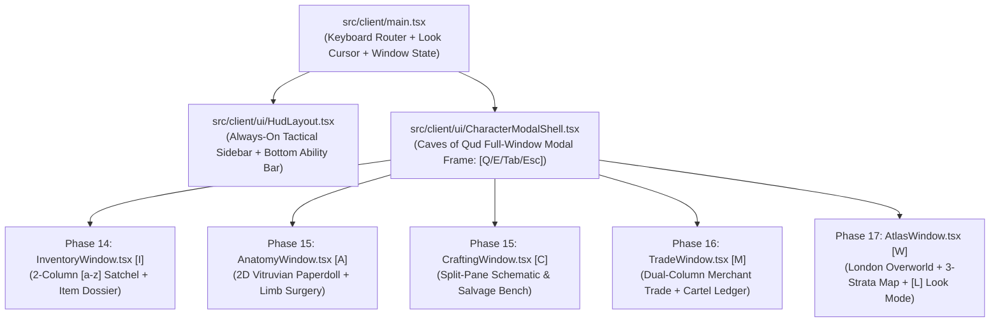

# ROADMAP.md — Phased AI Feature Handoff Plan (Aether & Soot)

> **HOW TO USE THIS ROADMAP**:
> - **Phases 1–6 (Completed)**: Established the deterministic headless core (`src/sim/`), 3-strata verticality, anatomy/prosthetics, thermodynamics, macro-economy, and the PixiJS/Preact presentation shell.
> - **Phases 7–12 (Completed — Issues #12–#17)**: Built world items & encumbrance, multi-building districts & inter-district transit, steam-powered crafting & salvage, autonomous NPC AI & targeted limb combat, physical merchant trading, and the initial UI inspector/system menu.
> - **Phases 13–17 (Active — The *Caves of Qud* UI & Tactical UX Overhaul)**: Replaces the cramped sidebar tabs with full-window, keyboard-driven *Caves of Qud*-style modal screens (`[I]` Satchel, `[A]` Vitruvian Anatomy & Grafts, `[C]` Artificer Schematic Bench, `[M]` Dual-Column Exchange & Factions, `[W]` Multi-Stratum World Atlas) and keyboard `[L]` Look/Target cursor mode.
>
> Every phase is engineered to be **handed off to an independent AI agent** without violating the **300-line file ceiling** (`AGENTS.md` Rule 2.2) or breaking `npm run verify`.

---

## 1. Current UI & UX Gap Analysis (Sidebar Tabs vs. *Caves of Qud* Windows)

| Domain | What Currently Exists (Phases 1–12) | What Phases 13–17 Deliver (*Caves of Qud* UX) |
| :--- | :--- | :--- |
| **Main Viewport & Sidebar (`HudLayout.tsx`)** | 5 tiny tabs (`TEL`, `INV[I]`, `SURG[A]`, `BENCH[C]`, `MKT[M]`) swap inside the narrow 340px right-hand sidebar, hiding telemetry whenever a tab is open. | Right sidebar stays permanently dedicated to **Live Telemetry, Nearby Entities/Hostiles, Tile Inspector, and the Action Chronicle**, plus a bottom **Quick-Action Ability Bar**. Pressing `[I]`, `[A]`, `[C]`, `[M]`, or `[W]` opens a **large full-window overlay modal**. |
| **Modal Window Navigation** | Only `[Esc]` System Menu is a modal; management views require clicking small sidebar buttons. | Unified **`CharacterModalShell.tsx`** with a *Caves of Qud*-style header bar (`[Q <<] SATCHEL [I] | ANATOMY [A] | WORKBENCH [C] | EXCHANGE [M] | ATLAS [W] [>> E]`), keyboard tab cycling (`Tab`, `Q`/`E`), and `[Esc]` to return to the map. |
| **Inventory & Item Inspection (`[I]`)** | Single narrow list (`InventoryPanel.tsx`) with truncated names and no item lore or `[a-z]` hotkeys. | **Two-Column `InventoryWindow.tsx`**: Categorized item list with `[a]`–`[z]` hotkeys on the left; rich **Victorian Item Dossier** (lore description, mass/volume gauges, steam kPa requirements, market value, and `[u] Use`, `[d] Drop`, `[g] Graft`, `[s] Salvage` keybinds) on the right. |
| **Anatomy & Crafting (`[A]` & `[C]`)** | Text-only limb rows (`AnatomyDoll.tsx`) and compact recipe buttons (`CraftingPanel.tsx`). | **2D Vitruvian Clockwork Paperdoll (`AnatomyWindow.tsx`)** with spatial limb boxes (`[1]`–`[6]`), bleed/HP meters, and direct prosthetic socket picker; plus a split-pane **Blueprint Schematic Bench (`CraftingWindow.tsx`)**. |
| **Trading & Economy (`[M]`)** | Compact commodity table (`MarketLedger.tsx`) and tiny inline buy/sell buttons inside `TileInspectorPanel.tsx`. | **Dual-Column `TradeWindow.tsx`**: Merchant Stock on the left, Player Satchel on the right, live faction discount math, plus the full **District Cartel & Storefront Ledger**. |
| **World Map (`[W]`) & Look Mode (`[L]`)** | No overview map of explored strata or London districts; tile inspection requires mouse hover. | **`AtlasWindow.tsx`** showing the London Overworld (`Spitalfields`, `Whitechapel`, `Kensington`) + 3-Strata Cross-Section (`SPIRE`, `STREET`, `UNDERCROFT`), and keyboard **`[L]` Look / Target Cursor Mode** on the main canvas. |

---

## 2. Architecture Diagram (Phases 13–17 UI & Window Hierarchy)

---

## 3. Active Implementation Plan (Phases 13–17 — Ready for AI Handoff)

### Phase 13: *Caves of Qud* Modal Window Shell & Always-On Tactical Sidebar (Issue #18)
- **Goal**: Decouple deep management screens from the narrow right-hand sidebar. Turn `HudLayout.tsx` into a clean, always-on tactical HUD (Vitals gauges, Stratum/District header, Nearby Entities & Hostiles list, Tile Inspector, and Action Chronicle) with a bottom Quick-Action Bar, and create the full-screen `CharacterModalShell.tsx` overlay triggered by `[I]`, `[A]`, `[C]`, `[M]`, or `[W]`.
- **Architectural Constraint**: Every `.tsx` file in `src/client/` must remain strictly **<= 250 lines** (hard gate: 300 lines).
- **Files to Create / Modify**:
  - **Create** `src/client/ui/CharacterModalShell.tsx` (**New Module**): Full-window Victorian double-brass-bordered modal overlay with top tab bar (`SATCHEL [I]`, `ANATOMY [A]`, `WORKBENCH [C]`, `EXCHANGE [M]`, `ATLAS [W]`), footer keybind legend (`[Q/E or Tab] Switch Window  |  [Esc] Return to World`), and active window slot rendering.
  - **Create** `src/client/ui/QuickActionBar.tsx` (**New Module**): Bottom horizontal ability bar below the PixiJS viewport (`[Space] Wait`, `[G] Get Item`, `[>/<] Portal`, `[R] Stoke Boiler`, `[V] Vent Steam`, `[L] Look`, `[I] Satchel`, `[A] Anatomy`, `[C] Craft`, `[M] Market`, `[W] Map`).
  - **Modify** `src/client/ui/HudLayout.tsx`: Remove the 5-tab switcher from the sidebar so the sidebar always displays live Player Vitals (Blood & Steam progress bars), District/Stratum status, Nearby Visible Entities/NPCs, `TileInspectorPanel`, and `ACTION CHRONICLE`.
  - **Modify** `src/client/main.tsx` & `index.html`: Track `activeModalWindow: ModalWindowId | null` (`'INVENTORY' | 'ANATOMY' | 'WORKBENCH' | 'EXCHANGE' | 'ATLAS' | null`), bind `[I]`, `[A]`, `[C]`, `[M]`, `[W]`, `[Tab]`, `[Q]`, `[E]`, and `[Esc]` to open/cycle/close the full-window modal, and block movement commands while a modal window is open.
- **Copy-Paste Prompt for AI Agent**:
  > Read `AGENTS.md`, `ARCHITECTURE.md`, and `ROADMAP.md` (Phase 13). Output the 5-point Pre-Flight Impact Analysis Checklist, then implement **Phase 13: Caves of Qud Modal Window Shell & Always-On Tactical Sidebar (Issue #18)** by creating `src/client/ui/CharacterModalShell.tsx` and `src/client/ui/QuickActionBar.tsx`, and refactoring `src/client/ui/HudLayout.tsx` and `src/client/main.tsx` so `[I]`, `[A]`, `[C]`, `[M]`, and `[W]` open a large full-window modal instead of sidebar tabs. Keep every file <= 250 lines and run `npm run verify` until all 4 checks pass with 0 errors.

---

### Phase 14: Two-Column Satchel Window (`[I]`), `[a–z]` Hotkeys & Item Dossier (Issue #19)
- **Goal**: Replace the cramped single-column inventory panel with a *Caves of Qud*-style two-column **Satchel & Equipment Dossier Window** featuring keyboard `[a]`–`[z]` item selection, category grouping, encumbrance/volume bars, ground-loot transfer, and rich mechanical/lore inspection.
- **Architectural Constraint**: Keep `src/client/ui/InventoryWindow.tsx` **<= 250 lines** by extracting item metadata/dossier rendering into `src/client/ui/ItemDossierCard.tsx` if needed.
- **Files to Create / Modify**:
  - **Create** `src/client/ui/InventoryWindow.tsx` (**New Module**):
    - **Left Column**: Carried items grouped by category (`PROSTHETIC`, `CONSUMABLE`, `MATERIAL`, `COMMODITY`) assigned `[a]`–`[z]` letter hotkeys, plus a "Ground Items at Feet" section (`[G]` to pick up).
    - **Top Encumbrance Bar**: Visual mass (`kg / max kg`) and volume (`mL / max mL`) meters with overburdened warnings.
  - **Create** `src/client/ui/ItemDossierCard.tsx` (**New Module**):
    - **Right Column**: Full inspection card for the selected item showing blueprint description, category badge, mass, volume, stack quantity, prosthetic socket/limb compatibility or consumable effect, and keyboard/click action buttons (`[U] Use / Consume`, `[D] Drop`, `[G] Graft to Limb`, `[S] Salvage into Scrap`).
  - **Modify** `src/client/ui/CharacterModalShell.tsx`: Mount `<InventoryWindow />` when the `INVENTORY` window is active.
- **Copy-Paste Prompt for AI Agent**:
  > Read `AGENTS.md`, `ARCHITECTURE.md`, and `ROADMAP.md` (Phase 14). Output the 5-point Pre-Flight Impact Analysis Checklist, then implement **Phase 14: Two-Column Satchel Window (`[I]`), `[a–z]` Hotkeys & Item Dossier (Issue #19)** by creating `src/client/ui/InventoryWindow.tsx` and `src/client/ui/ItemDossierCard.tsx` and wiring them into `CharacterModalShell.tsx`. Keep all files <= 250 lines and run `npm run verify` with 0 errors.

---

### Phase 15: Vitruvian Clockwork Paperdoll (`[A]`) & Schematic Workbench Window (`[C]`) (Issue #20)
- **Goal**: Upgrade the `[A]` Anatomy and `[C]` Crafting views into full-screen, spatial *Caves of Qud* / *Dwarf Fortress*-inspired engineering schematics.
- **Architectural Constraint**: Each window component (`AnatomyWindow.tsx` and `CraftingWindow.tsx`) must stay **<= 250 lines**.
- **Files to Create / Modify**:
  - **Create** `src/client/ui/AnatomyWindow.tsx` (**New Module**):
    - **Left/Center Pane (2D Vitruvian Paperdoll Grid)**: Spatial layout of `HEAD [1]`, `LEFT_ARM [2]`, `TORSO [3]`, `RIGHT_ARM [4]`, `LEFT_LEG [5]`, `RIGHT_LEG [6]` with visual HP bars, arterial bleed badges, and installed prosthetic blueprints.
    - **Right Pane (Limb Surgical Dossier)**: Selecting a limb slot (`[1]`–`[6]` or click) shows detailed tissue integrity, movement/combat penalties, `[R] Field Repair Limb (Brass Gears + 15 kPa)`, `[U] Uninstall Prosthetic`, or a list of compatible prosthetics in the player's satchel to `[G] Graft` directly into that socket.
  - **Create** `src/client/ui/CraftingWindow.tsx` (**New Module**):
    - **Left Pane**: Recipe catalog (`RECIPE_CATALOG`) with craftability status badges (`READY`, `MISSING PARTS`, `NEEDS WORKBENCH`, `LOW STEAM`) and `[1]`–`[9]` hotkeys.
    - **Right Pane**: Full blueprint schematic showing required ingredients (owned vs. required count), boiler pressure cost (`kPa`), nearby Artificer Workbench / Alchemical Still detection, output item stats, `[C] Forge Blueprint` button, and a quick-salvage list for turning extra items into brass gears.
  - **Modify** `src/client/ui/CharacterModalShell.tsx`: Mount `<AnatomyWindow />` and `<CraftingWindow />`.
- **Copy-Paste Prompt for AI Agent**:
  > Read `AGENTS.md`, `ARCHITECTURE.md`, and `ROADMAP.md` (Phase 15). Output the 5-point Pre-Flight Impact Analysis Checklist, then implement **Phase 15: Vitruvian Clockwork Paperdoll (`[A]`) & Schematic Workbench Window (`[C]`) (Issue #20)** by creating `src/client/ui/AnatomyWindow.tsx` and `src/client/ui/CraftingWindow.tsx` and mounting them in `CharacterModalShell.tsx`. Keep all files <= 250 lines and run `npm run verify` with 0 errors.

---

### Phase 16: Dual-Column Merchant Trade Window & Cartel Economy Ledger (`[M]`) (Issue #21)
- **Goal**: Create a *Caves of Qud*-style side-by-side **Merchant Exchange & Cartel Ledger Window** (`[M]`) so trading with adjacent merchants and managing storefront pedestals happens in a spacious dual-column interface rather than cramped inspector buttons.
- **Architectural Constraint**: Keep `TradeWindow.tsx` and `CartelLedgerView.tsx` **<= 250 lines** each.
- **Files to Create / Modify**:
  - **Create** `src/client/ui/TradeWindow.tsx` (**New Module**):
    - Detects any adjacent NPC with `aiController.role === 'MERCHANT'`.
    - **Left Column (Merchant Stock)**: Lists merchant inventory items with dynamic buy prices in pence (`d`) adjusted by the merchant's faction reputation multiplier, plus `[Buy]` action buttons.
    - **Right Column (Player Satchel)**: Lists player's sellable items with dynamic sell quotes in pence (`d`) and `[Sell]` action buttons.
    - **Header Strip**: Displays Player Treasury (`pence`), Merchant Faction Standing (`-100` to `+100`), and active price markup/discount percentage.
  - **Create** `src/client/ui/CartelLedgerView.tsx` (**New Module**):
    - Bottom or secondary sub-view inside the `[M]` Exchange window displaying the 3 Victorian Cartels (`Foundry Directorate`, `Sump Syndicate`, `Royal Aether Society`), live district commodity quotes (`refined_aether`, `whale_oil`, `clockwork_limb`, `smokeless_coal`), and storefront pedestal stocking controls.
  - **Modify** `src/client/ui/CharacterModalShell.tsx` & `src/client/ui/TileInspectorPanel.tsx`: Wire `[M]` and the Tile Inspector's `[Trade with Merchant]` button to open `TradeWindow.tsx` inside the modal shell.
- **Copy-Paste Prompt for AI Agent**:
  > Read `AGENTS.md`, `ARCHITECTURE.md`, and `ROADMAP.md` (Phase 16). Output the 5-point Pre-Flight Impact Analysis Checklist, then implement **Phase 16: Dual-Column Merchant Trade Window & Cartel Economy Ledger (`[M]`) (Issue #21)** by creating `src/client/ui/TradeWindow.tsx` and `src/client/ui/CartelLedgerView.tsx` and wiring them into `CharacterModalShell.tsx`. Keep all files <= 250 lines and run `npm run verify` with 0 errors.

---

### Phase 17: Multi-Stratum World Atlas (`[W]`) & Keyboard `[L]` Look / Target Mode (Issue #22)
- **Goal**: Give players a full **London Overworld & 3-Strata Cartography Window** (`[W]`) to visualize vertical connections and district transit routes, plus *Caves of Qud*'s signature **`[L]` Look / Examine & Limb-Target Cursor** on the main viewport for full keyboard-only play.
- **Architectural Constraint**: Keep `AtlasWindow.tsx` and `LookCursorController.ts` **<= 250 lines** each; zero browser imports in `src/sim/`.
- **Files to Create / Modify**:
  - **Create** `src/client/ui/AtlasWindow.tsx` (**New Module**):
    - **London District Overworld Map**: Interactive node graph of `Spitalfields Sootworks`, `Whitechapel Sump`, and `Kensington Aether Spire` showing current location, district descriptions, and active transit gates.
    - **3-Strata Cross-Section Minimap (`SPIRE` / `STREET` / `UNDERCROFT`)**: Side-by-side or switchable ASCII/grid overview of all three vertical strata in the current district, highlighting the player `@`, discovered portals (`>`, `<`, `^`, `v`), District Gates (`D`), Workbenches (`&`), Merchants, and Hostiles.
  - **Create** `src/client/ui/LookCursorOverlay.tsx` (**New Module**):
    - Pressing `[L]` on the main map enters **Look / Target Mode** at the player's coordinates.
    - `WASD` / Arrow keys move the brass reticle across the 24x20 viewport (updating `hoveredTile` in `TileInspectorPanel` without spending a turn).
    - When the reticle is over an adjacent hostile NPC, pressing `[1]`–`[6]` or `[F]` dispatches `ATTACK_ACTOR` targeting that specific limb (`HEAD`, `TORSO`, `LEFT_ARM`, `RIGHT_ARM`, `LEFT_LEG`, `RIGHT_LEG`), and pressing `[Enter]` interacts with doors/portals/merchants.
  - **Modify** `src/client/main.tsx` & `src/client/ui/CharacterModalShell.tsx`: Wire `[W]` to open `AtlasWindow.tsx` and `[L]` to toggle Look Mode on the main canvas.
- **Copy-Paste Prompt for AI Agent**:
  > Read `AGENTS.md`, `ARCHITECTURE.md`, and `ROADMAP.md` (Phase 17). Output the 5-point Pre-Flight Impact Analysis Checklist, then implement **Phase 17: Multi-Stratum World Atlas (`[W]`) & Keyboard `[L]` Look / Target Mode (Issue #22)** by creating `src/client/ui/AtlasWindow.tsx` and `src/client/ui/LookCursorOverlay.tsx` and wiring them into `CharacterModalShell.tsx` and `src/client/main.tsx`. Keep all files <= 250 lines and run `npm run verify` with 0 errors.

---

## 4. Archive: Completed Foundation Phases (Phases 7–12)
- **Phase 7 (Issue #12 — Completed)**: World Items, Ground Spawning & True Inventory Management (`src/sim/systems/inventory.system.ts`, `src/sim/systems/item-spawner.ts`).
- **Phase 8 (Issue #13 — Completed)**: Multi-Building District ProcGen, Doors & Inter-District Transit (`src/sim/spatial/district-layout.ts`, `src/sim/systems/transit.system.ts`).
- **Phase 9 (Issue #14 — Completed)**: Artificer Crafting, Salvage & Steam Workbenches (`src/sim/systems/crafting.system.ts`, `data/items/recipes.json`).
- **Phase 10 (Issue #15 — Completed)**: Autonomous NPCs, Enemies, Faction AI & Targeted Limb Combat (`src/sim/systems/combat.system.ts`, `src/sim/systems/ai.system.ts`).
- **Phase 11 (Issue #16 — Completed)**: Physical Storefront Inventories & Merchant Trading (`src/sim/systems/trade.system.ts`).
- **Phase 12 (Issue #17 — Completed)**: Initial Multi-Screen UI Panels, System Menu Modal & Canvas Tile Inspector (`src/client/ui/*.tsx`).
