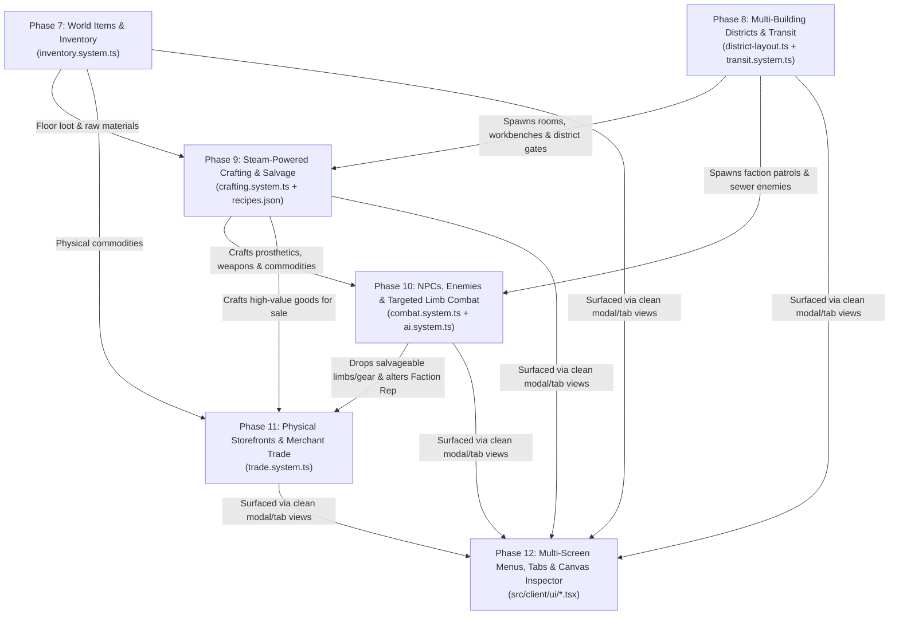

# ROADMAP.md — Phased AI Feature Handoff Plan (Aether & Soot)

> **HOW TO USE THIS ROADMAP**: Phases 1–6 established the deterministic headless core (`src/sim/`), 3-strata verticality, anatomy/prosthetics, thermodynamics, macro-economy, and the PixiJS/Preact presentation shell.
>
> Phases **7 through 12** below turn that engine foundation into a complete, interconnected roguelike loop. Each phase is engineered to be **handed off to an independent AI agent** without violating the **300-line file ceiling** (`AGENTS.md` Rule 2.2) or breaking `npm run verify`.

---

## 1. Current State Gap Analysis (What Exists vs. What Is Missing)

| Domain | What Currently Exists (Phases 1–6) | What Is Missing (Phases 7–12) |
| :--- | :--- | :--- |
| **Items & Inventory** | `InventoryComponentSchema` tracks `containedEntityIds` and mass; player starts with 2 hardcoded prosthetics (`world.ts`). | General `item` component (materials, consumables, weapons, commodities), items spawning on floor tiles, `PICK_UP_ITEM` and `DROP_ITEM` commands. |
| **World & Map Generation** | `generateVictorianDistrict` (`generator.ts`, 285 lines) carves 2–3 small rooms on a 24x20 grid with vertical portals (`>`, `<`, `^`, `v`). | Multi-room buildings with doors (`+`/`/`), outside street thoroughfares, and District Transit Gates to travel between the 3 districts in `data/world/districts.json`. |
| **Crafting & Salvage** | Declarative blueprints exist for prosthetics and commodities (`data/items/`). | Crafting recipes (`recipes.json`), Workbench entities, salvaging scrap from broken items, and crafting new prosthetics/vials using steam pressure + materials. |
| **NPCs, Enemies & Combat** | `DAMAGE_LIMB` command and limb amputation/bleeding mechanics exist in `anatomy.system.ts`. | Non-player actors (`AiControllerComponent`), enemy spawning, deterministic NPC turn loop in `scheduler.ts`, and targeted limb melee/ranged combat (`ATTACK_ACTOR`). |
| **Storefronts & Trading** | `economy.system.ts` simulates macro-tick price curves, supply shocks, and abstract pedestal sales. | Physical item linkage (stocking a pedestal consumes an item from `inventory`), plus buying/selling items and prosthetics at NPC merchants using `playerTreasuryPence`. |
| **Menus & Interface** | Everything renders on a single crowded sidebar (`HudLayout.tsx`) with hardcoded test buttons. | Title/Seed/Save-Load screen, tabbed/modal screens (`[I]` Inventory, `[C]` Crafting, `[A]` Anatomy, `[M]` Market), and canvas tile hover/click inspection. |

---

## 2. System Interconnection Diagram (How Phases 7–12 Fit Together)

---

## 3. Phased Implementation Plan (Ready for AI Handoff)

### Phase 7: World Items, Ground Spawning & True Inventory Management
- **Goal**: Make items physical entities that exist on map tiles, can be picked up, stacked, dropped, and inspected in the player's inventory.
- **Why First**: Crafting (Phase 9), Enemy Loot Drops (Phase 10), and Physical Storefronts (Phase 11) all depend on items existing as first-class ECS entities on the ground and inside `inventory.containedEntityIds`.
- **Files to Create / Modify**:
  - **Modify** `src/schemas/components.schema.ts`: Add `ItemComponentSchema` (`blueprintId`, `category: 'MATERIAL' | 'CONSUMABLE' | 'PROSTHETIC' | 'COMMODITY'`, `massGrams`, `volumeMl`, `quantity`, `commodityId?`).
  - **Modify** `src/schemas/blueprint.schema.ts` & `data/items/materials.json`: Add raw materials (`mat_brass_gears`, `mat_vulcanized_rubber`, `mat_aether_salt`, `mat_cast_iron_plate`) and consumables (`item_coagulant_tonic`, `item_pressurized_steam_canister`).
  - **Modify** `src/schemas/commands.schema.ts` & `src/schemas/events.schema.ts`: Add `PICK_UP_ITEM`, `DROP_ITEM`, and `USE_ITEM` commands + `ITEM_PICKED_UP`, `ITEM_DROPPED`, `ITEM_USED` events.
  - **Create** `src/sim/systems/inventory.system.ts` (**New Module** — do not bloat `anatomy.system.ts`): Implement `resolvePickupItem`, `resolveDropItem`, `resolveUseItem`, and deterministic ground-item spawning helper `spawnDistrictItems`.
  - **Create** `tests/sim/inventory-items.test.ts`: Verify mass/volume encumbrance limits, picking up items from a tile, dropping items back onto a tile, and using a coagulant tonic or steam canister.
- **Copy-Paste Prompt for AI Agent**:
  > Read `AGENTS.md`, `ARCHITECTURE.md`, and `ROADMAP.md` (Phase 7). Output the 5-point Pre-Flight Impact Analysis Checklist, then implement **Phase 7: World Items, Ground Spawning & True Inventory Management** by creating `src/sim/systems/inventory.system.ts` and `tests/sim/inventory-items.test.ts`. Run `npm run verify` and confirm 0 errors.

---

### Phase 8: Multi-Building District ProcGen, Doors & Inter-District Transit
- **Goal**: Expand the map from a single enclosed courtyard into a multi-building Victorian district (Workshop, Market Hall, Foundry Boiler House, Sewer Vaults, Spire Catwalks) with openable doors and District Transit Gates to travel to the outside world.
- **Architectural Constraint**: `src/sim/spatial/generator.ts` is currently at **286 lines** (near the 300-line hard cap). The agent **MUST** extract room/building carving into `src/sim/spatial/district-layout.ts` and inter-district travel into `src/sim/systems/transit.system.ts`.
- **Files to Create / Modify**:
  - **Modify** `src/sim/spatial/grid.ts`: Add `'WOODEN_DOOR_CLOSED'`, `'WOODEN_DOOR_OPEN'`, and `'DISTRICT_GATE'` to `TerrainTypeSchema`. Closed doors block movement, sight, and steam diffusion; open doors allow all three.
  - **Create** `src/sim/spatial/district-layout.ts` (**New Module**): Procedural building generator that carves named buildings with doorways along a central cobblestone thoroughfare on `STREET`, sewer tunnels on `UNDERCROFT`, and catwalk bridges on `SPIRE`.
  - **Modify** `src/sim/spatial/generator.ts`: Delegate room carving to `district-layout.ts` (reducing `generator.ts` below 200 lines) and place District Transit Portals at the North/South/East/West street borders linking the 3 districts in `data/world/districts.json` (`district_spitalfields_sootworks`, `district_whitechapel_sump`, `district_kensington_aether_spire`).
  - **Create** `src/sim/systems/transit.system.ts` (**New Module**): Implement `resolveToggleDoor` (`TOGGLE_DOOR` command) and `resolveTravelDistrict` (`TRAVEL_DISTRICT` command, which transitions `WorldState.currentDistrictId` and generates/restores the target district grid using `SeededRNG`).
  - **Create** `tests/sim/district-transit.test.ts`: Verify door opening/closing alters FOV & steam propagation, and verify deterministic travel between Spitalfields and Whitechapel Sump.
- **Copy-Paste Prompt for AI Agent**:
  > Read `AGENTS.md`, `ARCHITECTURE.md`, and `ROADMAP.md` (Phase 8). Output the 5-point Pre-Flight Impact Analysis Checklist, then implement **Phase 8: Multi-Building District ProcGen, Doors & Inter-District Transit**. Extract `src/sim/spatial/district-layout.ts` and `src/sim/systems/transit.system.ts` so `generator.ts` stays well under 250 lines. Run `npm run verify` and confirm 0 errors.

---

### Phase 9: Artificer Crafting, Salvage & Steam Workbenches
- **Goal**: Allow the player to combine raw materials (from Phase 7) at an Artificer Workbench (spawned in Phase 8) using personal or boiler steam pressure to craft prosthetics, commodities, and field supplies—or salvage unwanted items into raw materials.
- **Files to Create / Modify**:
  - **Modify** `src/schemas/blueprint.schema.ts` & **Create** `data/items/recipes.json`: Define `CraftingRecipeBlueprintSchema` (`id`, `outputBlueprintId`, `ingredients: { blueprintId, count }[]`, `steamCostKpa`, `requiresWorkbench: boolean`, `apCost`).
  - **Modify** `src/schemas/components.schema.ts`: Add `WorkbenchComponentSchema` (`stationType: 'ARTIFICER_BENCH' | 'ALCHEMICAL_STILL'`, `bonusEfficiencyPct`).
  - **Modify** `src/schemas/commands.schema.ts` & `src/schemas/events.schema.ts`: Add `CRAFT_RECIPE`, `SALVAGE_ITEM`, and `REPAIR_LIMB` commands + corresponding `SimEvent` variants.
  - **Create** `src/sim/systems/crafting.system.ts` (**New Module**): Implement `resolveCraftRecipe` (validates workbench adjacency, deducts ingredients from `inventory` and `steamReserveKpa` from `anatomy`, spawns crafted entity into `inventory`) and `resolveSalvageItem`.
  - **Create** `tests/sim/crafting-salvage.test.ts`: Verify recipe ingredient consumption, steam pressure requirement, and item salvage recovery.
- **Copy-Paste Prompt for AI Agent**:
  > Read `AGENTS.md`, `ARCHITECTURE.md`, and `ROADMAP.md` (Phase 9). Output the 5-point Pre-Flight Impact Analysis Checklist, then implement **Phase 9: Artificer Crafting, Salvage & Steam Workbenches** in `src/sim/systems/crafting.system.ts` and `data/items/recipes.json`. Run `npm run verify` and confirm 0 errors.

---

### Phase 10: Autonomous NPCs, Enemies, Faction AI & Targeted Limb Combat
- **Goal**: Populate the districts with autonomous NPCs and enemies (Clockwork Automaton Wardens, Sump Scavengers, Foundry Stokers, Guild Merchants) that act on the energy scheduler and engage in targeted limb combat.
- **Architectural Constraint**: `src/sim/systems/anatomy.system.ts` is at **293 lines**. Do NOT add combat or AI functions to `anatomy.system.ts`; create `src/sim/systems/combat.system.ts` and `src/sim/systems/ai.system.ts` and call `resolveDamageLimb` from `anatomy.system.ts`.
- **Files to Create / Modify**:
  - **Modify** `src/schemas/components.schema.ts`: Add `AiControllerComponentSchema` (`factionId`, `role: 'GUARD' | 'SCAVENGER' | 'MERCHANT' | 'CITIZEN'`, `hostile: boolean`) and `CombatStatsComponentSchema` (`meleeDamage`, `accuracyPct`, `armorReduction`).
  - **Modify** `src/schemas/commands.schema.ts` & `src/schemas/events.schema.ts`: Add `ATTACK_ACTOR` command (`attackerId`, `targetId`, `targetSlot: LimbSlotId`) + `COMBAT_ATTACK_RESOLVED` and `ACTOR_DEFEATED` events.
  - **Create** `src/sim/systems/combat.system.ts` (**New Module**): Implement targeted limb attacks (hitting `LEFT_LEG` slows enemy movement; hitting `RIGHT_ARM` disarms; hitting `TORSO`/`HEAD` to `0 HP` defeats the actor and drops their inventory/prosthetics onto the tile). Attacking a faction member reduces `factionReputation` in `state.economy`.
  - **Create** `src/sim/systems/ai.system.ts` (**New Module**): Implement `advanceNpcTurns(state, rng)` called during `dispatchCommand` after the player acts, using `computeVisibleTiles` (`fov.ts`) to detect targets and step toward or attack them.
  - **Create** `tests/sim/combat-ai.test.ts`: Verify targeted limb damage in combat, NPC turn scheduling, loot drops on defeat, and faction reputation penalties.
- **Copy-Paste Prompt for AI Agent**:
  > Read `AGENTS.md`, `ARCHITECTURE.md`, and `ROADMAP.md` (Phase 10). Output the 5-point Pre-Flight Impact Analysis Checklist, then implement **Phase 10: Autonomous NPCs, Enemies, Faction AI & Targeted Limb Combat** by creating `src/sim/systems/combat.system.ts` and `src/sim/systems/ai.system.ts`. Do not add lines to `anatomy.system.ts`. Run `npm run verify` and confirm 0 errors.

---

### Phase 11: Physical Storefront Inventories & Merchant Trading
- **Goal**: Connect physical items (Phase 7/9) and NPC merchants (Phase 10) to the district macro-economy (`economy.system.ts`) so stocking pedestals consumes real inventory items, and players can buy/sell gear with merchants using `playerTreasuryPence`.
- **Architectural Constraint**: `src/sim/systems/economy.system.ts` is at **283 lines**. Create `src/sim/systems/trade.system.ts` for merchant transactions and physical pedestal stocking.
- **Files to Create / Modify**:
  - **Modify** `src/schemas/commands.schema.ts` & `src/schemas/events.schema.ts`: Add `BUY_FROM_MERCHANT` and `SELL_TO_MERCHANT` commands + `MERCHANT_TRADE_COMPLETED` event.
  - **Create** `src/sim/systems/trade.system.ts` (**New Module**): Implement `resolveBuyFromMerchant` and `resolveSellToMerchant` (calculating prices from `state.economy.marketQuotes` and scaling by `factionReputation` standing), plus physical item transfer when stocking storefront pedestals.
  - **Create** `tests/sim/merchant-trade.test.ts`: Verify pence deduction, inventory item transfer, and faction reputation price modifiers.
- **Copy-Paste Prompt for AI Agent**:
  > Read `AGENTS.md`, `ARCHITECTURE.md`, and `ROADMAP.md` (Phase 11). Output the 5-point Pre-Flight Impact Analysis Checklist, then implement **Phase 11: Physical Storefront Inventories & Merchant Trading** in `src/sim/systems/trade.system.ts` (keeping `economy.system.ts` under 285 lines). Run `npm run verify` and confirm 0 errors.

---

### Phase 12: Multi-Screen UI Architecture, Modal Menus & Interactive Canvas Inspector
- **Goal**: Replace the single-screen debug sidebar with a clean, multi-screen Victorian interface featuring a Title/Save-Load Modal, Tabbed/Shortcut Drawers (`[I]` Inventory, `[C]` Crafting, `[A]` Anatomy & Prosthetics, `[M]` Market & Trade), and live Canvas Tile Inspection.
- **Architectural Constraint**: Every `.tsx` file in `src/client/ui/` must stay **<= 250 lines** (one UI panel per file).
- **Files to Create / Modify**:
  - **Create** `src/client/ui/EventFormatter.ts`: Extract `formatEventMessage(ev: SimEvent)` out of `HudLayout.tsx` into its own pure helper module so `HudLayout.tsx` stays compact as new events are added.
  - **Create** `src/client/ui/InventoryPanel.tsx`: Displays carried items, mass/volume bars, `[Pick Up]`, `[Drop]`, `[Use]`, and `[Install Prosthetic]` actions.
  - **Create** `src/client/ui/CraftingPanel.tsx`: Displays available recipes from `data/items/recipes.json`, ingredient checklist, steam cost, and `[Craft]` / `[Salvage]` buttons.
  - **Create** `src/client/ui/TileInspectorPanel.tsx`: Displays terrain, steam kPa, coal dust density, and entities/NPC limbs on the currently hovered or selected canvas tile.
  - **Create** `src/client/ui/SystemMenuModal.tsx`: Modal overlay (`[Esc]`) for New Seed Generation, Save to LocalStorage / JSON Export, and Load JSON Save (`serializeWorld` / `deserializeWorld`).
  - **Modify** `src/client/ui/HudLayout.tsx` & `src/client/main.tsx`: Add tab navigation (`TELEMETRY` | `INVENTORY [I]` | `SURGERY [A]` | `WORKBENCH [C]` | `EXCHANGE [M]`) and canvas pointer hover/click listeners.
- **Copy-Paste Prompt for AI Agent**:
  > Read `AGENTS.md`, `ARCHITECTURE.md`, and `ROADMAP.md` (Phase 12). Output the 5-point Pre-Flight Impact Analysis Checklist, then implement **Phase 12: Multi-Screen UI Architecture, Modal Menus & Interactive Canvas Inspector** across modular files in `src/client/ui/` (each <= 250 lines). Run `npm run verify` and confirm 0 errors.
