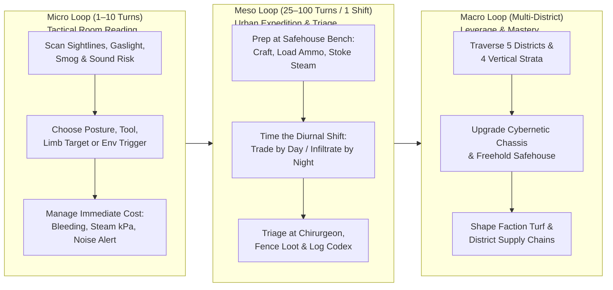

# DESIGN_INTENT.md — World, Setting, Player Experience & Systemic North Star (Aether & Soot)

> **PURPOSE FOR HUMAN DESIGNERS & AI AGENTS**: While [ARCHITECTURE.md](../ARCHITECTURE.md) defines *how* the code is structured and [AGENTS.md](../AGENTS.md) defines *how* to modify it safely, this document defines **why the game exists and how it must feel to play**. Whenever designing a feature, authoring a building template, tuning combat, or formatting an event log, use this document to ensure mechanics serve **player experience, atmosphere, and agency** rather than existing as isolated math.

---

## 1. Core Creative Vision & Experience North Star

*Aether & Soot* is a turn-based Victorian Steampunk survival-sandbox roguelike set in an alternate **1888 subterranean and vertically stratified London**.

It synthesizes three touchstones into a unified player experience:
1. ***Cataclysm: Dark Days Ahead (CDDA)* — Tactile Materiality & Anatomical Consequence**:
   - Buildings are recognizable Victorian workshops, apothecaries, pawnshops, and tenements with logical rooms, doors, windows, workbenches, and containers—not abstract dungeon boxes.
   - Your body is a physical machine of eight anatomical slots (`HEAD`, `TORSO`, `LEFT_ARM`, `RIGHT_ARM`, `LEFT_LEG`, `RIGHT_LEG`, `OCULAR_MOUNT`, `CHASSIS_CORE`), blood volume, stamina, pain shock, and boiler governor bandwidth.
   - Tools have physical qualities (`WRENCHING`, `PRYING`, `SURGERY`, `ALCHEMICAL`, `LOCKPICKING`); furniture can be pried, looted, constructed, or breached into rubble.
2. ***Caves of Qud* — Gaslamp-Scientific Mystery & Diegetic Instrumentation**:
   - The interface is an 1888 artificer's optical console framed in oxidized iron, tarnished brass, Bourdon pressure tubes, sanguine manometers, and split-flap tickers.
   - Discovery is systemic and diegetic: dissecting a fallen clockwork warden, surviving a superheated steam scald, or reading a schematic manual in a rookery study populates your **Royal Society Naturalist's Codex** (`[K]`) and changes how factions react to you.
3. ***Thief: The Dark Project* / *Dishonored* / *Fallen London* — Vertical Urban Stealth & Social Ecology**:
   - Sound decibels (`dB`), coal-dust opacity, gaslight radiance pools, and diurnal shift whistles (`DAWN_WHISTLE`, `FOUNDRY_SHIFT`, `GASLIGHT_CURFEW`, `GRAVEYARD_WATCH`) govern who sees you, who hears your pneumatic leg hissing on cobblestone, and which doors are open for business or locked under curfew.

### The Core Emotional Fantasy
You are **not** a chosen fantasy hero clearing disposable monster closets. You are a desperate, resourceful 1888 specialist—a disgraced chirurgeon, an blacklisted foundry artificer, or an undercroft fixer—carving out survival, knowledge, and leverage inside a roaring, indifferent industrial metropolis that runs on anthracite coal, pressurized steam, sanguine tonics, and cartel politics.

---

## 2. The World & Setting: 1888 Stratified London

After the **Great Subsidence of 1874**, central London sank into the Thames clay basin. Rather than abandon the capital, the Crown and the industrial cartels built upward on cast-iron viaducts and downward into the chalk vaults, creating a city where **altitude is class, air quality, and law**.

### 2.1. The Four Vertical Strata (`StratumId`)

| Stratum | Altitude & Air | Who Lives & Works Here | Core Gameplay Feel & Tactical Hazards |
| :--- | :--- | :--- | :--- |
| **1. The Spire** (`SPIRE`) | `+18.0m` Canopy Clean air, high wind, arc-lamp glare | Clockwork Guild savants, Royal Society naturalists, Constabulary marksmen, conservatory botanists | **High-exposure vertical catwalks**. Long sightlines, narrow brass bridges over lethal `ABYSS_DROP` plunges (`-20 HP` leg trauma on fall unless cushioned by pneumatic legs). |
| **2. The Street** (`STREET`) | `±0.0m` Cobblestone Grade Amber gaslight, drifting coal smog, steam vents | Shopkeepers, foundry stokers, chirurgeons, cartel enforcers, everyday citizens on shift schedules | **Living urban neighborhood**. Seamless district borders (canal bridges, viaduct arches, toll gates), multi-room storefronts, diurnal shift traffic, and witness crime attribution. |
| **3. The Undercroft** (`UNDERCROFT`) | `-9.5m` Brick Sewers Damp soot, pressurized steam mains, sluice sludge | Undercroft Syndicate smugglers, fugitive anatomists, autonomous maintenance automatons, monorail crews | **Claustrophobic acoustic pressure-cooker**. Tight brick vaults where boiler ruptures or spark-ignited coal dust flashes into lethal high-pressure steam (`>= 25 kPa` scald), plus the subterranean **Pneumatic Monorail** connecting districts. |
| **4. The Catacombs** (`CATACOMBS`) | `-24.0m+` Deep Chalk Delve Pitch dark, nitric acid drips, ancient clockwork | Derelict pre-Victorian Babbage-era automatons, feral scavengers, lost Royal Society expeditions | **High-risk endurance delve**. Scaling depth tiers (`depthLevel 1..N`) with rare relic schematics, unmapped vaults, and zero medical safety net. |

### 2.2. The Five Metropolitan Districts

The overworld is a continuous 2D planar metropolis where districts connect across open streets, Thames canal bridges, viaduct arches, and Crown toll gates:

1. **Spitalfields Smelting Works** (`district_spitalfields_soot_works` — Macro `(2, 1)`):
   - *Character*: The roaring industrial heart of East London. Reverberatory smelting furnaces, Bessemer converter halls, high ambient coal-dust density, and pressurized boilerhouses.
   - *Player Experience*: Abundant scrap, anthracite coal, and free steam stoking at active boilers, but a single stray spark (`EMIT_SPARK` or firearm discharge) in a dense coal-dust pocket can trigger a chain-reaction deflagration.
2. **Fleet Ditch Undercroft & Slums** (`district_fleet_ditch_undercroft` — Macro `(0, 1)`):
   - *Character*: Sunken canal-side rookeries, pawnshops, and black-market smuggling vaults straddling the open sewer of the Fleet.
   - *Player Experience*: The illicit trade hub. Low Constabulary presence, fenced contraband, cheap unsterile street surgery, and narrow alleys ideal for smog-occluded ambushes.
3. **Whitechapel Quarantine Ward** (`district_whitechapel_ward` — Macro `(1, 1)`):
   - *Character*: Dense CDDA-style urban blocks of brick infirmaries, apothecaries, surgical theaters, and cordoned tenement courts.
   - *Player Experience*: Where you go when your blood volume is critical or a limb is shattered. Operating tables eliminate surgical blood-loss shock (`0%` shock vs `15–20%` field surgery), and chirurgeons sell Dr. Halloway's Coagulant Tonics and Carbolic Tincture.
4. **Limehouse Docks** (`district_limehouse_docks` — Macro `(3, 1)`):
   - *Character*: Fog-drenched timber piers, Thames canal sluices, bonded customs warehouses, and whale-oil storage yards.
   - *Player Experience*: Maritime trade and hazardous liquid chemistry. Spilled whale-oil slicks ignite into roaring surface fires; canal bridges create tactical chokepoints between Spitalfields and the riverfront.
5. **Belgravia Brass Spires** (`district_belgravia_brass_spires` — Macro `(2, 0)`):
   - *Character*: Gilded Gothic colonnades, Clockwork Guild laboratories, Royal Society salons, and heavily patrolled Crown toll arches north of Spitalfields.
   - *Player Experience*: High-security, high-reward infiltration. Clean air means zero natural smog cover—you must bring your own steam vents, acoustic silencers, or forged credentials to survive.

### 2.3. The Four Factions & Social Leverage

| Faction | Ideology & Domain | What They Offer the Player | What Angers Them |
| :--- | :--- | :--- | :--- |
| **Ironmongers' Cartel** (`IRONMONGERS_CARTEL`) | Industrial barons controlling coal, foundry boilers, and heavy hydraulic prosthetics | Heavy armor plates, pneumatic piledrivers, boiler fuel, industrial salvage contracts | Sabotaging foundry boilers, striking stokers, disrupting coal escorts |
| **Clockwork Guild** (`CLOCKWORK_GUILD`) | Precision horologists, optic artificers, and Royal Society savants | Ocular lenses, silent gyrostabilizer legs, precision weapon mods, Codex patronage | Unlicensed automaton dissection in public, theft of guild schematics |
| **Undercroft Syndicate** (`UNDERCROFT_SYNDICATE`) | Subterranean smugglers, fixers, and rookery bosses | Black-market fencing, lockpicks, alchemical stimulants, safe passage through sewer vaults | Reporting crimes to the Constabulary, encroaching on Syndicate turf |
| **Crown Constabulary** (`CROWN_CONSTABULARY`) | Armed gaslamp watchmen and brass automaton wardens enforcing toll law and curfew | Bounties on outlaws, lawful transit permits, protection in high-society wards | Witnessed theft, assault, corpse desecration, or curfew trespass |

---

## 3. The Four Pillars of Player Experience

Every system in *Aether & Soot* exists to reinforce four core experiential pillars.

### Pillar I: Every Wound & Augment Changes How You Play
- **No Generic HP Bars**: Taking a harpoon to the `LEFT_LEG` slows your movement from `100 AP` to `160 AP`, making pursuit deadly. Losing your `OCULAR_MOUNT` collapses your vision radius to `1 tile`, forcing you to navigate by memory and sound until you reach a chirurgeon or graft a Clockwork Ocular Lens.
- **Cybernetics Are Tradeoffs, Not Pure Upgrades**:
  - Every prosthetic draws power (`strainLoadKw`) against your **Boiler Governor Bandwidth** (`governorCapacityKw`) and consumes compressed steam (`steamReserveKpa`).
  - A *Pneumatic Leg Mk.I* makes you fast (`-15 AP`) and cushions Spire falls (`50%` shock absorption), but increases footstep `noiseDb`, alerting guards in quiet corridors.
  - A *Clockwork Gyrostabilizer Leg* is whisper-quiet for stealth, while a *Pneumatic Piledriver Arm* lets you punch straight through `SOOT_BRICK_WALL` masonry at the cost of deafening acoustic shockwaves.
- **Alchemical Desperation**: Laudanum, Aether-Salt Stimulants, and Quicksilver Draughts push you past pain shock and stamina collapse in a crisis, but drive up `toxicityPct` (`>= 80%` overdose) and leave you shaking with withdrawal once the shift ends.

### Pillar II: The City Is a Physical Machine You Can Read and Sabotage
- **Atmosphere as Tactical Cover and Weapon**:
  - Steam pressure (`steamPressureKpa`) and coal dust (`coalDustDensity`) are not decorative particle effects. At `>= 20 kPa` steam or `>= 0.30` coal dust, line of sight is occluded—letting you vent a boiler or kick up soot to vanish from a rifleman's sights.
  - At `>= 25 kPa`, steam scalds uninsulated flesh; at `>= 0.25` coal dust, a single spark (`EMIT_SPARK`, `SPARK_TRIPWIRE`, or unbaffled gunshot) detonates the cloud into a room-clearing thermobaric flash.
- **Sound & Light Govern Stealth**:
  - Every action has a physical decibel signature (`10 dB` crouched step, `85 dB` shattered glass window, `90 dB` guard squad callout, `95 dB` harpoon rifle, `120 dB` boiler rupture).
  - Gaslamp posts (`☼`) cast radius-5 illumination pools; stepping into shadow or crouching (`SET_POSTURE: CROUCHED`) behind workshop counters keeps you unseen.
- **Architecture Is Interactive**:
  - Locked doors and sewer grates can be pried with a crowbar (`PRY_OBSTACLE`); weakened brickwork can be breached by overpressurizing an adjacent boiler (`PRESSURIZE_VESSEL`); safehouses can be fortified with player-built furniture (`BUILD_STRUCTURE`).

### Pillar III: A Continuous, Lived-In Metropolis on a Shift Clock
- **Seamless District Continuity**:
  - No district is a walled-in arena. Walking to the edge of a street, canal bridge, or viaduct arch projects a live lookahead into the neighboring district and transitions you seamlessly (`continuousTransitSystem`) with your companions at your side.
- **The 100-Turn Diurnal Rhythm**:
  - `DAWN_WHISTLE (0–24)`: Street fog thins; workers commute from rookeries toward foundries.
  - `FOUNDRY_SHIFT (25–49)`: Boilers run hot, workshops hum with noise (masking your footsteps!), and merchants restock physical trade pedestals.
  - `GASLIGHT_CURFEW (50–74)`: Gaslamps ignite; Constabulary patrols tighten around toll gates.
  - `GRAVEYARD_WATCH (75–99)`: Shopkeepers retire to their rest anchors, leaving storefronts unguarded for night burglary—while Syndicate fixers and night-watch automatons prowl the alleys.
- **Witnesses, Rumors & Supply Cascades**:
  - Crimes only penalize faction reputation if an unblinded witness sees or hears them and survives to report (`WITNESS_CRIME_REPORTED`).
  - District scarcity of *Anthracite Coal*, *Carbolic Tincture*, or *Preserved Rations* cascades into real world changes: dark workshops, clinic medicine stockouts, inflated merchant quotes, and turf skirmishes.

### Pillar IV: Diegetic Brass-and-Soot Instrumentation
- **Show Through Victorian Instruments, Never Raw Variable Dumps**:
  - The player reads their body and environment through tactile 1888 instruments on the Oxidized Iron console: the **Bourdon Pressure Gauge** (`kPa`), **Sanguine Manometer** (`bloodVolumePct`), **Split-Flap Turn Odometer**, and **Optical Vernier Tile Scanner**.
  - Never leak raw database identifiers (`item_tonic_coagulant`, `district_spitalfields_soot_works`) into the UI; every entity, terrain tile, and event speaks in grounded 1888 gaslamp prose.
  - Support all three visual presentation modes seamlessly (`ASCII`, `ENHANCED_GLYPHS`, `TILESET` via `[F2]`) so players can switch between classic CP437 typography and layered graphical tiles at will.

---

## 4. Target Gameplay Loops Across Three Time Horizons

1. **The Micro Loop (Every 1–10 Turns — "Read the Room before You Act")**:
   - Before opening a door or firing a shot, the player checks: *Where are the gaslamps? Is there coal dust on the floor? Which limb on that Warden is unarmored? How much steam is left in my chassis? If I smash this window (`85 dB`), who will hear it?*
2. **The Meso Loop (Every 25–100 Turns / One Diurnal Shift — "Plan, Execute, Stabilize")**:
   - Stock up on coal and bandages, pick up a faction contract or target a guild vault during `GRAVEYARD_WATCH`, escape across the district border or down a manhole into the `UNDERCROFT` when the Constabulary whistles blow, and reach a Whitechapel surgical table before blood loss claims you.
3. **The Macro Loop (Hour-to-Hour — "From Desperate Survivor to Master Artificer")**:
   - Establish a Freehold Workshop Deed (`[Phase 44]`), assemble a custom suite of prosthetics balanced against your Boiler Governor capacity, fill out the Royal Society Naturalist's Codex (`[K]`), and tip the balance of power across London's five districts.

---

## 5. Experience-First Design Heuristics for AI Agents

Before implementing any new phase, command, item, or worldgen rule, every AI agent **MUST** verify that the design passes these six questions:

1. **The Sensory Readability Test**: *Can the player see or hear this mechanic on the map or HUD before it hurts them?*
   - Every hazard or state change must project a clear glyph, Oxidized Iron color shift, floating combat callout, or atmospheric `SimEvent` chronicle line.
2. **The Multi-System Synergy Test**: *Does this feature interact with at least two existing systems?*
   - New mechanics must never be "island systems." A new liquid must interact with sparks/fire (`pressure.system.ts`) and movement (`movement.system.ts`); a new action must emit acoustic decibels (`stealth-acoustics.system.ts`) and respect witness line-of-sight (`squad-witness.system.ts`).
3. **The Spatial & Architectural Integrity Test**: *Does this space feel like a real 1888 building or street that a person could walk through?*
   - Doors must sit in walls (`isDoorEmbeddedInWall`), rooms must have logical purposes (`interiorZone`), and district edges must have open, reciprocated street/bridge/viaduct seams (`npm run survey:world` exits `0`).
4. **The Tactile Tradeoff Test**: *Does this item or augment create an interesting decision rather than a flat stat boost?*
   - Prefer tradeoffs across **Steam kPa**, **Governor Strain kW**, **Acoustic Noise dB**, **Toxicity %**, and **Carry Mass/Volume** over generic `+5 Damage` modifiers.
5. **The Autonomous Playtester Test**: *Can the headless playtester (`npm run playtest`) perceive and use this mechanic?*
   - Every new player command must be wired into `tests/scripts/playtester-actions.ts`, `playtester-dispatcher.ts`, and `playtester-serializer.ts` so autonomous evaluation can exercise it.
6. **The Diegetic Prose Test**: *Does the text sound like 1888 gaslamp London?*
   - Use grounded Victorian technical and medical terminology (*Bourdon gauge, carbolic tincture, anthracite clinker, chirurgeon's lancet, pneumatic sluice*) and never expose raw enum or blueprint IDs to the player.
