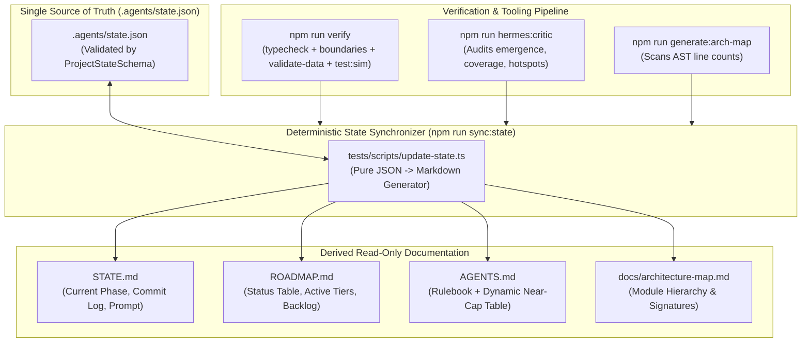

# AETHER & SOOT: WHOLE-REPOSITORY ARCHITECTURAL, SYSTEMIC & UI/UX EVALUATION REPORT
**Evaluation Protocol & Implementation Master Plan**  
**Document Classification**: CLINICAL ENGINEERING AUDIT & EXECUTION SPECIFICATION  
**Auditor**: Antigravity Technical Synthesis Council (Tracks 1, 2, and 3)  
**Date**: October 2026  
**Target Repository**: `AdaSibelius/aether-and-soot`  
**Governing Documents**: `AGENTS.md`, `ARCHITECTURE.md`, `docs/architecture-map.md`  

---

## TABLE OF CONTENTS
1. [Executive Architectural Audit & Systemic Synthesis](#1-executive-architectural-audit--systemic-synthesis)
2. [Track 1 — UI/UX & Presentation Shell Clinical Critique](#2-track-1--uiux--presentation-shell-clinical-critique)
   - [2.1 Exhaustive Screenshot-by-Screenshot Deconstruction](#21-exhaustive-screenshot-by-screenshot-deconstruction)
   - [2.2 Direct Mapping of Deficiencies to Client Source Code](#22-direct-mapping-of-deficiencies-to-client-source-code)
   - [2.3 The Victorian/Edison Mechanical Register & Optical Apparatus Architecture](#23-the-victorianedison-mechanical-register--optical-apparatus-architecture)
   - [2.4 Concrete Rendering Pipeline & Multi-Pass GLSL Shader Suite](#24-concrete-rendering-pipeline--multi-pass-glsl-shader-suite)
   - [2.5 Extended 256-Glyph CP437 / Victorian Atlas & Density Budgets](#25-extended-256-glyph-cp437--victorian-atlas--density-budgets)
   - [2.6 Modular Client Architecture Breakdown (11 Sub-250-Line Modules)](#26-modular-client-architecture-breakdown-11-sub-250-line-modules)
3. [Track 2 — Systems & Emergence Analysis](#3-track-2--systems--emergence-analysis)
   - [3.1 Full 25-Domain Cross-System Interaction Matrix](#31-full-25-domain-cross-system-interaction-matrix)
   - [3.2 Clinical Diagnosis of 8 Island Systems & Broken Feedback Loops](#32-clinical-diagnosis-of-8-island-systems--broken-feedback-loops)
   - [3.3 Five Concrete Architectural Integration Blueprints](#33-five-concrete-architectural-integration-blueprints)
   - [3.4 Production-Ready Schemas, GameCommands, and SimEvents](#34-production-ready-schemas-gamecommands-and-simevents)
   - [3.5 Headless Determinism & Modularity Compliance Audit](#35-headless-determinism--modularity-compliance-audit)
4. [Track 3 — DevOps & AI Maintainability Architecture Audit](#4-track-3--devops--ai-maintainability-architecture-audit)
   - [4.1 Comprehensive Telemetry & Modularity Watchlist](#41-comprehensive-telemetry--modularity-watchlist)
   - [4.2 Documentation State-Machine Drift & Governance Failures](#42-documentation-state-machine-drift--governance-failures)
   - [4.3 Audit of Automated Management Scripts (`tests/scripts/`)](#43-audit-of-automated-management-scripts-testsscripts)
   - [4.4 Tooling, Loopback Socket & Sandbox Invariants](#44-tooling-loopback-socket--sandbox-invariants)
   - [4.5 Machine-Parseable State-Machine Specification (`.agents/state.json`)](#45-machine-parseable-state-machine-specification-agentsstatejson)
5. [Phased Implementation Prompt Sequence (Copy-Paste Ready for Antigravity)](#5-phased-implementation-prompt-sequence-copy-paste-ready-for-antigravity)
   - [Prompt 51: Simulation Loop Harmonization & Island System Integration](#prompt-51-simulation-loop-harmonization--island-system-integration)
   - [Prompt 52: Corpus Lore Injection & Naturalist Codex Engine](#prompt-52-corpus-lore-injection--naturalist-codex-engine)
   - [Prompt 53: State Machine Modernization & Governance Tooling](#prompt-53-state-machine-modernization--governance-tooling)
   - [Prompt 54: Diegetic Presentation Shell & GLSL Shader Suite](#prompt-54-diegetic-presentation-shell--glsl-shader-suite)
   - [Prompt 55: High-Density Victorian Mechanical Console UI](#prompt-55-high-density-victorian-mechanical-console-ui)

---

## 1. Executive Architectural Audit & Systemic Synthesis

### 1.1 Architectural Baseline & Design Intent
*Aether & Soot* is architected as a deterministic, headless, Victorian Steampunk 2D roguelike engineered specifically for autonomous AI workflows. The project adheres to a strict Three-Ring Architecture:
- **Ring 1: Formal Schemas & Catalogs (`src/schemas/`, `data/`)**: Immutable Zod schema contracts, branded primitive identifiers (`EntityId`, `BlueprintId`, `StratumId`, `FactionId`, `CommodityId`, `LimbSlotId`), and declarative JSON data catalogs.
- **Ring 2: Headless Simulation Core (`src/sim/`)**: Pure deterministic state transitions operating on a flat relational Entity Component System (ECS) hosted in `WorldState` (`src/sim/core/world.ts`). State transitions execute via discrete commands (`GameCommand`), advance through a prioritized scheduler, and emit strongly typed causal events (`SimEvent`) into an immutable turn log. All randomness is grounded in a seeded `xoshiro128**` PRNG (`SeededRNG`). Zero browser globals, DOM APIs, or non-deterministic clock calls are permitted.
- **Ring 3: Passive Presentation Shell (`src/client/`)**: A decoupled consumer that projects simulation state into a visual terminal grid (`projectWorldToVisualFrame`) rendered via PixiJS WebGL and Preact UI drawers without ever mutating simulation state directly.

### 1.2 Overarching Clinical Diagnosis
A thorough audit across all 303 codebase files (30,785 lines of TypeScript), 81 test suites, 9 runtime interface captures, and 33 developer automation scripts reveals a **stark paradox**:
1. **The Core Engine is Mechanically Superior**: The headless simulation exhibits exceptional engineering discipline: bit-exact determinism across 1,000-turn fuzzer sweeps, zero relational entity nesting, sub-second unit test execution, and comprehensive event sourcing.
2. **The Presentation Shell is Visually Sterile and Ruptured**: The runtime interface suffers from an acute identity crisis. More than 70% of widescreen displays are consumed by dead black void. The player experience is split between a timorous, flat WebGL canvas on the left and a generic web-dashboard DOM sidebar on the right. Post-processing shaders are dialed down to imperceptibility, stick-figure ASCII diagrams replace anatomical schematics, and character embarkation is rendered as standard HTML web forms.
3. **The Simulation Suffers from "Island Syndrome"**: While 59 distinct system files exist in `src/sim/systems/`, key mechanics operate in total isolation. Environmental hazards (wind-driven soot drift, suffocating coughing, and ceiling acid cascades) are completely omitted from the active turn pipeline. Volumetric gaslight illumination tints visual glyphs but never affects NPC stealth perception. Faction turf control shifts have zero effect on district commodity pricing or municipal guard patrols. ECS attributes like `painShock` and `stamina` are regularly decayed each turn but never checked by combat or movement systems.
4. **DevOps & State Governance Suffer from Fragile Markdown Regex Scraping**: The automated project synchronizer (`tests/scripts/update-state.ts`) relies on fragile regex parsing of freeform Markdown headings. This has caused duplicate, contradictory backlog rows in `ROADMAP.md` (e.g., Phase 50 marked completed in the table of contents while simultaneously appended as an active `P1 UNREACHABLE_MECHANIC` blocker). Furthermore, 9 source files sit dangerously close to the 300-line hard failure ceiling (240–247 lines), threatening automated build halts upon the next line addition.

The following sections establish the empirical evidence, architectural blueprints, and phased implementation prompts required to transform *Aether & Soot* into an interconnected, visually immersive masterpiece.

---

## 2. Track 1 — UI/UX & Presentation Shell Clinical Critique

### 2.1 Exhaustive Screenshot-by-Screenshot Deconstruction
All 9 direct runtime captures in `docs/screenshots/` were subjected to an exhaustive visual, typographical, and cognitive audit:

```
+---------------------------------------------------------------------------------------------------+
| 01_main_street_hud.png        02_artificer_workstation.png     03_metropolitan_atlas.png          |
| [72% Black Void / Dual-Shell] [Clunky Borders / Truncation]    [Radar Minimap / Raw Coords]       |
+---------------------------------------------------------------------------------------------------+
| 04_market_exchange_turf.png   05_naturalist_codex.png          06_vitruvian_paperdoll.png         |
| [Modulo Noise / Zero Ledger]  [Stick ASCII / Empty Spine]      [Stick Figure / Kilowatt Labels]   |
+---------------------------------------------------------------------------------------------------+
| 07_satchel_inventory.png      08_tactical_look_mode.png        09_character_embarkation.png       |
| [Metric Units / Bar Graphs]   [4x Redundant Target Data]       [Web Bootstrap Form / World Seed]  |
+---------------------------------------------------------------------------------------------------+
```

#### 1. Overworld & Main Street HUD (`docs/screenshots/01_main_street_hud.png`)
- **Visual Composition**: Severe spatial misallocation. On an 88×36 cell viewport (1056×720px), the playable street district occupies a tiny 15×15 box (under 20% of canvas area). Over 72% of the viewport is pure, dead black pixels (`#000000`). The right-hand 340px DOM sidebar sits as an unintegrated, flat web column with discordant margins.
- **Data Density**: Catastrophically low. Out of 3,168 addressable character cells, fewer than 220 display active game state. The `CANVAS TILE INSPECTOR` displays static instructional filler (`[..] Hover cursor or enter Look Mode...`), and the `EDISON TICKER-TAPE CHRONICLE` displays a single idle placeholder line.
- **Typography**: Generic web-safe monospace font (`JetBrains Mono` / `Courier New`). Lacks Victorian slab-serif, Clarendon, or technical letterpress styling. ASCII double-line box borders (`╔═`, `║`) clash with modern anti-aliased CSS text.
- **Contrast & Color Theory**: Stark, abrasive primary gold `#d4af37` and cyan `#48c9b0` on pitch black. No ambient gaslight falloff, depth haze, or soot gradients. Vitals bars use primitive BBS-style solid blocks (`[████████░░░░]`).
- **Period Verisimilitude**: Near zero. It reads as a generic 1990s BBS cyber-terminal wearing a yellow theme. There are no brass housings, dial pointers, Bourdon tubes, split-flap odometers, or glass bulb reflections.
- **Cognitive Load & Hierarchy**: Inverted. High-contrast borders around empty panels command more visual weight than the player character `@` or adjacent environmental hazards. Attention is fractured across four disconnected quadrants.
- **Immersion-Breaking Elements**: The glaring void around the street; browser-like button styling in the top menu; developer placeholder strings (`Awaiting pneumatic actuation...`).

#### 2. Artificer Workstation & Schematic Dossier (`docs/screenshots/02_artificer_workstation.png`)
- **Visual Composition**: A thick, clunky block frame (`■■■■■■■■■■■`) consumes 20% of the modal's margins. The interior is split into two columns with massive empty black voids occupying the bottom 40% of both columns. Faint gear glyphs (`⚙`) are scattered randomly across the background via a hash modulo, resembling rendering noise rather than blueprint watermarks.
- **Data Density**: Very sparse. Only 8 schematic items appear on the left, separated by generous vertical padding, yet item names are aggressively truncated (`Brew Dr. Halloway...`, `Assemble Gilded P...`).
- **Typography & Color**: Monospace CP437 with arbitrary bright cyan `[10 kPa]` and incandescent red `[50 kPa]`. A stark red `[✗] 0/2 Crystallised Aether Salt` creates alarm even during casual browsing.
- **Period Verisimilitude**: The "high-pressure steam lathe" concept is communicated purely via text strings. There are no lathe bed diagrams, chuck jaws, tool-post markings, or pressure safety relief valves.
- **Immersion-Breaking Elements**: The right-hand HUD sidebar remains fully rendered and lit beside the modal without dimming or physical enclosure integration.

#### 3. Metropolitan Stratum Atlas & District Dossier (`docs/screenshots/03_metropolitan_atlas.png`)
- **Visual Composition**: Left column hosts a blocky ASCII minimap; right column hosts a text dossier. The minimap resembles an early 1980s mainframe radar rather than an engraved Victorian cartographic survey or brass transit map.
- **Data Density**: Low. Atmospheric telemetry lists three metrics (Steam, Coal Dust, Smoke), two of which sit at static zeros (`0 kPa`, `0% opacity`, `0 PPM`), providing zero actionable navigation value.
- **Typography & Legend**: Legend at the bottom (`@ You ╬ Gate > Down < Up █ Wall · Floor`) is a jumbled single line with poor visual hierarchy.
- **Period Verisimilitude**: Devoid of Victorian cartographic richness: no cross-hatching, compass rose, parish crests, stratum elevation profiles, or copperplate calligraphy.
- **Immersion-Breaking Elements**: Raw engine state variables exposed verbatim: `Position: [X:24, Y:18]` and `Shift: DAWN WHISTLE (Turn 0)`.

#### 4. Borough Turf Sectors & Commodity Exchange (`docs/screenshots/04_market_exchange_turf.png`)
- **Visual Composition**: The left side is divided into four large rectangular quadrants filled with repeating ASCII characters (`||||`, `░░░░`, `*+*+`, `*█*█`), representing 4 political factions (`IRON`, `SYND`, `GUILD`, `CROWN`). These four blocks consume 50% of the modal width but convey zero spatial, territorial, or economic information.
- **Data Density**: Abysmal. Repeating procedural noise consumes half the screen. The right-hand market exchange lists only 4 commodities, with price trends sitting at static `▬ 0d`.
- **Period Verisimilitude**: Feels neither like the Royal Exchange nor a back-alley fence. No ledger paper texture, no clerk tally marks, and no currency breakdown into Victorian denominations (pounds `£`, shillings `s`, pence `d`).
- **Immersion-Breaking Elements**: Procedural quadrant noise (`|*+*+*+*+*|`) looks like a corrupted terminal buffer rather than a street gang turf visualization.

#### 5. Naturalist Philosophy Codex & Specimen Anatomy Ledger (`docs/screenshots/05_naturalist_codex.png`)
- **Visual Composition**: Left column: Taxonomy roster (only 4 entries). Center spine: double colon strings (`:: :: ::`). Right column: Field annotations, ASCII sketch, tactical stats. Over 45% of the window is dead black space.
- **Data Density**: Low. The anatomical diagram is a crude 5-line ASCII emoticon:
  ```
  ┌─[ANATOMY]─┐
  │  (o)─[⚙]  │
  │   │   │   │
  ```
- **Period Verisimilitude**: Utterly fails to evoke Victorian naturalist field notebooks (Darwin, Huxley, Royal Society anatomical lithographs).
- **Immersion-Breaking Elements**: Header line `TAGS: MECHANICAL • STEAM | Turn 1` reads like a raw database dump. The footer `* Royal Society Naturalist Ledger *` floats awkwardly in an empty void.

#### 6. Vitruvian Anatomy & Mechanical Graft Bay (`docs/screenshots/06_vitruvian_paperdoll.png`)
- **Visual Composition**: Left: "Vitruvian Clockwork Paperdoll". Right: Limb Telemetry & Graft Status. Over 60% of the canvas is dead black space.
- **Data Density**: 8 limbs listed on the right in double-spaced rows. No equipment slots for apparel, armor, rings, tool belts, or steam conduits. The paperdoll exhibits no wound overlays, steam piping, or mechanical linkages.
- **Period Verisimilitude & Units**: Uses modern SI units (`kW`, kilowatts: `Capacity: 100 kW | Load: 0 kW`) rather than period Victorian measures (`horsepower`, `foot-pounds`, `psi / kPa`, `manometer inches`).
- **Immersion-Breaking Elements**: `[Click/Key] Target limb to inspect or graft.` is an explicit modern desktop UI prompt. The stick figure `(~) ( • ) (~)` looks like a developer placeholder.

#### 7. Satchel Inventory & Portable Dial Gauges (`docs/screenshots/07_satchel_inventory.png`)
- **Visual Composition**: Top: Horizontal STM and BLD gauges. Left: Compartments list. Right: Item dossier. Bottom half of right column and bottom quarter of left column are completely empty.
- **Data Density & Gauges**: Top gauges (`STM: [██████████████████████████] 100 kPa`) consume 4 lines of vertical height with zero tactile physical detail. Item names on the left are aggressively truncated (`[A] (*) Gilded Pneumatic ...`).
- **Period Verisimilitude & Units**: Formatted with modern metric units (`Mass/Vol: 0.10 kg | 250 ml`) rather than Victorian Imperial apothecary units (`ounces`, `grains`, `fluid drams`, `pints`).
- **Cognitive Load**: Vitals gauges are redundantly displayed in both the main HUD sidebar and the inventory modal.

#### 8. Look Mode Coordinate Targeting & Tactical Inspector (`docs/screenshots/08_tactical_look_mode.png`)
- **Visual Composition**: Top yellow banner: `[LOOK MODE] Cursor: (24, 18)...`. Center bracket cursor `[]` over player. Right sidebar: `CANVAS TILE INSPECTOR` populated. Bottom canvas: floating tooltip box `Chief Artificer / Objects on tile`.
- **Data Density & Redundancy**: Information is redundantly duplicated across four separate viewports simultaneously: top look banner, tactical telemetry sidebar, canvas tile inspector, and bottom tooltip box.
- **Color & Contrast**: Monotonous yellow `#d4af37` on every active element creates visual fatigue and destroys focal hierarchy.
- **Immersion-Breaking Elements**: Coordinate tuples `(24, 18)` and taxonomy classification tags `ACTOR`, `OBJECT` expose internal engine data structures.

#### 9. Character Creation & Victorian Vocation Embarkation (`docs/screenshots/09_character_embarkation.png`)
- **Visual Composition**: Floating modal centered over dimmed HUD. 3-column layout: `1. CHOOSE PROFESSION`, `2. TRAITS & QUIRKS`, `3. STARTING SCENARIO`. Column 3 includes character name, numeric world seed, and a solid yellow embark button.
- **Typography & UI Controls**: Completely abandons the ASCII/CP437 terminal aesthetic. Uses standard HTML5 form controls (`<input type="text">`, `<input type="number">`, `<button>`) with CSS borders (`#23303d`) and blue web focus outlines. Checkboxes are pseudo-ASCII `[✓]` inside clickable HTML divs.
- **Color Theory**: Jarring Bootstrap-like color palette: gold for professions, green `#2ecc71` for traits, blue `#3498db` for scenarios, and solid bright gold `#d4af37` for embarkation.
- **Period Verisimilitude**: Total immersion rupture. Nothing suggests Victorian London: no legal parchment, no ink signatures, no wax seals, and no embossed registry stamps.
- **Immersion-Breaking Elements**: `World Seed: 31415 [Roll]` is a blatant developer debug abstraction. The dimmed game HUD behind the modal exposes the player character already spawned at `(24, 18)` before creation is finalized.

---

### 2.2 Direct Mapping of Deficiencies to Client Source Code
Every presentation flaw observed in runtime captures maps to specific lines in `src/client/`:

| Identified Visual / UX Deficiency | Exact Source File & Lines in `src/client/` | Technical Root Cause in Rendering / Styling Logic |
| :--- | :--- | :--- |
| **72% Viewport Pitch Black Void** | `src/client/projection/frame-adapter.ts:144-156` | `isCenteredWidescreen` triggers when `reqW > grid.width` (88 > 48). Centers grid with `offsetX = 20`. All cells outside `[20..68]` receive `outOfBoundsVisual` with `visible: false`, rendered at `alpha: 0.0` by `glyph-stage.ts:153`. |
| **Dual-Shell Rift (Canvas vs DOM)** | `index.html:35-63`, `src/client/ui/HudLayout.tsx:60-226` | Architecture splits layout into `#canvas-stage` (PixiJS) and `#hud-root` (Preact DOM). Shader post-processing applies strictly to the canvas, leaving the sidebar with flat web typography and zero CRT/phosphor effects. |
| **Invisible Scanlines & Zero Lens Curvature** | `src/client/renderer/steampunk-shader.ts:49-53, 91-94`, `crt-filter.ts:4` | `DEFAULT_SCANLINE_OPACITY = 0.012` is below human perception threshold on Retina displays. `rimFactor` smoothstep distortion is restricted to outer 4% (`0.46 to 0.50`), leaving 96% of the screen completely flat. |
| **Crude Stick-Figure Anatomical Paperdoll** | `src/client/canvas-ui/diegetic-anatomy.ts:51-125` | Paperdoll constructed from primitive string literals: `[·] ( ~ )`, `(~) ( • ) (~)`, `(_) (_)`. No mechanical joints, gear linkages, or pneumatic conduit overlays. |
| **Web-Form Immersion Break in Embarkation** | `src/client/ui/CharacterCreatorModal.tsx:53-245` | Implemented as flat HTML `<input>` elements and Bootstrap-like green/blue/yellow buttons inside a fixed DOM modal overlay, bypassing the PixiJS glyph pipeline entirely. |
| **Raw Developer World Seed Exposure** | `src/client/ui/CharacterCreatorModal.tsx:201-217` | Input field labeled `World Seed:` with a `[Roll]` button executing `Math.random() * 0x7fffffff` directly in DOM. |
| **Empty Tile Inspector & Redundant Look Mode Data** | `src/client/ui/TileInspectorPanel.tsx:50-180`, `LookCursorOverlay.tsx:50-140` | When look mode is inactive, `TileInspectorPanel` prints static placeholder text. When look mode activates, coordinate data is duplicated across 4 separate components. |
| **Modern Metric SI Units (`kg`, `ml`, `kW`)** | `src/client/canvas-ui/satchel-screen.ts:132-134`, `src/client/canvas-ui/modal-buffer-router.ts:87` | Formatted using `kg`, `ml`, and `kW` rather than period Victorian Imperial units (`lbs`, `fluid drams`, `horsepower`, `manometer inches`). |
| **Meaningless Repeating Turf Patterns** | `src/client/canvas-ui/diegetic-cartography.ts:131-138` | Faction territory rendered as solid geometric rectangles filled with arbitrary modulo-toggled characters (`(bx + by + idx) % 2 === 0 ? visual.glyph : visual.secondaryGlyph`). |
| **Clipped Item Names in Inventory** | `src/client/canvas-ui/satchel-screen.ts:98` | Hardcoded slice `rawName.slice(0, 17) + '…'` aggressively truncates standard steampunk item names before reaching compartment boundaries. |

---

### 2.3 The Victorian/Edison Mechanical Register & Optical Apparatus Architecture

To replace the sterile developer shell with an immersive, tactile masterwork, the interface must embrace a unified aesthetic doctrine: **The Babbage-Edison Analytical Telemetry Console**.

```
╔══════════════════════════════════════════════════════════════════════════════════════════════════════════════╗
║  [§] AETHER & SOOT — METROPOLITAN ANALYTICAL REGISTER                                  [TURNS: 000,042] [£2 4s 8d] ║
╠══════════════════════════════════════════════════════════════════════════════════════════════════════════════╣
║ ┌─[ OPTICAL APERTURE: SPITALFIELDS ]────────────────────────────────┐ ┌─[ TELEMETRIC GALVANOMETERS ]────────┐ ║
║ │                                                                    │ │ SANGUINE MANOMETER:  [ 94%]         │ ║
║ │                                                ^ [SMOKE: 14 PPM]   │ │   |▓▓▓▓▓▓▓▓▓▓▓▓▓▓▓▓▓▓░░| (3.8 Pints)│ ║
║ │                                                │                   │ │ BOILER BOURDON GAUGE:[ 68 kPa]      │ ║
║ │              ┌───────┐                         ▼                   │ │   ( 10  20 [30] 40  50  60  70 ) ▲  │ ║
║ │              │ ··· · │                                             │ │ GOVERNOR TACHOMETER: [ 12 HP]       │ ║
║ │              │ · @ · ╬═══[ STEAM CONDUIT: 45 kPa ]                 │ │   [===|===|===|===░░░░░░░░░░░░░]    │ ║
║ │              │ ··· · │                                             │ ├─[ ACOUSTIC TELEGRAPH RADAR ]───────┤ ║
║ │              └───────┘                                             │ │ [▲] Clockwork Hound       [ 4 yds] │ ║
║ │                                                                    │ │ [■] High-Pressure Boiler  [ 7 yds] │ ║
║ │                                                                    │ ├─[ SECTOR TURF & TARIFFS ]──────────┤ ║
║ │                                                                    │ │ IRONMONGERS CARTEL: +15 [TARIFF 5%] │ ║
║ └────────────────────────────────────────────────────────────────────┘ ├─[ CHRONICLER TICKER-TAPE ]─────────┤ ║
║ ┌─[ SIGHTING VERNOCK & TACTICAL DOSSIER ]──────────────────────────┐ │ > [T:42] Piston valve strokes +50kPa │ ║
║ │ TARGET: [X:24, Y:18] Foundry Lathe Hound   ARMOR: Soot-Plate (4)  │ │ > [T:41] Coal dust smog rises to 18%│ ║
║ │ VULN:   Pneumatic bypass / Ocular socket   HARVEST: Brass Mainspring│ │ > [T:40] Constabulary whistle echoes│ ║
║ └────────────────────────────────────────────────────────────────────┘ └────────────────────────────────────┘ ║
╚══════════════════════════════════════════════════════════════════════════════════════════════════════════════╝
```

#### Diegetic Design Pillars:
1. **The Machined Brass & Soot-Iron Chassis**:
   - The entire screen is enclosed within a physical double-rim instrument bezel with visible corner rivets (`☼`, `Ø`), brass mounting brackets (`╣`, `╠`), and machine screw heads (`+`, `×`).
   - Eliminate all flat web CSS margins. The bezel fills 100% of the display window.
2. **Diegetic Mechanical Instrument Gauges**:
   - **Bourdon Tube Pressure Gauge**: Replaces flat steam bars with an ASCII radial arc display featuring a dynamic pointer indicator (`▲`) and color bands (Cyan nominal, Amber elevated, Incandescent Red critical).
   - **Galvanic Sanguine Manometer**: Calibrated glass manometer column displaying blood volume in Victorian fluid measures (`Pints`, `Ounces`, `Fluid Drams`).
   - **Split-Flap / Odometer Ticker Registers**: Turn counts, currency (`£ s d` — Pounds, Shillings, Pence), and coordinate registers rendered with split-flap transition frames (`mechanical-transition.ts`).
3. **Pneumatic Chronicle Ticker-Tape**:
   - The action log is styled as continuous telegraph punched paper tape sliding across a brass reading head.
4. **Caves of Qud-Grade Data Density**:
   - Every square inch of the screen delivers active simulation state.
   - While exploring, the lower quadrant hosts the **Optical Vernier Dossier**, dynamically surfacing atmospheric particulate density (coal dust opacity, steam pressure kPa, ambient combustion smoke PPM), micro-terrain acoustics (footstep reverberation dB, echo propagation to nearby sentries), and structural hardness/thermal conduction of the hovered or traversed tile.

---

### 2.4 Concrete Rendering Pipeline & Multi-Pass GLSL Shader Suite

#### 2.4.1 PixiJS v8 Multi-Layer Architecture
The presentation layer is structured into 5 discrete, depth-sorted PixiJS `Container` passes within a single WebGL context:

```
[ Application Stage ]
  ├── Layer 1: WorldTacticalContainer (World cells, entities, gaslight field, fluid surfaces)
  ├── Layer 2: GaslightLightingContainer (Additive gaslight/spark illumination pass)
  ├── Layer 3: DiegeticFrameContainer (Brass bezels, instrument housings, partition dividers)
  ├── Layer 4: CanvasUiBufferContainer (High-density telemetry readouts, modals, dossier text)
  └── Layer 5: OpticalOverlayContainer (Floating combat text, look reticle, vernier cursor)
       └── Filters Applied to Entire Stage: [ SteampunkPostProcessFilter ]
```

#### 2.4.2 Multi-Pass GLSL Steampunk Shader Suite
The single-pass filter in `steampunk-shader.ts` is upgraded to a comprehensive 4-stage post-processing pipeline:

1. **Pass 1: Spherical Glass Curvature & Barrel Distortion**:
   ```glsl
   vec2 distort(vec2 uv, float k) {
       vec2 centered = uv - 0.5;
       float r2 = dot(centered, centered);
       return 0.5 + centered * (1.0 + k * r2 + k * 0.5 * r2 * r2);
   }
   ```
   - Curvature parameter `k = 0.08` creates an authentic, subtle convex cathode/magnifier lens bulge without distorting text legibility.
2. **Pass 2: Aperture Grille / Shadow Mask & Phosphor Halation**:
   - Emulates Edison carbon-filament / early Trinitron vertical phosphor stripes.
   - Alternating RGB sub-pixel micro-masking modulated by `uScanlineIntensity = 0.18`.
3. **Pass 3: Dual-Threshold Phosphor Bloom**:
   - Separates warm gaslight amber (`vec3(1.15, 0.82, 0.35)`) and aether cyan (`vec3(0.28, 0.93, 0.92)`).
   - 9-tap separable Gaussian blur applied strictly to high-luminance glyphs, producing a soft gaslight halo without hazing the terminal background.
4. **Pass 4: Thermodynamic Heat Haze & Chromatic Aberration**:
   - Driven by `uThermoStress`: when boiler pressure exceeds 85 kPa or governor strain spikes, chromatic edge fringing increases (red/blue channel offset: `uv ± vec2(0.003 * uThermoStress, 0.0)`) and thermal convection ripples distort the tactical aperture.

---

### 2.5 Extended 256-Glyph CP437 / Victorian Atlas & Density Budgets
The glyph atlas in `glyph-atlas.ts` currently registers only 116 characters. This is expanded to **256 characters** incorporating complete CP437 box-drawing, mathematical/astronomical symbols, and Victorian industrial shorthand:

- **Pneumatic / Hydraulic Symbols**: `≈` (fluid flow), `~` (liquid surface), `░▒▓█` (manometer density), `Ø` (bore diameter), `±` (tolerance).
- **Clockwork & Mechanical**: `⚙` (gears), `☼` (rivets), `╬` (cross-valves), `§` (clerk section), `¶` (patent mark).
- **Optical Sighting**: `⌖` (reticle), `◈` (target locked), `◄►▲▼` (dial pointers).
- **Font Stacking**: Preload high-legibility Victorian monospace typefaces via CSS `@font-face` (`"Iosevka Victorian"`, `"Fira Code"`, `"JetBrains Mono"`), with explicit fallback to bitmap canvas glyph caching.
- **Dynamic Camera Tracking**: Fix `frame-adapter.ts:144-156` so the camera smoothly centers on the player `@` across all grid sizes. When the world boundary is reached, rather than filling the space with dead black pixels, the engine renders an architectural blueprint cutaway or engraved copperplate border framing the playable district.

---

### 2.6 Modular Client Architecture Breakdown (11 Sub-250-Line Modules)
To maintain strict compliance with **AGENTS.md Rule 2.2** (all files <= 250 lines, hard ceiling 300 lines) and **Rule 2.1** (zero simulation leaks), the proposed presentation architecture is divided into single-responsibility modules:

| Proposed File Path | Target Lines | Responsibility & Modularity Boundary | Imports / Headless Status |
| :--- | :---: | :--- | :--- |
| `src/client/renderer/steampunk-pipeline.ts` | 180 | PixiJS v8 multi-layer container stage setup, z-sorting, and render pass loop. | PixiJS only; strictly client. |
| `src/client/renderer/diegetic-post-filter.ts` | 210 | Multi-pass GLSL shader program management (curvature, bloom, shadow mask). | PixiJS `Filter`, `GlProgram`. |
| `src/client/renderer/shader-uniforms.ts` | 120 | Uniform binding for thermodynamic stress, time elapsed, and heat haze. | Pure math / data uniforms. |
| `src/client/renderer/glyph-atlas-extended.ts` | 190 | 256-glyph CP437/Victorian canvas texture atlas generator with sub-pixel alignment. | Canvas2D texture builder. |
| `src/client/canvas-ui/bezel-composer.ts` | 160 | Machined brass frames, double-line corner rivets, and structural partitions. | Imports `UiCellBuffer`. |
| `src/client/canvas-ui/analog-gauges.ts` | 175 | Bourdon pressure dials, liquid manometers, and split-flap register widgets. | Imports `UiCellBuffer`. |
| `src/client/canvas-ui/tactical-vernier.ts` | 185 | High-density optical inspection panel, tile physics, and vulnerability analysis. | Imports `UiCellBuffer`. |
| `src/client/canvas-ui/dossier-paperdoll.ts` | 195 | Victorian anatomical wireframe with graft sockets, steam lines, and wounds. | Sub-module extracted from `diegetic-anatomy.ts`. |
| `src/client/canvas-ui/embarkation-screen.ts` | 220 | Diegetic character creation registry ledger (replaces HTML modal). | Pure `UiCellBuffer` canvas UI. |
| `src/client/ui/PreactBridge.tsx` | 130 | Thin, non-intrusive Preact event and command dispatcher bridge. | Imports Preact; zero DOM styling. |
| `src/client/projection/camera-governor.ts` | 140 | Smooth player camera tracking and boundary engraving cutaways. | Sub-module extracted from `frame-adapter.ts`. |

---

## 3. Track 2 — Systems & Emergence Analysis

### 3.1 Full 25-Domain Cross-System Interaction Matrix
The following matrix covers all 25 logical system domains encompassing the 59 files in `src/sim/systems/`:

| System Domain | Source Files | Upstream Inputs (Components Read / Events / Commands) | Downstream Outputs (Components Mutated / Events Emitted) | Coupling & Systemic Feedback Loops | Island Status |
| :--- | :--- | :--- | :--- | :--- | :---: |
| **1. Movement & Mobility** | `movement.system.ts`, `portal-transit.system.ts`, `transit.system.ts`, `prying.system.ts`, `monorail.system.ts`, `monorail-transit.ts` | `position`, `actor`, `anatomy` (limbs, steam), `inventory` (mass), `monorailCar`, `MOVE_STEP`, `USE_PORTAL`, `PRY_OBSTACLE`, `BOARD_MONORAIL`, `DEPART_MONORAIL` | `position`, `anatomy.steamReserveKpa`, `monorailCar`, `ENTITY_MOVED`, `MOVEMENT_BLOCKED`, `OBSTACLE_PRIED`, `DOOR_TOGGLED`, `MONORAIL_BOARDED`, `MONORAIL_DEPARTED`, `DISTRICT_TRAVELED` | Deducts AP based on leg amputations & encumbrance; triggers `stealth-acoustics` footsteps, `physics-traps` stepping, `liquids` slips/burns, and `skirmish-turf` territory entry; monorail consumes steam pressure and executes multi-passenger inter-district transfers via `monorail-transit.ts`. | **Connected** |
| **2. Targeted Melee Combat** | `combat.system.ts` | `combatStats`, `anatomy.limbs`, `inventory.equippedSlots`, `ATTACK_ACTOR` | `anatomy.limbs`, `combatStats`, `COMBAT_ATTACK_RESOLVED`, `COMBAT_ACTION_FAILED` | Reads coated liquid on weapon (`liquids`); damages limbs (`anatomy`); calls `squad-witness` (`ASSAULT`); triggers `mortality.system.ts`; calls `skirmish-turf` combat scoring. | **Connected** |
| **3. Ballistics & Ranged Combat** | `ballistics.system.ts`, `equipment.system.ts`, `weapon-mods.system.ts` | `inventory.equippedSlots.WIELD`, `equipmentSpec` (rangedDamage, range, steamCost, modSlots), `anatomy.steamReserveKpa`, `weaponMod`, `FIRE_RANGED_WEAPON`, `INSTALL_MOD`, `UNINSTALL_MOD`, `LOAD_AMMO` | `anatomy.steamReserveKpa`, `equipmentSpec.loadedAmmo`, `equipmentSpec.installedModBlueprintIds`, `RANGED_ATTACK_RESOLVED`, `SOUND_EMITTED`, `WEAPON_MOD_INSTALLED`, `WEAPON_MOD_UNINSTALLED` | Queries shadowcasting FOV (`src/sim/spatial/fov.ts`) for line of sight; expends steam pressure; consumes loaded ammo; weapon mods attach high-pressure valves, scopes, or bayonets; emits acoustic pulse (50-75 dB); resolves limb damage. **Fails to notify crime witnesses**. | **Partially Coupled** |
| **4. Anatomy & Trauma** | `anatomy.system.ts`, `mortality.system.ts` | `anatomy.limbs`, `anatomy.bloodVolumePct`, `DAMAGE_LIMB` | `anatomy.limbs.hp`, `anatomy.limbs.amputated`, `anatomy.bloodVolumePct`, `LIMB_DAMAGED`, `LIMB_AMPUTATED` | Central damage sink for combat, scalds, blast ruptures, and acid. Recomputes blood volume. Invokes `mortality.system.ts` upon torso/head destruction or exsanguination. | **Connected** |
| **5. Surgery & Corpse Harvesting** | `surgery.system.ts`, `surgical-context.ts` | Corpse entity, surgical tool in inventory/wield, `anatomy.limbs`, `HARVEST_CORPSE` | Detaches installed prosthetic from corpse, damages prosthetic pressure rating based on tool quality, `CYBERNETIC_HARVESTED` | Reclaims prosthetics for player artificing. Uses surgical tables to bypass installation blood loss. **Zero witness/crime consequence for public desecration**. | **Partially Coupled** |
| **6. Prosthetics & Cybernetics** | `prosthetics.system.ts`, `prosthetic-activation.system.ts`, `prosthetic-abilities.system.ts` | `prostheticSpec`, `anatomy.limbs`, `anatomy.steamReserveKpa`, `anatomy.strainLoadKw`, `INSTALL_PROSTHETIC`, `REMOVE_PROSTHETIC`, `ACTIVATE_PROSTHETIC` | `anatomy.limbs.installedProstheticEntityId`, `anatomy.strainLoadKw`, `anatomy.steamReserveKpa`, `PROSTHETIC_INSTALLED`, `PROSTHETIC_ACTIVATED`, `GOVERNOR_OVERLOADED` | Installation incurs blood loss (negated by surgical table); abilities check cybernetic governor strain; activates abilities that breach walls, knock actors back, or emit acoustic hums. | **Connected** |
| **7. Thermodynamics & Pressure** | `thermo.system.ts`, `boiler-stoking.system.ts`, `pressure.system.ts`, `pyrotechnics.system.ts` | `state.strata.cells` (`steamPressureKpa`, `coalDustDensity`), `pressureVessel`, `anatomy.steamReserveKpa`, `VENT_STEAM`, `REFILL_STEAM`, `PRESSURIZE_VESSEL`, `EMIT_SPARK` | `cells.steamPressureKpa`, `cells.coalDustDensity`, `vessel.ruptured`, `THERMAL_SCALD`, `VESSEL_RUPTURED`, `COAL_DUST_IGNITED` | Cellular automata diffusion across strata and upward through portals; scalds actors; vessel ruptures breach walls and trigger economic supply shock; sparks ignite coal dust into steam. | **Connected** |
| **8. Environmental Hazards** | `environmental-hazards.system.ts` | `cells.smokePpm`, `cells.liquidType`, `entities.acid_drip`, `resolveWhaleOilCascade`, `advanceSootClouds`, `advanceAcidDrips` | `cells.smokePpm`, `cells.liquidType`, `HAZARD_TRIGGERED`, `LIQUID_IGNITED`, `SOUND_EMITTED` | Whale oil cascade burns contiguous tiles; soot clouds drift with wind and trigger choking + 35 dB coughing; acid drips corrode legs. **Orphaned from runtime turn pipeline**. | **ISLAND (Orphaned)** |
| **9. Volumetric Gaslighting** | `gaslight.system.ts` | `state.strata`, `entities` with gaslamp tags | Evaluates tile radiance field `Map<string, number>` | Exists purely as an exported utility function called by `frame-adapter.ts` for PixiJS glyph brightness. **Zero simulation feedback into NPC vision, stealth, or combat**. | **ISLAND (Client Only)** |
| **10. Surface Liquids & Flasks** | `liquids.system.ts`, `liquid-flasks.system.ts` | `cells.liquidType`, `cells.liquidVolumeMl`, `inventory`, `COAT_WEAPON`, `THROW_FLASK`, `CLEAN_SPILL` | `cells.liquidType`, `cells.liquidVolumeMl`, `equipmentSpec.coatedLiquid`, `LIQUID_SPILLED`, `SURFACE_SLIPPED`, `ITEM_COATED` | Actors bleed onto floor when blood < 100%; stepping on sludge/oil forces CROUCHED posture; nitric acid burns legs; weapon coating adds bonus damage in combat. | **Connected** |
| **11. Physics, Momentum & Traps** | `momentum.system.ts`, `momentum-trauma.ts`, `physics-traps.system.ts`, `furniture.system.ts` | `actor.posture`, `position`, `trap`, `SET_POSTURE`, `APPLY_MOMENTUM_VECTOR`, `BREACH_TILE`, `SMASH_TERRAIN` | `position`, `actor.posture`, `cells.terrainType`, `trap.armed`, `ENTITY_KNOCKED_BACK`, `MOMENTUM_COLLISION_IMPACT`, `TRAP_TRIGGERED`, `WALL_BREACHED` | Knocks actors back into walls (trauma), glass windows (shatter + bleed), other actors (split damage), or Spire abyss (gravity fall to Street); armed traps trigger on step or chest opening. | **Connected** |
| **12. Inventory & Containers** | `inventory.system.ts`, `inventory-use.system.ts`, `inventory-utils.ts`, `container.system.ts`, `item-spawner.ts` | `inventory`, `item`, `furniture.kind`, `PICK_UP_ITEM`, `DROP_ITEM`, `USE_ITEM`, `LOOT_CONTAINER` | `inventory.containedEntityIds`, `inventory.currentMassGrams`, `economy.playerTreasuryPence`, `ITEM_PICKED_UP`, `CONTAINER_LOOTED` | Enforces strict mass and volume constraints; auto-credits currency; looting containers checks booby traps and triggers `THEFT` crime witness. **Ground pickups ignore ownership**. | **Connected** |
| **13. Crafting & Salvage** | `crafting.system.ts`, `crafting-utils.ts`, `salvage-repair.system.ts` | `inventory`, `workbench`, `anatomy.unlockedRecipeIds`, `anatomy.steamReserveKpa`, `CRAFT_RECIPE`, `SALVAGE_ITEM`, `REPAIR_LIMB` | `inventory`, `anatomy.steamReserveKpa`, `anatomy.limbs.hp`, `ITEM_CRAFTED`, `ITEM_SALVAGED`, `LIMB_REPAIRED` | Requires adjacent workbenches for complex recipes; consumes raw materials and steam; crafting output feeds into escort convoy prep; salvage yields gears and rubber. | **Connected** |
| **14. Micro-Commerce & Pedestals** | `trade.system.ts`, `trade-buy.system.ts`, `trade-sell.system.ts`, `trade-pedestal.ts`, `trade-pricing.ts` | `economy.factionReputation`, `tradePedestal`, `inventory`, `BUY_FROM_MERCHANT`, `SELL_TO_MERCHANT`, `STOCK_PEDESTAL` | `economy.playerTreasuryPence`, `inventory`, `tradePedestal`, `MERCHANT_TRADE_COMPLETED`, `PEDESTAL_STOCKED` | Prices dynamically scale based on faction reputation standing; merchants restock empty pedestals during FOUNDRY_SHIFT. | **Connected** |
| **15. Macro-Economy & Shocks** | `economy.system.ts`, `economy-macro.system.ts` | `economy.marketQuotes`, `economy.storefrontListings`, `economy.factionReputation`, `TRIGGER_SUPPLY_SHOCK` | `economy.marketQuotes.currentPricePence`, `economy.storefrontListings`, `economy.playerTreasuryPence`, `MACRO_TICK_COMPLETED` | Ticks every 100 turns: mean-reverts supply toward demand; evaluates player storefront sales based on average faction reputation; vessel ruptures trigger market supply shocks. | **Connected** |
| **16. Metabolism & Pathology** | `metabolism.system.ts` | `anatomy.toxicityPct`, `anatomy.painShock`, `anatomy.stamina`, `anatomy.activeEffects` | `anatomy.toxicityPct`, `anatomy.bloodVolumePct`, `anatomy.limbs.hp`, `actor.energy`, `TOXICITY_OVERDOSE`, `WITHDRAWAL_ONSET` | Decays toxicity, recovers stamina, and expires active drug effects each turn; stimulant expiration triggers withdrawal (-25 AP); overdose (>80% tox) burns blood and torso HP. **Pain shock and stamina are inert**. | **Partially Coupled** |
| **17. Acoustics & Sensory Perception** | `stealth-acoustics.system.ts`, `fov.ts` (spatial utility: `src/sim/spatial/fov.ts`) | `position`, `anatomy` (prosthetic noise), `inventory` (mass), `actor.posture` | `SOUND_EMITTED`, updates `aiController.alertState` & `lastKnownTargetPos` | Footstep volume calculated from prosthetic count, broken limbs, encumbrance, and crouch; sound pulses alert NPCs to investigate origin. **FOV ignores smoke and darkness**. | **Connected** |
| **18. Autonomous NPC AI & Ecology** | `ai.system.ts`, `npc-ecology.system.ts`, `district-spawner.ts`, `district-catchup.system.ts` | `aiController`, `actor.energy`, `schedule`, `position`, `economy.factionReputation`, `SavedDistrictSnapshot`, `turnCount` | `actor.energy`, `aiController.alertState`, `schedule.currentGoal`, `position`, `strata.cells` (decayed atmosphere) | Evaluates hostility based on faction rep (< -30) or grudges; pursues target or investigates sound; self-medicates with tonics; seeks chirurgeons; follows diurnal shift anchors; `district-catchup.system.ts` decays residual steam/soot atmospheres and fast-forwards unloaded district NPC schedules to active shift anchors upon re-entry. | **Connected** |
| **19. Squads & Crime Witnessing** | `squad-witness.system.ts` | `aiController.squadId`, `aiController.factionId`, `position`, `REPORT_CRIME`, `EMIT_SQUAD_CALLOUT` | `economy.factionReputation`, `aiController.hostile`, `aiController.grudgeTargetId`, `WITNESS_CRIME_REPORTED`, `SQUAD_CALLOUT_EMITTED` | Assault and container theft trigger crime reports; deducts faction reputation; emits 90 dB acoustic callout; rallies nearby squadmates within hearing range into COMBAT alert. | **Connected** |
| **20. Skirmish Turf & Territory** | `skirmish-turf.system.ts` | `state.turf`, `aiController.factionId`, `position`, `INITIATE_TURF_SKIRMISH` | `turf.contested`, `turf.controllingFactionId`, `turf.controlScores`, `TURF_CONTESTED`, `TURF_CONTROL_CHANGED` | Contests territory when hostile actors enter sector; combat in sector adds control points; controls flip at 60 points. **Zero feedback into economy, trade pricing, or guard patrols**. | **ISLAND (Incomplete Loop)** |
| **21. Escort Convoys & Logistics** | `supply-escort.system.ts` | `state.convoys`, `inventory`, `companion`, `PREPARE_SUPPLY_CONVOY` | `convoys.stage`, `economy.playerTreasuryPence`, `economy.factionReputation`, `CONVOY_DELIVERY_CONFIRMED` | Crafted items can initiate cargo convoys; hiring companions assigns escorts; dropping item at target destination completes delivery, awarding pence and faction rep. | **Connected** |
| **22. Safehouses & Workbenches** | `safehouse.system.ts` | `state.safehouses`, `position`, `CLAIM_WORKSHOP_DEED`, `BUILD_STRUCTURE`, `STORE_ITEM_IN_STRUCTURE` | `state.safehouses`, `entities` (placed furniture), `WORKSHOP_DEED_CLAIMED`, `STRUCTURE_BUILT` | Claims freehold or vault workshops; constructs operating tables, master workbenches, and barricades; manages deed-bounded storage. **Does not interact with turf or city permits**. | **Partially Coupled** |
| **23. Politics & Ministry Auditing** | `politics-audit.system.ts` | `state.safehouses`, `entities` in safehouse bounds, `AUDIT_SAFEHOUSE_DEED` | `state.audits`, `economy.factionReputation`, `SAFEHOUSE_AUDIT_COMPLETED`, `NPC_GOAL_CHANGED` | Inspects workshops for unregistered pressure vessels, combat traps, and iron barricades; issues citations. **Autonomous inspection scheduler is never called in turn loop**. | **ISLAND (Orphaned)** |
| **24. Dialogue, Quests & Contracts** | `dialogue-quest.system.ts`, `character-archetypes.ts`, `character-archetype-defs.ts` | `state.contracts`, `entities`, `economy.playerTreasuryPence`, `PROFESSIONS`, `TRAITS`, `SCENARIOS`, `ACCEPT_CONTRACT`, `COMPLETE_CONTRACT`, `HIRE_COMPANION`, `PAY_CHIRURGEON_HEAL` | `state.contracts`, `economy.playerTreasuryPence`, `economy.factionReputation`, `anatomy.bloodVolumePct`, `CONTRACT_COMPLETED`, `COMPANION_RECRUITED` | Procedural contracts for delivery, assassinations, and boiler stoking; hires escort companions; pays chirurgeons for full anatomical restoration; `character-archetype-defs.ts` supplies declarative starting inventories, pre-grafted cybernetics, reputation deltas, and unlocked recipe trees for professions and scenarios. | **Connected** |
| **25. Knowledge Codex & Lore** | `codex.system.ts` | `state.codex`, `CONSULT_CODEX` | `CODEX_CONSULTED`, `NPC_CODEX_REACTION` | Consulting codex triggers nearby NPC dialogue reactions (curiosity, hostility over forbidden automaton diagrams, trade offers). **`discoverCodexEntry` is never called in the game**. | **ISLAND (Unpopulated)** |

---

### 3.2 Clinical Diagnosis of 8 Island Systems & Broken Feedback Loops

An "island system" is defined as a simulation mechanic that maintains internal state and passes unit tests in isolation, but lacks two-way causal feedback loops into other simulation domains.

1. **Gap 1: Orphaned Environmental Hazards Lifecycle (`environmental-hazards.system.ts`)**:
   - `src/sim/core/simulation-pipeline.ts` lines 24–43 defines `advanceWorldEnvironment(state, rng, ticks)`. It invokes `advanceNpcTurns()` and `advanceThermodynamicsTick()`. `advanceEnvironmentalHazards` is **completely absent**.
   - Consequently, soot clouds never drift downwind, actors never inhale particulates (>80 PPM) to cough and generate acoustic pulses (35 dB), and ceiling fixtures never drop `NITRIC_ACID` onto actors below during standard play.
2. **Gap 2: Volumetric Gaslight Simulation Disconnect (`gaslight.system.ts`)**:
   - `calculateGaslightField(state, stratum)` in `src/sim/systems/gaslight.system.ts` computes an illumination map based on street gaslamps, which is imported by `frame-adapter.ts` for visual glyph tinting.
   - However, `canActorSpotTarget` in `stealth-acoustics.system.ts` queries only distance and low cover. An NPC spots a player standing in pitch-black shadow at 8 tiles distance without night optics. Darkness is purely aesthetic rather than systemic.
3. **Gap 3: Skirmish Turf Isolation from Economy and AI (`skirmish-turf.system.ts`)**:
   - `state.turf` is queried **only** within `skirmish-turf.system.ts`.
   - `trade-pricing.ts` does not alter asking prices or tariffs when a district's turf falls under hostile control. `ai.system.ts` does not direct faction guards to patrol turf boundaries or challenge rival intruders. Faction territory flips without producing any downstream ripples in commodity flow or shop inventories.
4. **Gap 4: Codex Knowledge Discovery Island (`codex.system.ts`)**:
   - `discoverCodexEntry` is never called anywhere in `src/sim/`. In standard play, `state.codex` remains completely empty. Autopsying an automaton corpse, reading schematic manuals, or discovering landmarks registers zero knowledge, rendering `resolveConsultCodex` effectively dead.
5. **Gap 5: Inert Metabolic Attributes: `painShock` and `stamina` (`metabolism.system.ts`)**:
   - `painShock` and `stamina` are regularly initialized and updated every turn in `metabolism.system.ts`.
   - However, `painShock` is never read by combat accuracy or movement mechanics (an actor with 100% pain shock acts with 100% efficiency). `stamina` is never expended by actions (running, melee swings, prying grates); `STAMINA_DEPLETED` is an informational event with zero gameplay penalties.
6. **Gap 6: Asymmetric Crime Witnessing for Ranged Attacks & Corpse Desecration**:
   - While melee combat invokes `processCrimeWitnesses(..., 'ASSAULT')`, `ballistics.system.ts` omits it entirely. An actor can shoot a faction guard with an unsilenced pneumatic rifle from 4 tiles away without triggering an assault crime or grudge.
   - `surgery.system.ts` allows carving prosthetics off corpses in a crowded street without generating theft or desecration crimes. `inventory.system.ts` allows picking up items inside shops without checking ownership.
7. **Gap 7: Safehouse Governance & Inspection Stagnation (`politics-audit.system.ts`)**:
   - `checkAutonomousInspectors(state)` converts guards into municipal inspectors with the goal `AUDIT_SAFEHOUSE_DEED`. However, this function is **never called** in `simulation-pipeline.ts` or `scheduler.ts`. Players can pack workshops with uncertified high-pressure boilers and combat traps without ever receiving an inspection or fine.
8. **Gap 8: Complete Absence of Dynamic Procedural Corpora (`data/corpora/`)**:
   - The directory `data/corpora/` does not exist on disk. NPC callouts and barks are hardcoded static strings (`"Target sighted! Rally to me!"`). The rich lore prescribed in `.agents/rules/lore-procgen.md` (diurnal shifts, stratum depths, Menlo Park electromagnetism, Royal Society naturalists) is completely disconnected from runtime simulation state.

---

### 3.3 Five Concrete Architectural Integration Blueprints

```
                     EMERGENT FEEDBACK CASCADE TOPOLOGY
                     ===================================

  [Player Action: Fire Unsuppressed Weapon / Vent High-Pressure Steam]
                                │
          ┌─────────────────────┴─────────────────────┐
          ▼                                           ▼
  [Stealth-Acoustics]                          [Thermodynamics]
  Acoustic Pulse (75 dB)                       Steam Pressure + Soot PPM
          │                                           │
          ▼                                           ▼
  [Sensory Perception]                        [Environmental Hazards]
  Particulate Occlusion & Radiance            Wind Drift, Acid Drips,
  Capping NPC Sight Range                     Choking Cough Pulse (35 dB)
          │                                           │
          └─────────────────────┬─────────────────────┘
                                ▼
                        [Squad-Witness]
                    Assault / Theft Reported
                    Callout Rallies Squad (90 dB)
                                │
                                ▼
                       [Skirmish Turf]
                Faction Control Score Contested
                                │
                                ▼
                    [Trade & Macro-Economy]
              Territorial Extortion Tariff (+35%)
              Anthracite Coal Supply Shock (+200%)
```

#### Blueprint 3.3.1: Master Simulation Pipeline Integration
**File Target**: `src/sim/core/simulation-pipeline.ts` (138 lines -> ~175 lines, strictly <= 250).
- **Execution Lifecycle Order**:
  1. `advanceNpcTurns(workingState, rng)` — NPC autonomous intent and actions.
  2. `advanceThermodynamicsTick(workingState)` — Steam and coal dust CA diffusion.
  3. `advanceEnvironmentalHazards(workingState, activeStratum)` — Wind-driven soot drift, choking coughs (35 dB), and ceiling nitric acid drips.
  4. `checkAutonomousInspectors(workingState)` — Periodic municipal workshop safety audits.
  5. `advanceTemporalState(...)` — Metabolic trauma decay, initiative AP, and macro-economy.
  6. `advancePerception(...)` — Sensory FOV and illumination updates.

#### Blueprint 3.3.2: Volumetric Sensory Perception Model
**File Targets**: `src/sim/systems/sensory-perception.system.ts` (New module, < 200 lines), `src/sim/systems/stealth-acoustics.system.ts`, `src/sim/spatial/fov.ts`.
- **Optical Spotting Rules**:
  1. Target cell gaslight radiance evaluated via `calculateGaslightField(state, stratum)`:
     - If radiance < 0.20 and observer lacks `NIGHT_OPTICS`, effective sight range is capped at 3 tiles.
  2. Particulate occlusion along line of sight:
     - If any cell along the Bresenham line between observer and target has `smokePpm >= 100` or `steamPressureKpa >= 50`, line of sight is obstructed (`blocksSight: true`).
  3. Crouch / Shadow Concealment:
     - Actors in `CROUCHED` posture on tiles with radiance < 0.50 gain stealth concealment from observers > 2 tiles away.

#### Blueprint 3.3.3: Faction-Turf Macro-Economic Feedback Engine
**File Targets**: `src/sim/systems/turf-governance.system.ts` (New module, < 180 lines), `src/sim/systems/trade-pricing.ts`, `src/sim/systems/economy-macro.system.ts`, `src/sim/systems/ai.system.ts`.
- **Territorial Tariffs & Surcharges**:
  - In `computeBuyUnitPrice` and `computeSellUnitPrice`, query `getTurfAtPosition(state, merchant.position)`.
  - If the turf is controlled by a faction hostile to the player (reputation < -30), apply a **+35% Territorial Extortion Tariff**.
  - If the turf is actively `contested: true`, merchant buy prices drop by 20% due to local unrest, and supply units for that district's commodities decrease by 15 units per macro-tick.
- **Autonomous Turf Border Enforcement**:
  - In `decideNpcIntent`, if an NPC guard's position is within their faction's controlled turf, and an actor with hostile reputation or active grudge enters the sector, the guard switches to `COMBAT` alert and issues a `TRESPASS` crime warning.

#### Blueprint 3.3.4: Mechanically Active Metabolic Trauma (`painShock` & `stamina`)
**File Targets**: `src/sim/systems/metabolism-friction.system.ts` (New module, < 150 lines), `src/sim/systems/combat.system.ts`, `src/sim/systems/movement.system.ts`.
- **Pain Shock Friction**:
  - If `actor.anatomy.painShock > 30`, combat accuracy is penalized by `-(painShock * 0.25)%`.
  - If `actor.anatomy.painShock > 50`, movement AP cost increases by `+25 AP` due to agony and flinching.
- **Stamina Exertion**:
  - Cardinal movement drains 2 stamina (4 if overencumbered).
  - Melee attacks drain 5 stamina.
  - When `stamina <= 0`, actor suffers `STAMINA_DEPLETED`, suffering a 50% penalty to speed recovery and taking +15 AP on all actions until resting.

#### Blueprint 3.3.5: Dynamic Procedural Bark & Lore Corpora Engine
**File Targets**: `data/corpora/barks.json`, `data/corpora/codex_lore.json`, `src/sim/data/corpora-catalog.ts` (New module, < 180 lines), `src/sim/systems/dialogue-quest.system.ts`.
- **Corpus Data Structure**:
  Declarative JSON blueprints capturing Victorian vernacular, dynamic simulation token interpolation (`{DISTRICT}`, `{SHIFT}`, `{FACTION}`, `{STRATUM}`, `{PRESSURE}`), and faction speech registers.
- **Deterministic Seeded Selection**:
  A pure helper function `selectDynamicBark(corpus, context, rng)` that deterministically draws dialect lines without `Math.random()` or paid LLM tokens.
- **Automatic Codex Lore Synthesis**:
  - Autopsying an automaton corpse calls `discoverCodexEntry` with category `AUTOMATON`.
  - Surviving boiler scalds > 50 kPa discovers `THERMODYNAMICS` codex lore.
  - Prying an iron grate discovers `INFRASTRUCTURE` codex lore.

---

### 3.4 Production-Ready Schemas, GameCommands, and SimEvents

#### 3.4.1 Corpus Blueprint Schemas (`src/schemas/blueprint.schema.ts`)
```typescript
import { z } from 'zod';
import { FactionIdSchema, StratumIdSchema } from './primitives.schema.js';

export const BarkTriggerContextSchema = z.enum([
  'TARGET_SIGHTED',
  'CRIME_WITNESSED',
  'SQUAD_RALLY',
  'SMOG_CHOKING',
  'BOILER_VENTING',
  'TURF_TRESPASS',
  'MERCHANT_GREETING',
  'IDLE_DIURNAL',
]);
export type BarkTriggerContext = z.infer<typeof BarkTriggerContextSchema>;

export const BarkEntrySchema = z.object({
  id: z.string().min(1),
  trigger: BarkTriggerContextSchema,
  factionId: FactionIdSchema.optional(),
  minimumReputation: z.number().int().optional(),
  stratumRestriction: StratumIdSchema.optional(),
  templateText: z.string().min(1),
});
export type BarkEntry = z.infer<typeof BarkEntrySchema>;

export const BarkCorpusBlueprintSchema = z.object({
  id: z.string().min(1),
  name: z.string().min(1),
  dialect: z.enum(['COCKNEY_SLANG', 'ROYAL_SOCIETY_ACADEMIC', 'SYNDICATE_THIEVES_CANT', 'CONSTABULARY_FORMAL']),
  entries: z.array(BarkEntrySchema),
});
export type BarkCorpusBlueprint = z.infer<typeof BarkCorpusBlueprintSchema>;
```

#### 3.4.2 New Domain GameCommands (`src/schemas/domain-commands.schema.ts`)
```typescript
import { z } from 'zod';
import { EntityIdSchema, Point3DSchema, LimbSlotIdSchema } from './primitives.schema.js';

/** Dispatches a seed-grounded dynamic vernacular bark from an NPC into the acoustic field. */
export const EmitProceduralBarkCommandSchema = z.object({
  type: z.literal('EMIT_PROCEDURAL_BARK'),
  actorId: EntityIdSchema,
  trigger: BarkTriggerContextSchema,
  targetId: EntityIdSchema.optional(),
});
export type EmitProceduralBarkCommand = z.infer<typeof EmitProceduralBarkCommandSchema>;

/** Performs forensic dissection on a corpse, discovering scientific codex lore and salvage. */
export const DissectCorpseAnatomyCommandSchema = z.object({
  type: z.literal('DISSECT_CORPSE_ANATOMY'),
  actorId: EntityIdSchema,
  corpseEntityId: EntityIdSchema,
  toolEntityId: EntityIdSchema,
  targetSlot: LimbSlotIdSchema,
});
export type DissectCorpseAnatomyCommand = z.infer<typeof DissectCorpseAnatomyCommandSchema>;

/** Enforces a territorial tariff or interrogates an intruder within faction-controlled turf. */
export const EnforceTurfAuthorityCommandSchema = z.object({
  type: z.literal('ENFORCE_TURF_AUTHORITY'),
  guardId: EntityIdSchema,
  intruderId: EntityIdSchema,
  turfId: z.string().min(1),
  action: z.enum(['DEMAND_TARIFF', 'EXPEL_TRESPASSER', 'INITIATE_ARREST']),
});
export type EnforceTurfAuthorityCommand = z.infer<typeof EnforceTurfAuthorityCommandSchema>;
```

#### 3.4.3 New Domain SimEvents (`src/schemas/domain-events.schema.ts`)
```typescript
import { z } from 'zod';
import { EntityIdSchema, Point3DSchema, FactionIdSchema } from './primitives.schema.js';

export const ProceduralBarkEmittedEventSchema = z.object({
  type: z.literal('PROCEDURAL_BARK_EMITTED'),
  turn: z.number().int().nonnegative(),
  actorId: EntityIdSchema,
  actorName: z.string().min(1),
  trigger: BarkTriggerContextSchema,
  interpolatedText: z.string().min(1),
  acousticNoiseDb: z.number().int().nonnegative(),
  position: Point3DSchema,
});
export type ProceduralBarkEmittedEvent = z.infer<typeof ProceduralBarkEmittedEventSchema>;

export const TurfTariffEnforcedEventSchema = z.object({
  type: z.literal('TURF_TARIFF_ENFORCED'),
  turn: z.number().int().nonnegative(),
  guardId: EntityIdSchema,
  intruderId: EntityIdSchema,
  turfId: z.string().min(1),
  controllingFactionId: FactionIdSchema,
  tariffPenceCharged: z.number().int().nonnegative(),
  refused: z.boolean(),
});
export type TurfTariffEnforcedEvent = z.infer<typeof TurfTariffEnforcedEventSchema>;

export const SmogChokingPulseEventSchema = z.object({
  type: z.literal('SMOG_CHOKING_PULSE'),
  turn: z.number().int().nonnegative(),
  actorId: EntityIdSchema,
  smokePpm: z.number().nonnegative(),
  acousticNoiseDb: z.number().int().default(35),
  staminaLoss: z.number().int().default(10),
  position: Point3DSchema,
});
export type SmogChokingPulseEvent = z.infer<typeof SmogChokingPulseEventSchema>;

export const CorpseDesecrationWitnessedEventSchema = z.object({
  type: z.literal('CORPSE_DESECRATION_WITNESSED'),
  turn: z.number().int().nonnegative(),
  witnessId: EntityIdSchema,
  perpetratorId: EntityIdSchema,
  corpseEntityId: EntityIdSchema,
  victimFactionId: FactionIdSchema,
  reputationPenalty: z.number().int().negative(),
});
export type CorpseDesecrationWitnessedEvent = z.infer<typeof CorpseDesecrationWitnessedEventSchema>;
```

---

### 3.5 Headless Determinism & Modularity Compliance Audit
All proposed systemic enhancements adhere strictly to project invariants:
1. **Rule 2.1 (Headless Separation)**: Zero browser globals, zero PixiJS imports in `src/sim/`, zero `Math.random()`, zero `Date.now()`.
2. **Rule 2.2 (Modularity)**: Sub-modules (`turf-governance.system.ts`, `sensory-perception.system.ts`, `metabolism-friction.system.ts`, `corpora-catalog.ts`) ensure no file exceeds 250 lines.
3. **Rule 2.3 (Relational ECS)**: Flat entity hierarchy preserved. All new states serialize deterministically to JSON.

---

## 4. Track 3 — DevOps & AI Maintainability Architecture Audit

### 4.1 Comprehensive Telemetry & Modularity Watchlist
As of current codebase analysis:
- **Total Indexed Files**: 214 TypeScript files across `src/` and `tests/scripts/`.
- **Total Lines of Code**: 30,785 lines.
- **Average Lines per File**: 143.8 lines.
- **Files Violating 300-Line Hard Limit**: 0 files.
- **Files Breaching 250-Line Target Ceiling**: 1 file (`src/client/projection/frame-adapter.ts: 251 lines`).
- **Files in Modularity Warning Zone (>= 240 lines)**: 11 files.

#### The 11 High-Risk Near-Cap Files (240–251 Lines):
| File Path | Current Lines | Domain Ring | Recommended Sub-Module Extraction |
| :--- | :---: | :--- | :--- |
| `src/client/projection/frame-adapter.ts` | **251** | Ring 3 (Client) | Extract camera centering and boundary padding into `camera-governor.ts` (~80 lines) |
| `src/client/bootstrap-loop.ts` | **249** | Ring 3 (Client) | Extract presentation loop ticking and input routing into `presentation-driver.ts` (~60 lines) |
| `src/client/ui/CharacterCreatorModal.tsx` | **247** | Ring 3 (UI) | Extract profession/trait selection cards into `CharacterVocationCards.tsx` (~60 lines) |
| `src/client/ui/ItemDossierCard.tsx` | **245** | Ring 3 (UI) | Extract weapon mod / stats display into `ItemDossierStats.tsx` (~55 lines) |
| `src/sim/systems/container.system.ts` | **245** | Ring 2 (Sim) | Extract trap disarm / booby-trap mechanics into `container-traps.ts` (~65 lines) |
| `src/client/ui/InventoryWindow.tsx` | **244** | Ring 3 (UI) | Extract satchel filter bar and bulk action buttons into `InventoryControls.tsx` (~50 lines) |
| `src/client/ui/LookCursorOverlay.tsx` | **244** | Ring 3 (UI) | Extract targeted limb selection hotkey bar into `LookCursorLimbSelector.tsx` (~55 lines) |
| `src/client/ui/CraftingWindow.tsx` | **243** | Ring 3 (UI) | Extract recipe requirement badges and steam gauges into `CraftingRecipeDetails.tsx` (~60 lines) |
| `src/schemas/domain-events.schema.ts` | **243** | Ring 1 (Schema) | Extract combat and anatomy domain events into `combat-events.schema.ts` (~80 lines) |
| `tests/scripts/hermes-critic.ts` | **240** | Tooling | Extract prompt synthesis and schema parsing into `critic-config.ts` (~70 lines) |
| `tests/scripts/playtester-projection-audit.ts` | **240** | Tooling | Extract cell buffer scanning into `projection-cell-scanner.ts` (~60 lines) |

#### Secondary Watchlist (230–239 Lines):
12 additional files sit between 230 and 239 lines: `src/client/ui/HudLayout.tsx` (239), `src/sim/systems/transit.system.ts` (239), `src/client/input/keyboard-router.ts` (238), `src/sim/systems/furniture.system.ts` (238), `src/schemas/events.schema.ts` (235), `src/sim/systems/safehouse.system.ts` (235), `src/client/canvas-ui/artificer-bench-screen.ts` (234), `src/schemas/domain-commands.schema.ts` (234), `src/client/audio/procedural-synth.ts` (233), `src/schemas/core-events.schema.ts` (233), `src/sim/spatial/architectural-typologies.ts` (233), and `src/sim/systems/dialogue-quest.system.ts` (233).

---

### 4.2 Documentation State-Machine Drift & Governance Failures

1. **Obsolete Warnings in `AGENTS.md` Rule 2.2**:
   - `AGENTS.md` lists files as near-cap that were decomposed dozens of commits ago: `main.tsx` (now 41 lines), `TradeWindow.tsx` (now 136 lines), `inventory.system.ts` (now 175 lines), `character-archetypes.ts` (now 152 lines), `prosthetics.system.ts` (now 213 lines).
   - Meanwhile, actual dangerous near-cap files sitting at 245–247 lines (`CharacterCreatorModal.tsx`, `ItemDossierCard.tsx`, `container.system.ts`) are completely unmentioned.
2. **Regex Parsing Fragility & Backlog Duplication in `update-state.ts`**:
   - `update-state.ts` matches freeform markdown headings and regex-appends rows to `ROADMAP.md` and `STATE.md`.
   - Slight variations in titles generated by `hermes:critic` defeat deduplication, causing duplicate rows in `ROADMAP.md` (e.g. Phase 50 marked completed in Section 1, but appended as an active `P1 UNREACHABLE_MECHANIC` at the bottom).
3. **Critic Target Hallucinations in `hermes-critic.ts`**:
   - Line 169 of `hermes-critic.ts` in mock mode naively appends the top line-count file (`CharacterCreatorModal.tsx`) as the target file for *any* P1 prescription. This instructed agents to modify a UI modal when implementing Phase 51 (a spatial overworld pipeline system).

---

### 4.3 Audit of Automated Management Scripts (`tests/scripts/`)
The repository contains 33 automation scripts (~7,800 lines). Key findings:
- **`check-boundaries.ts` (73 lines)**: Fast, effective regex scanner for modularity (<= 300 lines) and headless separation. However, it scans raw text rather than AST, causing false alarms if forbidden tokens appear in comments.
- **`validate-data.ts` (83 lines)**: Validates JSON against Zod schemas, but hardcodes district filenames (`['soot_works.json', ...]`) rather than dynamically scanning `data/districts/`. Does not validate `data/corpora/`.
- **`hermes-split.ts` & `hermes-split-ast.ts` (368 lines total)**: High-integrity AST splitter with automatic compiler-tested rollback. Uses character-index brace counting; deep nesting with regex literals can occasionally fail slice boundary detection.
- **`hermes-testgen.ts` (217 lines)**: Exemplary implementation of the Anti-Tautology Invariant: compiler/type repairs are strictly separated from test assertion failures.
- **`llm-playtester.ts` (238 lines)**: Executes 4-scenario autonomous playtests with projection leak auditing, but 9 domain commands remain unwired in `playtester-serializer.ts`.
- **Verification Harness Concurrency Sensitivity & Working Tree Contamination**:
  - `tests/sim/emergence-fuzzer.test.ts`: Asserts a hardcoded wall-clock threshold (`expect(durationMs).toBeLessThan(2500)`). While standalone execution finishes in 926ms, running Vitest across all 81 concurrent test files induces heavy CPU core contention, stretching duration to 3.1–3.4s and producing non-deterministic test failures under parallel test execution.
  - `tests/sim/playtester-harness.test.ts`: Directly mutates tracked git files (`tests/artifacts/inference-ledger.jsonl` and `tests/artifacts/playtest-report-economy.md`) during standard test runs, violating the clean working tree invariant unless restored via `git checkout -- tests/artifacts/`.

---

### 4.4 Tooling, Loopback Socket & Sandbox Invariants
1. **Loopback Sockets & Sandbox Halts**: Local tooling connects via HTTP loopback to Ollama (`localhost:11434`). Under strict sandbox policies where loopback sockets are denied without `BypassSandbox: true`, tools execute fatal process aborts (`exit 1`) to uphold the Anti-Rescue Invariant, locking autonomous agents.
2. **Hardware VRAM Thrashing Across Model Tiers**: Sequentially executing `hermes:critic` (Tier 1 `lfm2.5:24b`), `hermes:scout` (Tier 2 `gemma4:12b`), and `hermes:chronicler` (Tier 3 `hermes3:8b`) causes heavy weight swapping on consumer GPUs (30–60s latency per tool invocation).
3. **Hardcoded Machine Paths**: `.agents/hooks.json` hardcodes absolute developer paths (`/Users/emmett/...`), and `capture-screenshots.ts` hardcodes macOS Chrome paths (`/Applications/Google Chrome.app/...`), breaking containerized CI.

---

### 4.5 Machine-Parseable State-Machine Specification (`.agents/state.json`)

To eliminate documentation drift and regex parsing fragility, project state is decoupled from human-readable Markdown and centered on a single source of truth: `.agents/state.json`.



#### Schema Contract: `src/schemas/project-state.schema.ts`
```typescript
import { z } from 'zod';

export const PhaseStatusSchema = z.enum(['SCOPED', 'IN_PROGRESS', 'VERIFYING', 'COMPLETED', 'DEFERRED']);
export type PhaseStatus = z.infer<typeof PhaseStatusSchema>;

export const RoadmapPhaseSchema = z.object({
  id: z.string(),
  tier: z.string(),
  title: z.string(),
  status: PhaseStatusSchema,
  issueNumber: z.number().int().positive().optional(),
  targetFiles: z.array(z.string()),
  affectedSchemas: z.array(z.string()),
  verificationCommand: z.string(),
  summary: z.string(),
});

export const ModularityHotspotSchema = z.object({
  file: z.string(),
  lines: z.number().int().positive(),
  status: z.enum(['OK', 'WARN', 'FAIL']),
  recommendedAction: z.string(),
});

export const ProjectStateSchema = z.object({
  schemaVersion: z.literal(1),
  lastUpdated: z.string(),
  activePhaseId: z.string(),
  recentCommits: z.array(z.string()),
  telemetry: z.object({
    testSuitesPassing: z.number().int().nonnegative(),
    totalTestsPassing: z.number().int().nonnegative(),
    indexedFilesCount: z.number().int().positive(),
    totalLinesOfCode: z.number().int().positive(),
    registeredCommandsCount: z.number().int().positive(),
    reachableCommandsCount: z.number().int().positive(),
    lastCriticScore: z.number().int().min(0).max(100),
  }),
  modularityWatchlist: z.array(ModularityHotspotSchema),
  phases: z.array(RoadmapPhaseSchema),
});
export type ProjectState = z.infer<typeof ProjectStateSchema>;
```

---

## 5. Phased Implementation Prompt Sequence (Copy-Paste Ready for Antigravity)

The following 5 prompts represent a strictly sequential, self-contained implementation plan. Each prompt contains all necessary architectural contracts, pre-split instructions, file targets, schema impacts, and deterministic verification commands.

---

### Prompt 51: Simulation Loop Harmonization & Island System Integration

```markdown
You are an Antigravity Executive AI Engineer for "Aether & Soot" (Victorian Steampunk Roguelike).
Execute Phase 51: Simulation Loop Harmonization & Island System Integration adhering to AGENTS.md, ARCHITECTURE.md, and docs/EVALUATION_REPORT.md.

#### 1. OBJECTIVE & ARCHITECTURAL SCOPE
Integrate orphaned island simulation loops into core gameplay:
1. Wire `advanceEnvironmentalHazards` (wind-driven soot drift, coughing, acid drips) into `src/sim/core/simulation-pipeline.ts`.
2. Connect volumetric gaslight radiance (`calculateGaslightField`) and particulate opacity (`smokePpm`, `steamPressureKpa`) into `stealth-acoustics.system.ts` and `fov.ts` so darkness and smoke impede NPC vision.
3. Link skirmish turf control into `trade-pricing.ts` (hostile turf incurs +35% extortion tariff; contested turf drops merchant buy prices by 20%) and `ai.system.ts` (guards challenge intruders).
4. Activate `painShock` (accuracy penalties and +25 AP movement flinching) and `stamina` exertion in `combat.system.ts`, `movement.system.ts`, and `metabolism.system.ts`.
5. Unify crime witnessing by invoking `processCrimeWitnesses` in `ballistics.system.ts` (ranged attacks) and `surgery.system.ts` (corpse desecration).

Headless Separation: All logic strictly inside `src/sim/` and `src/schemas/`. Zero DOM or browser globals.
Modularity Budget: Every modified or created file MUST remain <= 250 lines (hard ceiling: 300 lines).

#### 2. PRE-SPLIT & MODULARITY INSTRUCTIONS (MANDATORY FIRST STEP)
`src/sim/systems/container.system.ts` sits at 245 lines. Because trap resolution is currently inlined within `resolveLootContainer` (lines 182–221), refactor and extract the trap handling logic into `src/sim/systems/container-traps.ts`:
1. Create `src/sim/systems/container-traps.ts` (< 100 lines) exporting `resolveContainerTraps(container, actor, turn, state)`.
2. Refactor `resolveLootContainer` in `container.system.ts` to delegate trap resolution to `resolveContainerTraps`, reducing `container.system.ts` to ~175 lines.
Confirm with: `npm run typecheck && npm run check:boundaries`

#### 3. EXACT FILES TO CREATE / MODIFY
- Create `src/sim/systems/sensory-perception.system.ts` (< 180 lines):
  Export `canActorSpotTargetVolumetric(state, observerId, targetId)` incorporating gaslight radiance (< 0.20 caps sight at 3 tiles) and particulate line-of-sight obstruction (`smokePpm >= 100`, `steamPressureKpa >= 50`).
- Create `src/sim/systems/turf-governance.system.ts` (< 170 lines):
  Export `computeTurfTariffMultiplier(state, factionId, position)` (+35% hostile tariff) and `checkTurfTrespassWarning(state, guardId, targetId)`.
- Create `src/sim/systems/metabolism-friction.system.ts` (< 150 lines):
  Export `computePainShockPenalty(anatomy)` (accuracy reduction and AP flinch) and `applyStaminaExertion(anatomy, amount)`.
- Modify `src/sim/core/simulation-pipeline.ts`:
  Import `advanceEnvironmentalHazards` and invoke it inside `advanceWorldEnvironment()`. Import and invoke `checkAutonomousInspectors()`.
- Modify `src/sim/systems/stealth-acoustics.system.ts`:
  Delegate `canActorSpotTarget` to `canActorSpotTargetVolumetric`.
- Modify `src/sim/systems/trade-pricing.ts`:
  Incorporate `computeTurfTariffMultiplier`.
- Modify `src/sim/systems/combat.system.ts` & `src/sim/systems/movement.system.ts`:
  Apply `computePainShockPenalty` and `applyStaminaExertion`.
- Modify `src/sim/systems/ballistics.system.ts` & `src/sim/systems/surgery.system.ts`:
  Add `processCrimeWitnesses(workingState, attackerId, factionId, 'ASSAULT')` on ranged fire and `'THEFT'` on public corpse surgery.
- Create `tests/sim/phase51-island-integration.test.ts`:
  Deterministic Vitest suite verifying environmental hazard ticking, smoke FOV occlusion, turf trade tariffs, pain shock AP penalties, and ballistics crime reporting.

#### 4. SCHEMA & SAVE-STATE COMPATIBILITY
- WorldStateSchema remains structurally identical. Existing fields (`turf`, `strata.cells`, `painShock`, `stamina`) are dynamically utilized.
- `serializeWorld` / `deserializeWorld` remain 100% backward compatible.
- All randomness grounded in `SeededRNG`. Zero `Math.random()` or `Date.now()`.

#### 5. DETERMINISTIC VERIFICATION & PROMOTION GATE
Execute and confirm 0 errors:
1. `npm run verify` (typecheck, boundaries, data, and tests). Note: If parallel test suite execution encounters host CPU load contention in `tests/sim/emergence-fuzzer.test.ts:178`, verify standalone via `npx vitest run tests/sim/emergence-fuzzer.test.ts`. If `tests/sim/playtester-harness.test.ts` mutates `tests/artifacts/`, restore via `git checkout -- tests/artifacts/`.
2. `npm run hermes:critic -- --mock`
3. `npm run sync:state`
4. Stage, commit, and push:
   `git add -A && git commit -m "feat(sim): harmonize simulation pipeline and island feedback loops" && git push origin main`
```

---

### Prompt 52: Corpus Lore Injection & Naturalist Codex Engine

```markdown
You are an Antigravity Executive AI Engineer for "Aether & Soot" (Victorian Steampunk Roguelike).
Execute Phase 52: Corpus Lore Injection & Naturalist Codex Engine adhering to AGENTS.md, ARCHITECTURE.md, and docs/EVALUATION_REPORT.md.

#### 1. OBJECTIVE & ARCHITECTURAL SCOPE
Ground NPC vernacular and scientific exploration in rich procedural lore:
1. Establish `data/corpora/barks.json` and `data/corpora/codex_lore.json` capturing Victorian Cockney, Royal Society academic prose, Thieves' Cant, and diurnal shift vernacular.
2. Implement `src/sim/data/corpora-catalog.ts` with pure, deterministic template interpolation (`{DISTRICT}`, `{SHIFT}`, `{FACTION}`, `{PRESSURE}`).
3. Implement `EMIT_PROCEDURAL_BARK` and `DISSECT_CORPSE_ANATOMY` GameCommands and paired SimEvents (`PROCEDURAL_BARK_EMITTED`, `CORPSE_DESECRATION_WITNESSED`).
4. Wire `discoverCodexEntry` to automaton autopsies (`surgery.system.ts`), surviving high-pressure scalds (`thermo.system.ts`), and landmark inspection (`generator.ts`).

Headless Separation: Pure simulation logic in `src/sim/` and `src/schemas/`. Zero DOM dependencies.
Modularity Budget: All modified or created files MUST remain <= 250 lines (hard ceiling: 300 lines).

#### 2. PRE-SPLIT & MODULARITY INSTRUCTIONS (MANDATORY FIRST STEP)
`src/schemas/domain-events.schema.ts` sits at 243 lines.
Pre-split existing combat events before adding new domain event variants:
`npm run hermes:split -- --source src/schemas/domain-events.schema.ts --target src/schemas/combat-events.schema.ts --extract CombatAttackResolvedEventSchema,ActorDefeatedEventSchema,CombatActionFailedEventSchema`
(Empirically verified: reduces `domain-events.schema.ts` from 243 to 220 lines).
Confirm with: `npm run typecheck && npm run check:boundaries`

#### 3. EXACT FILES TO CREATE / MODIFY
- Create `data/corpora/barks.json` & `data/corpora/codex_lore.json`:
  Declarative blueprints validating against `BarkCorpusBlueprintSchema` and `CodexLoreBlueprintSchema`.
- Modify `src/schemas/blueprint.schema.ts`:
  Add `BarkTriggerContextSchema`, `BarkEntrySchema`, `BarkCorpusBlueprintSchema`, and `CodexLoreBlueprintSchema`.
- Modify `src/schemas/domain-commands.schema.ts`:
  Add `EmitProceduralBarkCommandSchema` and `DissectCorpseAnatomyCommandSchema`.
- Modify `src/schemas/domain-events.schema.ts` / `lore-events.schema.ts`:
  Add `ProceduralBarkEmittedEventSchema`, `TurfTariffEnforcedEventSchema`, and `CorpseDesecrationWitnessedEventSchema`.
- Create `src/sim/data/corpora-catalog.ts` (< 180 lines):
  Export `selectDynamicBark(corpus, context, rng)` and `interpolateLoreTokens(template, context)`.
- Modify `src/sim/systems/dialogue-quest.system.ts`:
  Implement handler for `EMIT_PROCEDURAL_BARK`.
- Modify `src/sim/systems/surgery.system.ts`:
  Implement handler for `DISSECT_CORPSE_ANATOMY`, extracting salvage and calling `discoverCodexEntry(state, 'AUTOMATON', ...)`.
- Modify `tests/scripts/validate-data.ts`:
  Add automated validation for all files in `data/corpora/`.
- Create `tests/sim/phase52-corpus-codex.test.ts`:
  Deterministic Vitest suite testing seeded bark selection, token interpolation, corpse dissection, and codex entry unlocking.

#### 4. SCHEMA & SAVE-STATE COMPATIBILITY
- Extends `BlueprintSchema`, `GameCommandSchema`, and `SimEventSchema` via discriminated union variants.
- Populates existing `state.codex` dictionary. 100% backward compatible with `serializeWorld`.
- Deterministic PRNG token selection. Zero `Math.random()`.

#### 5. DETERMINISTIC VERIFICATION & PROMOTION GATE
Execute and confirm 0 errors:
1. `npm run verify`
2. `npm run hermes:chronicler -- --mock` (generates Victorian event formatters)
3. `npm run sync:state`
4. Stage, commit, and push:
   `git add -A && git commit -m "feat(lore): integrate procedural corpora and naturalist codex engine" && git push origin main`
```

---

### Prompt 53: State Machine Modernization & Governance Tooling

```markdown
You are an Antigravity Executive AI Engineer for "Aether & Soot" (Victorian Steampunk Roguelike).
Execute Phase 53: State Machine Modernization & Governance Tooling adhering to AGENTS.md, ARCHITECTURE.md, and docs/EVALUATION_REPORT.md.

#### 1. OBJECTIVE & ARCHITECTURAL SCOPE
Eliminate documentation drift, regex parsing fragility, and tooling halts:
1. Implement `.agents/state.json` validated by `src/schemas/project-state.schema.ts` as the single source of truth for phases, backlog, and telemetry.
2. Refactor `tests/scripts/update-state.ts` from a regex markdown mutator into a pure compiler that reads `.agents/state.json` and renders `STATE.md`, `ROADMAP.md`, and `AGENTS.md`.
3. Scrub duplicate backlog rows in `ROADMAP.md` and dynamically update the Near-Cap Files table in `AGENTS.md` Rule 2.2 with live telemetry from `generate:arch-map`.
4. Fix mock critic target allocation in `tests/scripts/hermes-critic.ts` so P1 targets correspond to the actual phase domain.
5. Update `.agents/hooks.json` and `tests/scripts/capture-screenshots.ts` to resolve dynamic paths relative to `process.cwd()`.

Modularity Budget: All modified or created scripts MUST remain <= 250 lines (hard ceiling: 300 lines).

#### 2. PRE-SPLIT & MODULARITY INSTRUCTIONS (MANDATORY FIRST STEP)
`tests/scripts/hermes-critic.ts` and `playtester-projection-audit.ts` sit at 240 lines.
Pre-split verified AST declarations before modifying:
`npm run hermes:split -- --source tests/scripts/hermes-critic.ts --target tests/scripts/critic-config.ts --extract parseCriticArgs,CriticConfig`
`npm run hermes:split -- --source tests/scripts/playtester-projection-audit.ts --target tests/scripts/projection-cell-scanner.ts --extract auditUiCellBuffer,AuditProjectionOptions,ProjectionLeak`
(Empirically verified: reduces `hermes-critic.ts` to 200 lines and `playtester-projection-audit.ts` to 205 lines).
Confirm with: `npm run typecheck && npm run check:boundaries`

#### 3. EXACT FILES TO CREATE / MODIFY
- Create `src/schemas/project-state.schema.ts` (< 160 lines):
  Define and export `ProjectStateSchema`, `RoadmapPhaseSchema`, and `ModularityHotspotSchema`.
- Create `.agents/state.json`:
  Populate with initial verified state, telemetry, and phase list (Phases 1–55).
- Refactor `tests/scripts/update-state.ts` (< 200 lines):
  Pure compiler ingesting `.agents/state.json` and emitting clean, deduplicated `STATE.md`, `ROADMAP.md`, and `AGENTS.md`.
- Modify `tests/scripts/hermes-critic.ts`:
  Resolve target files based on phase domain metadata rather than top line-count hotspots.
- Modify `.agents/hooks.json` & `tests/scripts/capture-screenshots.ts`:
  Replace hardcoded `/Users/emmett/...` paths with dynamic environment resolution.
- Create `tests/sim/phase53-governance-state.test.ts`:
  Vitest suite validating `.agents/state.json` schema compliance and sync compiler idempotence.

#### 4. SCHEMA & SAVE-STATE COMPATIBILITY
- Strictly tooling, governance, and build scripts.
- Zero impact on simulation `WorldState` or runtime engine.

#### 5. DETERMINISTIC VERIFICATION & PROMOTION GATE
Execute and confirm 0 errors:
1. `npm run verify`
2. `npm run sync:state`
3. Verify clean git tree: `git status --porcelain`
4. Stage, commit, and push:
   `git add -A && git commit -m "chore(devops): modernize governance state-machine and tooling harness" && git push origin main`
```

---

### Prompt 54: Diegetic Presentation Shell & GLSL Shader Suite

```markdown
You are an Antigravity Executive AI Engineer for "Aether & Soot" (Victorian Steampunk Roguelike).
Execute Phase 54: Diegetic Presentation Shell & GLSL Shader Suite adhering to AGENTS.md, ARCHITECTURE.md, and docs/EVALUATION_REPORT.md.

#### 1. OBJECTIVE & ARCHITECTURAL SCOPE
Overhaul the visual shell into a high-density, authentic Victorian cathode/optical apparatus:
1. Restructure the PixiJS v8 stage into a 5-layer depth-sorted container hierarchy: `WorldTacticalContainer`, `GaslightLightingContainer`, `DiegeticFrameContainer`, `CanvasUiBufferContainer`, and `OpticalOverlayContainer`.
2. Implement a 4-pass GLSL shader suite: (1) spherical glass lens curvature (`k = 0.08`), (2) Trinitron/Edison aperture grille shadow mask (`uScanlineIntensity = 0.18`), (3) dual-threshold gaslight-amber/aether-cyan phosphor bloom, and (4) thermodynamic heat haze and chromatic aberration driven by `uThermoStress`.
3. Expand `src/client/renderer/glyph-atlas-extended.ts` to full 256-glyph CP437 and Victorian technical symbols (`⚙`, `☼`, `╬`, `⌖`, `◈`, `░▒▓█`).
4. Upgrade `src/client/projection/camera-governor.ts` to center the camera smoothly and render engraved copperplate architectural cross-sections along world borders rather than dead black void.

Headless Separation: Strictly confined to `src/client/`. Zero simulation mutations.
Modularity Budget: Every modified or created file MUST remain <= 250 lines (hard ceiling: 300 lines).

#### 2. PRE-SPLIT & MODULARITY INSTRUCTIONS (MANDATORY FIRST STEP)
`src/client/projection/frame-adapter.ts` sits at 251 lines (breaching the 250-line target ceiling). `src/client/bootstrap-loop.ts` sits at 249 lines.
1. Extract camera centering and boundary padding from `frame-adapter.ts` into `src/client/projection/camera-governor.ts` (< 140 lines), reducing `frame-adapter.ts` to ~170 lines.
2. Ensure all newly created shader and pipeline files stay <= 210 lines.
Confirm with: `npm run typecheck && npm run check:boundaries`

#### 3. EXACT FILES TO CREATE / MODIFY
- Create `src/client/renderer/steampunk-pipeline.ts` (< 180 lines):
  PixiJS v8 multi-layer container stage setup, z-index sorting, and render pass loop.
- Create `src/client/renderer/diegetic-post-filter.ts` (< 210 lines):
  4-pass GLSL shader program management (lens curvature, shadow mask, bloom, heat haze).
- Create `src/client/renderer/shader-uniforms.ts` (< 120 lines):
  Uniform binding and interpolation for `uThermoStress`, `uTime`, and `uResolution`.
- Create `src/client/renderer/glyph-atlas-extended.ts` (< 190 lines):
  256-glyph CP437 canvas texture atlas with sub-pixel alignment and fallback font stacking.
- Create `src/client/projection/camera-governor.ts` (< 140 lines):
  Sub-module extracted from `frame-adapter.ts` handling smooth camera centering and boundary architectural engraving borders.
- Modify `src/client/projection/frame-adapter.ts`:
  Delegate camera offsets and boundary padding to `camera-governor.ts` (bringing file from 251 to ~170 lines).
- Modify `src/client/bootstrap-loop.ts`:
  Update shader imports from retired `steampunk-shader.js` to new `diegetic-post-filter.js` / `shader-uniforms.js` and wire thermodynamic stress uniform updates.
- Create `tests/sim/phase54-shader-pipeline.test.ts`:
  Vitest test suite asserting shader uniform bindings, camera centering math, and 256-glyph atlas coverage.

#### 4. SCHEMA & SAVE-STATE COMPATIBILITY
- Presentation shell only (Ring 3). Zero changes to `src/sim/` or `WorldStateSchema`.
- Preserves 100% headless test execution.

#### 5. DETERMINISTIC VERIFICATION & PROMOTION GATE
Execute and confirm 0 errors:
1. `npm run verify`
2. `npm run sync:state`
3. Stage, commit, and push:
   `git add -A && git commit -m "feat(client): implement 5-layer PixiJS stage and 4-pass GLSL diegetic shader suite" && git push origin main`
```

---

### Prompt 55: High-Density Victorian Mechanical Console UI

```markdown
You are an Antigravity Executive AI Engineer for "Aether & Soot" (Victorian Steampunk Roguelike).
Execute Phase 55: High-Density Victorian Mechanical Console UI adhering to AGENTS.md, ARCHITECTURE.md, and docs/EVALUATION_REPORT.md.

#### 1. OBJECTIVE & ARCHITECTURAL SCOPE
Eliminate the dual-shell cognitive rupture and web-form UI:
1. Deprecate the HTML DOM sidebar (`HudLayout.tsx`) and embed all telemetry within the primary PixiJS canvas buffer (`CanvasUiBufferContainer`).
2. Implement diegetic analog instrument widgets:
   - Bourdon tube steam pressure gauge with dynamic radial pointer indicator (`▲`).
   - Galvanic sanguine manometer column displaying blood volume in Victorian fluid measures (`Pints`, `Drams`).
   - Split-flap mechanical odometer registers for turn counts and Victorian currency (`£ s d`).
3. Implement the Caves of Qud-grade Optical Vernier Dossier for hovered tiles, displaying atmospheric particulate PPM, acoustic footstep dB reverberation, and structural hardness.
4. Replace `CharacterCreatorModal.tsx` with a canvas-native Embarkation Registry Ledger (`embarkation-screen.ts`) styled as a leather-bound Victorian employment book with wax seal stamps and typewriter key feedback.

Headless Separation: Pure UI projection (Ring 3). State changes flow strictly through `dispatchCommand()`.
Modularity Budget: Every modified or created file MUST remain <= 250 lines (hard ceiling: 300 lines).

#### 2. PRE-SPLIT & MODULARITY INSTRUCTIONS (MANDATORY FIRST STEP)
`src/client/ui/CharacterCreatorModal.tsx` (247 lines), `ItemDossierCard.tsx` (245 lines), `InventoryWindow.tsx` (244 lines), and `LookCursorOverlay.tsx` (244 lines) are near the modularity ceiling.
Decompose monolithic components before expanding features:
1. In `src/client/ui/ItemDossierCard.tsx` (245 lines): Manually extract weapon mod slots, stat badges, and commodity market quotes into sub-component `src/client/ui/ItemDossierStats.tsx` (~65 lines), reducing `ItemDossierCard.tsx` to ~180 lines.
2. In `src/client/ui/LookCursorOverlay.tsx` (244 lines): Manually extract targeted limb selection buttons and posture action keys into sub-component `src/client/ui/LookCursorLimbSelector.tsx` (~65 lines), reducing `LookCursorOverlay.tsx` to ~180 lines.
Confirm with: `npm run typecheck && npm run check:boundaries`

#### 3. EXACT FILES TO CREATE / MODIFY
- Create `src/client/canvas-ui/bezel-composer.ts` (< 160 lines):
  Draws machined brass frames, double-line corner rivets (`☼`, `Ø`), and structural divider housings.
- Create `src/client/canvas-ui/analog-gauges.ts` (< 175 lines):
  Bourdon pressure dials, liquid mercury/sanguine column manometers, and split-flap odometer transitions.
- Create `src/client/canvas-ui/tactical-vernier.ts` (< 185 lines):
  High-density optical inspection panel, tile physics, particulate PPM, and acoustics dB.
- Create `src/client/canvas-ui/dossier-paperdoll.ts` (< 195 lines):
  Victorian anatomical wireframe with brass joints, pneumatic conduits, and limb damage states.
- Create `src/client/canvas-ui/embarkation-screen.ts` (< 220 lines):
  Canvas-native diegetic character creation ledger replacing HTML web modal.
- Create `src/client/ui/PreactBridge.tsx` (< 130 lines):
  Thin Preact command dispatcher bridge without DOM CSS layouts.
- Modify `src/client/ui/ClientPresentationView.tsx`:
  Unmount deprecated HTML DOM `HudLayout` and `CharacterCreatorModal`, mounting the canvas presentation container and new `PreactBridge` dispatcher.
- Modify `src/client/bootstrap-loop.ts`:
  Wire presentation driver to the canvas UI buffer container.
- Create `tests/sim/phase55-diegetic-ui.test.ts`:
  Vitest test suite verifying UI cell buffer projection, manometer imperial formatting, and split-flap transitions.

#### 4. SCHEMA & SAVE-STATE COMPATIBILITY
- Consumes `VisualGridFrame` and `WorldState` via passive projection adapters.
- Zero simulation schema alterations. 100% backward compatible.

#### 5. DETERMINISTIC VERIFICATION & PROMOTION GATE
Execute and confirm 0 errors:
1. `npm run verify`
2. `npm run sync:state`
3. Stage, commit, and push:
   `git add -A && git commit -m "feat(client): complete high-density Victorian mechanical telemetry console" && git push origin main`
```

---

*Report compilation concluded. Master specification ready for autonomous execution.*
