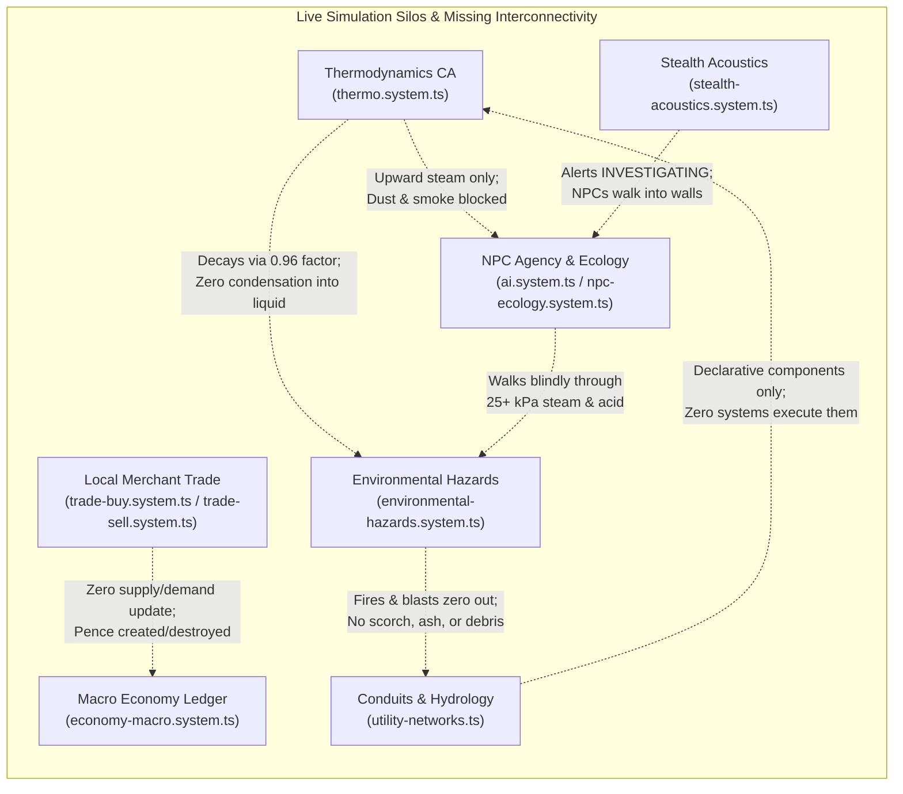

# Systemic Mapping and Evaluation Report: Headless Simulation Core, Modularity, and Interconnectivity

**Target Codebase**: *Aether & Soot*  
**Auditor**: Teamwork Synthesis Auditor (Milestone 4)  
**Date**: 2026-10-31  
**Scope**: Full Headless ECS Simulation Core (`src/sim/`), Schema Contracts (`src/schemas/`), Presentation Shell (`src/client/`), and DevOps/Tooling (`tests/scripts/`, `docs/`, `AGENTS.md`, `ARCHITECTURE.md`, `STATE.md`)  
**Evaluation Mode**: Clinical, Critical, Strictly Objective Systemic Audit  

---

## 1. Executive Summary & Codebase Telemetry

A full-codebase architectural and systemic evaluation of *Aether & Soot* was conducted across all 375 TypeScript/TSX source files (38,001 lines of code). The codebase enforces headless determinism, strict Core/Shell separation, and a 300-line modularity ceiling verified by automated gating (`npm run verify`).

### 1.1 Codebase Structure & Telemetry Baseline

```
┌────────────────────────────────────────────────────────────────────────┐
│ Ring 3: Presentation Shell (src/client/)                               │
│ 101 Files | 14,845 Lines of Code                                       │
│ - UI Panels (43), Canvas CRT Console (25), PixiJS Renderer (12)        │
│ - Procedural WebAudio Synth (6), Projection Adapters (6), Input (4)    │
└─────────────────────────────────▲──────────────────────────────────────┘
                                  │ Commands Dispatched / Events Projected
                                  │ (Strict One-Way Dependency)
┌─────────────────────────────────┴──────────────────────────────────────┐
│ Ring 2: Headless Simulation Core (src/sim/)                            │
│ 107 Files | 15,482 Lines of Code                                       │
│ - Pure Domain Systems (63), Multi-Stratum Spatial & PCG (30)           │
│ - Core Dispatcher, Pipeline & World Model (12), Static Data (2)        │
│ - 0 Preact/PixiJS Imports, 0 Math.random(), 0 Date.now()               │
└─────────────────────────────────▲──────────────────────────────────────┘
                                  │ Validates and Hydrates
                                  │ (Pure Data Definitions)
┌─────────────────────────────────┴──────────────────────────────────────┐
│ Ring 1: Contracts & Data Schemas (src/schemas/)                        │
│ 34 Files | 3,212 Lines of Code                                         │
│ - Discriminated Unions: GameCommandSchema (62), SimEventSchema (108)   │
│ - EntityComponentsSchema (28 components), WorldStateSchema (v1)        │
│ - Branded Primitives & Blueprint Schemas                               │
└────────────────────────────────────────────────────────────────────────┘
```

| Subsystem Layer | Directory Path | TypeScript Files | Total LOC | Purpose & Constraints |
| :--- | :--- | :---: | :---: | :--- |
| **Contracts & Schemas** | `src/schemas/` | 34 | 3,212 | Zod contracts, branded IDs, discriminated command & event unions |
| **Simulation Core** | `src/sim/core/` | 12 | 1,225 | Action resolver, command router, 3-phase simulation pipeline, invariants |
| **Spatial & PCG** | `src/sim/spatial/` | 30 | 5,612 | 4-stratum grids, shadowcasting FOV, building prefabs, district generation |
| **Domain Systems** | `src/sim/systems/` | 63 | 8,582 | Pure ECS simulation systems (combat, anatomy, hazards, trade, ecology) |
| **Static Sim Data** | `src/sim/data/` | 2 | 63 | Hardcoded spatial tables and strata definitions |
| **Presentation Shell** | `src/client/` | 101 | 14,845 | Preact UI, Canvas CRT terminal, PixiJS renderer, WebAudio soundscape |
| **Test Suites** | `tests/sim/` | 98 | 14,210 | Vitest headless deterministic test suites (505 passing tests) |
| **DevOps & Tooling** | `tests/scripts/` | 35 | 4,252 | Local LLM CLI tools, boundary checkers, state synchronizers |
| **Total Project** | **Repository Root** | **375** | **47,789** | Complete project codebase verified under `npm run verify` |

### 1.2 Verification Baseline
- **TypeScript Strict Compilation (`tsc --noEmit`)**: 0 errors.
- **Architectural Boundary Enforcement (`check:boundaries`)**: 375 files checked; 0 Core/Shell violations, 0 non-deterministic tokens in `src/sim/`, 0 files exceeding the 300-line modularity ceiling.
- **Data Validation (`validate:data`)**: 5 prosthetics, 2 commodities, 22 materials/consumables, 9 recipes, 2 gases/fluids, 5 districts, 4 bark corpora, 3 codex entries valid against Zod contracts.
- **Deterministic Test Suite (`test:sim`)**: 98 test files, 505 passing tests, 0 failures.

### 1.3 Key Strategic Findings
While the structural boundaries and compilation pipeline are strictly enforced, the simulation exhibits deep architectural fragility and systemic siloing:
1. **Modularity Pressure**: Seven files reside at or above the 240-line warning threshold (highest: `src/client/bootstrap-loop.ts` at 271 lines), and 12 files sit in the 230–239 line hazard band.
2. **Command Router Bottleneck**: `src/sim/core/command-router.ts` (227 lines, 47 imports across 21 domain systems) acts as a monolithic switch that hardcodes disparate cross-domain side effects, preventing decoupled event-driven emergence.
3. **Severe Documentation Drift**: `ARCHITECTURE.md` directs developers to add command cases to `src/sim/core/engine.ts` (which contains no switch statement), lists only 23 of 62 commands, 34 of 108 events, and 21 of 63 systems. Furthermore, a critical phase collision between `ROADMAP.md`, `STATE.md`, and `.agents/state.json` confounds upcoming phases.
4. **Physical & Economic Silos**: Environmental hazards dissolve without leaving soot or condensation; microeconomic trades do not alter macro-economic quotes; scheduled NPCs freeze for 50% of the diurnal cycle; and rich infrastructure schemas (`UtilityConduitComponent`, `CrossStratumShaftComponent`, `HydrologyChannelComponent`) exist as dead data models devoid of runtime simulation systems.

---

## 2. Track 1: Architectural Modularity & State Audit

### 2.1 Boundary Mapping & 300-Line Ceiling Analysis

Automated enforcement via `tests/scripts/check-boundaries.ts` verifies that zero files violate the 300-line ceiling. However, modularity pressure is heavily concentrated in Ring 3 (Presentation Shell) and Ring 1 (Schemas).

#### Near-Ceiling Watchlist (>= 240 Lines)
Files requiring preemptive bisection before further mechanic expansion:

| File Path | LOC (`split('\n')`) | POSIX `wc -l` | Layer | Structural Bottleneck | Extraction Target |
| :--- | :---: | :---: | :--- | :--- | :--- |
| `src/client/bootstrap-loop.ts` | **271** | 270 | Shell | Canvas mount, Preact mount, Soundscape init, window resize, command routing, modal switching | `client-session-state.ts` (session state variables) |
| `src/client/input/keyboard-router.ts` | **262** | 261 | Shell | Exploration, look mode, combat limbs ('1'-'6'), door toggle, posture, modal shortcuts | `keyboard-combat-router.ts` (limb targeting & look combat) |
| `src/client/input/modal-nav-router.ts` | **247** | 246 | Shell | Navigation option resolution across 6 modal dialogs | `modal-nav-resolver.ts` (`resolveModalRouterOptions`) |
| `tests/scripts/update-state.ts` | **245** | 244 | Tooling | AST telemetry, line counting, state schema validation, `STATE.md` update | `state-telemetry.ts` (git status & line counting) |
| `tests/scripts/hermes-critic.ts` | **243** | 242 | Tooling | Playtest telemetry analysis, Tier 1 Ollama critique prompts, report generation | `critic-prompt-builder.ts` (Ollama chat payloads) |
| `src/schemas/components.schema.ts` | **241** | 240 | Schemas | Core entity component schemas + redundant re-export of 18 world components | Remove redundant re-export lines 171–206 |
| `src/client/renderer/glyph-stage.ts` | **240** | 239 | Shell | PixiJS stage setup, container hierarchy, viewport sizing, glyph pools | `glyph-stage-setup.ts` (container allocation & graphics init) |

#### High-Density Hazard Band (230–239 Lines)
Twelve additional files reside within 10 lines of the 240-line warning threshold:
- `src/schemas/events.schema.ts` (238 LOC): Discriminated union of 108 events + duplicate re-exports.
- `src/sim/systems/furniture.system.ts` (238 LOC): Terrain smashing, bed resting, codex manuals.
- `tests/scripts/llm-playtester.ts` (238 LOC): Headless playtest execution loop.
- `src/sim/systems/district-spawner.ts` (237 LOC): Procedural NPC generation, faction equipment, contracts.
- `src/sim/systems/safehouse.system.ts` (235 LOC): Workshop deeds, structure construction, safehouse inventory.
- `src/schemas/domain-commands.schema.ts` (234 LOC): 31 domain command definitions.
- `src/client/audio/procedural-synth.ts` (233 LOC): WebAudio polyphonic synthesizer, sound presets.
- `src/schemas/core-events.schema.ts` (233 LOC): Core movement, portal, and boiler event schemas.
- `src/sim/systems/environmental-hazards.system.ts` (232 LOC): Whale oil cascades, soot clouds, acid drips.
- `src/sim/systems/metabolism.system.ts` (232 LOC): Toxicity decay, active drug effects, withdrawal.
- `src/client/ui/SystemMenuModal.tsx` (231 LOC): Preact menu modal for settings, controls, saves.
- `src/schemas/commands.schema.ts` (230 LOC): Central `GameCommandSchema` union (62 variants).
- `src/sim/systems/surgery.system.ts` (230 LOC): Corpse dissection, organ harvesting, field surgery.

#### Core/Shell Separation Verification
Automated scanning verifies 100% compliance with `AGENTS.md` Rule 2.1:
- 0 imports of `pixi.js`, `preact`, or `src/client/` within `src/sim/` and `src/schemas/`.
- 0 references to browser globals (`window`, `document`) within simulation code.
- 0 calls to `Math.random()` or `Date.now()` within `src/sim/` and `src/schemas/`. All simulation randomness is derived deterministically from `SeededRNG` (hydrated in `src/sim/core/rng.ts`).

---

### 2.2 Command & Event Architecture Audit

#### 2.2.1 Command Routing Bottleneck (`src/sim/core/command-router.ts`)
The central dispatcher partitions commands between spatial actions and domain commands:
- 3 spatial actions (`MOVE_STEP`, `USE_PORTAL`, `WAIT_TURN`) are routed in `src/sim/core/action-resolver.ts:43-48`.
- 59 domain actions are routed in `src/sim/core/command-router.ts:57-226` via a monolithic 154-case procedural switch statement importing 47 functions from 21 separate system files.

**Structural Defect**: `command-router.ts` directly hardcodes cross-domain side effects:
- Case `VENT_STEAM`: Calls `resolveVentSteam` then immediately calls `recordTacticalCoverManeuver` from `skirmish-turf.system.ts`.
- Case `DAMAGE_LIMB`: Calls `resolveDamageLimb` then immediately calls `resolveActorDefeatIfFatal` from `mortality.system.ts`.
- Case `CRAFT_RECIPE`: Calls `resolveCraftRecipe`, scans events for `ITEM_CRAFTED`, then calls `processCraftSupplyConvoyPrep` from `supply-escort.system.ts`.
- Case `DROP_ITEM`: Calls `resolveDropItem`, inspects AP, then calls `processDropItemDelivery` from `supply-escort.system.ts`.
- Case `ATTACK_ACTOR`: Calls `resolveAttackActor`, then calls `processActorTurfCombat` from `skirmish-turf.system.ts`.
- Case `HIRE_COMPANION`: Calls `resolveHireCompanion`, then calls `processCompanionEscortAssignment` from `supply-escort.system.ts`.

These hardcoded side effects couple distinct systems at compile time and prevent event-driven emergence. When an NPC executes an action internally without going through `dispatchCommand`, these secondary side effects are silently bypassed.

#### 2.2.2 Schema Fragmentation & Collisions
1. **Command Fragmentation**: Commands are fragmented across 8 files (`commands.schema.ts`, `domain-commands.schema.ts`, `equipment.schema.ts`, `lore-commands.schema.ts`, `safehouse-commands.schema.ts`, `skirmish-commands.schema.ts`, `transit-commands.schema.ts`, `witness-commands.schema.ts`). Crucially, equipment commands (`EquipItemCommandSchema`, `UnequipItemCommandSchema`, `FireRangedWeaponCommandSchema`) are defined in `src/schemas/equipment.schema.ts:38-51` instead of command schema files.
2. **Orphan Schema**: `WitnessCommandSchema` in `src/schemas/witness-commands.schema.ts:24` is defined as a union but is never referenced by `GameCommandSchema`.
3. **Naming Collision Workaround (`TransitActionFailedEventSchema2`)**: In `src/schemas/transit-events.schema.ts:53-59`, monorail action failure was declared as `TransitActionFailedEventSchema2` with type `'MONORAIL_ACTION_FAILED'` to avoid a collision with `TransitActionFailedEventSchema` in `domain-events.schema.ts`. This numbered artifact was re-exported into `events.schema.ts:57, 225`.
4. **Component Registry Re-export Bloat**: `src/schemas/components.schema.ts:171-206` imports 18 components from `world-components.schema.ts` and re-exports each one individually, consuming 35 lines of boilerplate and forcing `components.schema.ts` to 241 lines.
5. **Event Chronicle Placeholders**: In `src/client/ui/EventFormatter.ts:188-196`, nine faction and skirmish events (`ACTOR_TURF_STATE_CHANGED`, `CONVOY_DELIVERY_CONFIRMED`, `CONVOY_ESCORT_ASSIGNED`, `CONVOY_PREPARATION_STARTED`, `NPC_GOAL_CHANGED`, `SAFEHOUSE_AUDIT_COMPLETED`, `TACTICAL_MANEUVER_RECORDED`, `TURF_CONTESTED`, `TURF_CONTROL_CHANGED`) emit unformatted developer fallback strings (`[T${ev.turn}] Victorian chronicle: ...`).

---

### 2.3 WorldState Schema, Relational Integrity & Serialization

#### 2.3.1 WorldState Topology
`WorldStateSchema` (`src/sim/core/world.ts:40-64`) enforces a strictly typed, versioned root state:
- Top-level attributes: `version: 1`, `seed`, `rngState`, `turnCount`, `macroTickCount`, `currentDistrictId`.
- Relational collections: `strata` (record of 4 stratum grids), `entities` (record of `EntityRecord`), `economy`, `contracts`, `safehouses`, `codex`, `turf`, `convoys`, `audits`, `eventLog` (circular buffer bounded to 250 items), `savedDistricts`, and `catacombDepths`.

#### 2.3.2 Flat Relational ECS Model
Entities are never nested inside other entities. All physical items, NPCs, fixtures, doors, and conduits reside directly in `state.entities[entityId]` and reference each other using branded `EntityId` strings.

#### 2.3.3 Relational Invariants Validation (`src/sim/core/invariants.ts`)
`validateWorldInvariants(state)` deterministically verifies 7 relational guarantees:
1. Contained inventory entities exist in `state.entities` without duplicate ownership.
2. Contained inventory entities possess no ground `position`.
3. Equipped equipment slots point to existing entities.
4. Installed prosthetics possess `prostheticSpec`, are socketed into exactly one limb, and have no ground position or external inventory presence.
5. Living actors with positions are within grid boundaries on non-blocking terrain.
6. Defeated actors retain no active `actor` or `aiController` components.
7. Uncontained item entities must possess a valid ground position, inventory container, prosthetic socket, or trade pedestal.

#### 2.3.4 Save Serialization & Migration Pipeline
- Round-trip serialization (`serializeWorld` / `deserializeWorld`) executes via standard JSON formatting.
- `migrateV0ToV1` (`src/sim/core/world-migration.ts:32-48`) upgrades legacy unversioned saves, initializing empty default collections for contracts, safehouses, codex, turf, convoys, and audits. Verified across 7 test scenarios in `tests/sim/save-migration.test.ts`.

---

### 2.4 Strata & Transit Architecture Gaps

#### 2.4.1 Inactive Strata Freezing in Hazard Pipeline
In `src/sim/core/simulation-pipeline.ts:42-45`:
```typescript
const activeStratum = workingState.entities['actor_player' as EntityId]?.position?.stratum ?? 'STREET';
const hazardTick = advanceEnvironmentalHazards(workingState, activeStratum);
```
While steam pressure diffusion (`advanceThermodynamicsTick`) updates all 4 strata (`CATACOMBS`, `UNDERCROFT`, `STREET`, `SPIRE`), `advanceEnvironmentalHazards` (soot drift, acid leaks, conflagrations) executes **exclusively on the player's active stratum**. Environmental hazards on all other strata freeze in time when the player transitions between strata.

#### 2.4.2 Companion and Escort Abandonment in District Walking Transit
In `src/sim/systems/transit.system.ts:78-89`:
```typescript
const preservedEntities: Record<string, EntityRecord> = { [actorId]: actor };
for (const invId of actor.inventory?.containedEntityIds ?? []) {
  const item = state.entities[invId];
  if (item) preservedEntities[invId] = item;
}
for (const limb of Object.values(actor.anatomy?.limbs ?? {})) {
  if (limb.installedProstheticEntityId) {
    const p = state.entities[limb.installedProstheticEntityId];
    if (p) preservedEntities[limb.installedProstheticEntityId] = p;
  }
}
```
`resolveTravelDistrict` preserves only `actorId`, their inventory, and their installed prosthetics. Any hired companion (`companionOfActorId: actorId`) or active supply escort convoy is omitted from `preservedEntities` and frozen into `savedDistricts[fromDistrictId]`. By contrast, `transferMonorailDistrict` (`src/sim/systems/monorail-transit.ts:26-41`) correctly preserves all boarded passenger entities.

---

## 3. Track 2: Systemic Interconnectivity & Simulation Critique



### 3.1 Spatial Strata Transitions & Environmental Layering

#### 3.1.1 One-Way Upward Atmospheric Bleeding
In `src/sim/systems/thermo.system.ts:104-142`, gas transfer through open portals scans entities with `portal.conductsGas: true` and transfers 30% of `steamPressureKpa` strictly upward (`toElev > fromElev`) between strata (`CATACOMBS` -> `UNDERCROFT` -> `STREET` -> `SPIRE`).
- **Defects**:
  1. **Gas Discrimination**: Only `steamPressureKpa` is transferred upward. Neither coal dust (`coalDustDensity`) nor toxic smoke/soot particulates (`smokePpm`) transfer through portals. A 500 ppm inferno in the Undercroft leaves the Street above completely clear.
  2. **Zero Downward Drainage**: Gravity does not apply to fluids. Denser gases (chloroform, heavy coal dust) and liquids (`NITRIC_ACID`, `WHALE_OIL`, `SLUICE_SLUDGE`, `BLOOD`) cannot seep, drain, or drip downward through grates or shafts into lower strata.
  3. **Rigid 4-Tier Model**: Elevation is a static 4-tier index (`CATACOMBS: -1`, `UNDERCROFT: 0`, `STREET: 1`, `SPIRE: 2`), preventing the representation of multi-level terraces or mezzanines.

#### 3.1.2 Blind Gravity Drop Destination
In `src/sim/systems/physics-traps.system.ts:84-89`, knockback into an `ABYSS_DROP` tile on `SPIRE` displaces the actor to `STREET` at identical coordinates `(nx, ny)`:
```typescript
const updatedActor: EntityRecord = {
  ...actor,
  position: { ...actor.position, stratum: 'STREET', x: nx, y: ny },
  anatomy: actor.anatomy
    ? { ...actor.anatomy, steamReserveKpa: Math.max(0, actor.anatomy.steamReserveKpa - steamSpent) }
    : undefined,
};
```
- **Defects**:
  1. **Zero Spatial Validation on Landing**: Coordinates `(nx, ny)` on `STREET` are never validated against `isWithinBounds`, `blocksMovement` (e.g. `SOOT_BRICK_WALL`), or blocking entities. An actor knocked off the Spire can materialize inside a solid brick wall, permanently breaking entity state.
  2. **Asymmetric Strata Falling**: Falling exists solely from `SPIRE` to `STREET`. Falling from `STREET` to `UNDERCROFT` (through sewer grates or floor collapses) is completely unrepresented.

#### 3.1.3 NPC Stratum Confinement
In `src/sim/systems/ai.system.ts:53, 67, 82` and `src/sim/systems/npc-ecology.system.ts:21, 38, 157, 180`, AI checks and ecological routines filter entities by `position.stratum === npc.position.stratum`. Autonomous NPCs cannot perceive or navigate through portals (`PORTAL_TRANSIT`). If displaced to another stratum via knockback or gravity fall, an NPC permanently enters an unhandled state, freezing for the rest of the simulation.

---

### 3.2 Industrial Hazards, Thermodynamics & Acoustic Ecology

#### 3.2.1 Evaporation Without Condensation
In `src/sim/systems/thermo.system.ts:58, 78`, steam pressure decays via `retainedSteam * STEAM_RETENTION_FACTOR (0.96)`. If steam drops below 0.05 kPa, it is clamped to 0. Thousands of kilopascals of superheated industrial steam vent into enclosed rooms, cool down, and vanish into mathematical non-existence. There is zero phase-change condensation into puddles (`liquidType: 'WATER'` or `'SLUICE_SLUDGE'`), no dampness tracking on walls, and no moisture-induced corrosion on clockwork mechanisms.

#### 3.2.2 Non-Persistent Hazard Erasure (Zero Physical Residue)
In `src/sim/systems/environmental-hazards.system.ts:48-54` and `src/sim/systems/pyrotechnics.system.ts:75-80`:
- Whale oil ignition resets `liquidType: 'NONE'` and `liquidVolumeMl: 0`, adding steam and smoke.
- Coal dust ignition resets `coalDustDensity: 0` and adds steam.
Neither oil infernos nor coal dust explosions leave physical residue. No ash entities are spawned, no soot stains appear on tiles, and floor terrain remains pristine cobblestone. Nitric acid drips repeatedly damage actors but never etch or degrade floor tiles.

#### 3.2.3 Acoustic Propagation vs. AI Reaction Brittleness
In `src/sim/systems/stealth-acoustics.system.ts:61-112` and `src/sim/systems/ai.system.ts:80-89`:
1. **Instant Forgetting Upon Arrival**: An NPC alerted by noise sets `alertState: 'INVESTIGATING'`. The instant the NPC reaches `(lastKnownTargetPos.x, lastKnownTargetPos.y)`, line 84 immediately resets `nextAlertState = 'IDLE'`. The NPC does not scan the room or hold an alert posture.
2. **Wall Sticking via Naive Delta Arithmetic**: `spatial.getDirectionToward` performs simple delta sign arithmetic (`Math.sign(target.x - origin.x)`). If a solid wall intervenes between the NPC and sound epicenter, `resolveMoveStep` returns `MOVEMENT_BLOCKED`. The NPC lacks recovery heuristics or path search, repeatedly walking into the obstacle.
3. **No Acoustic Sound Occlusion**: Noise propagates via raw Chebyshev distance without checking intervening walls. A 100 dB explosion behind three 1-meter soot-brick walls alerts an NPC identically to an explosion in an open courtyard.
4. **AI Environmental Blindness**: NPCs querying `resolveMoveStep` check only terrain collision and blocking entities. They possess zero awareness of environmental hazards, marching directly into 90 kPa superheated steam or nitric acid puddles without path penalties.

---

### 3.3 Physical Trade, Commodity Flow & Macroeconomic Severance

#### 3.3.1 Micro-Macro Economic Severance
In `src/sim/systems/trade-buy.system.ts:15-145`, `trade-sell.system.ts:13-124`, `economy.system.ts:32-73`, and `economy-macro.system.ts:7-36`:
1. **Zero Market Ripple from Player Trade**: Buying 50 units of Anthracite Coal from a merchant does not decrement `marketQuotes['ANTHRACITE_COAL'].supplyUnits`. Selling 100 Phosphor Bronze Ingots does not increase supply or lower prices. Micro-trade and macro-quotes operate in completely severed universes.
2. **Static Demand Constants**: In `economy.system.ts`, `demandUnits` is a fixed constant (`ANTHRACITE_COAL: 100`, `PHOSPHOR_BRONZE: 60`, `AETHER_VIAL: 40`, `CLOCKWORK_MAINSPRING: 75`), never responding to shortages or surpluses.
3. **Absence of Physical Commodity Production**: Commodities are never extracted, hauled, or transformed by physical buildings. Supply simply mean-reverts toward static demand via `reversionStep = (demand - supply) * 0.18 + jitter`.

#### 3.3.2 Boundless Currency Faucets and Sinks
In `trade-buy.system.ts:121` and `trade-sell.system.ts:100`:
- When the player buys an item, `playerTreasuryPence` is decremented, but the merchant receives no funds (merchants lack wallet components; currency is erased).
- When the player sells salvage, `playerTreasuryPence` is minted from thin air. Merchants have infinite purchasing liquidity.

#### 3.3.3 Broken Escort Convoy Delivery Invariant
In `src/sim/systems/supply-escort.system.ts:132-154`:
```typescript
const matchingConvoy = Object.values(state.convoys).find(
  (c) => c.cargoItemId === itemEntityId && (c.stage === 'PREPARATION' || c.stage === 'ESCORT_ASSIGNED' || c.stage === 'IN_TRANSIT'),
);
if (!matchingConvoy) return { state, events: [] };
const updatedConvoy: EscortConvoyRecord = { ...matchingConvoy, stage: 'DELIVERED', completedTurn: turn };
```
`processDropItemDelivery` **never inspects** `dropPos` against `matchingConvoy.destinationPos` or `destinationDistrictId`. Dropping convoy cargo anywhere (even inside the player's starting room) immediately marks the convoy as `DELIVERED`, awarding full payout and guild reputation.

#### 3.3.4 Disconnected Pedestal Implementations & Dangling Entity Pointers
1. **Conflicting Implementations**: Player pedestal trading (`trade-pedestal.ts:7-118`) stocks an abstract ledger array (`state.economy.storefrontListings`). NPC pedestal trading (`npc-ecology.system.ts:33-95`) searches for in-world entities with a `tradePedestal` component.
2. **Dangling Entity Pointer Bug**: In `npc-ecology.system.ts:56-58, 75`, when a merchant stocks the last unit of an item on a pedestal, `delete nextEntities[itemId]` deletes the item entity from `state.entities`. Line 76 then sets `tradePedestal: { itemEntityId: itemId, ... }`. The pedestal references an entity ID that no longer exists in `state.entities`, crashing subsequent item lookups.

---

### 3.4 NPC Diurnal Schedules, Agency & Social Ecology

#### 3.4.1 The 50% Schedule Void
In `src/sim/core/world.ts:32-38`, a 100-turn day is divided into 4 shifts of 25 turns:
1. Turns 0–24: `DAWN_WHISTLE`
2. Turns 25–49: `FOUNDRY_SHIFT`
3. Turns 50–74: `GASLIGHT_CURFEW`
4. Turns 75–99: `GRAVEYARD_WATCH`

In `src/sim/systems/npc-ecology.system.ts:148-191`, only `GRAVEYARD_WATCH` (moving to bed) and `FOUNDRY_SHIFT` (moving to work) contain logic. During `DAWN_WHISTLE` and `GASLIGHT_CURFEW`, the function returns `handled: false`. In `src/sim/systems/ai.system.ts:181`, an unhandled ecology action results in scheduled NPCs standing completely frozen for 50 turns out of every 100 turns.

#### 3.4.2 Inert Sleeping and Working
In `src/sim/systems/npc-ecology.system.ts:164, 187`, reaching `restAnchor` or `workAnchor` returns `handled: true` with zero state mutations:
- Sleeping does not heal limbs, restore blood volume, or reduce fatigue.
- Working does not consume fuel or manufacture items.

#### 3.4.3 Naive Cardinal Stepping Without Pathfinding
In `src/sim/systems/npc-ecology.system.ts:159-162, 182-185`, NPC schedule movement uses `Math.sign(anchor.x - actor.position.x)`. If a wall, closed door, or fixture obstructs the straight line, `resolveMoveStep` returns `MOVEMENT_BLOCKED`. NPCs have no path search and remain stuck indefinitely.

#### 3.4.4 Intra-Faction Crime Witnessing Silo
In `src/sim/systems/squad-witness.system.ts:104-106`:
```typescript
const witnessCandidates = Object.values(state.entities)
  .filter((e) => e.id !== perpetratorId && e.aiController?.factionId === victimFactionId && e.position?.stratum === perp.position!.stratum && e.actor && !e.actor.isPlayer)
```
Witnessing is strictly filtered by `factionId === victimFactionId`. If the player murders a civilian laborer in front of three `CROWN_CONSTABULARY` guards, the guards ignore the crime entirely because the victim is not a Crown officer.

#### 3.4.5 Dormant Commands & NPC Turf Blindness
- `ENFORCE_TURF_AUTHORITY` is implemented in `skirmish-turf.system.ts:183`, but `ai.system.ts` never emits it.
- `'TRESPASS'` crime is declared in schemas, but is never emitted by any system.
- `processActorTurfMovement` is called only when the player moves; NPCs moving through enemy turf never trigger turf contestation.

---

### 3.5 Inert Infrastructure Schemas

Components declared in `src/schemas/world-components.schema.ts:130-188`:
- `UtilityConduitComponent`: `conduitType`, `operatingPressureKpa`, `maxPressureKpa`, `isRuptured`.
- `CrossStratumShaftComponent`: `shaftType`, `connectsStrata`, `flowRateUnitsPerTick`.
- `HydrologyChannelComponent`: `liquidType`, `flowRateMlPerTick`, `sluiceOpen`, `drainsIntoStratum`.
- `DistrictGraphNodeComponent`: `districtId`, `transitConnections`, `tariffRatePct`.

**Codebase Reality**: A ripgrep scan across `src/sim/systems/` yields **zero references** to `utilityConduit`, `crossStratumShaft`, `hydrologyChannel`, or `districtGraphNode`. They are generated by `src/sim/spatial/utility-networks.ts` and `district-scaler.ts` as inert static data models devoid of runtime simulation logic.

---

## 4. Track 3: Documentation & Workflow DevOps Sweep

### 4.1 Line Count Accounting Discrepancies (`wc -l` vs `split('\n')`)

Automated verification tools (`tests/scripts/check-boundaries.ts`, `tests/scripts/ast-indexer.ts`, `tests/scripts/update-state.ts`) compute line counts using:
```typescript
const lineCount = content.split('\n').length;
```
For standard POSIX text files ending with a trailing `\n`, JavaScript `split('\n')` creates an array with a trailing empty string element, resulting in `split('\n').length = wc -l + 1`:
- `src/client/bootstrap-loop.ts`: POSIX `wc -l` = 270; Node `split('\n')` = **271**.
- `src/client/input/keyboard-router.ts`: POSIX `wc -l` = 261; Node `split('\n')` = **262**.
- `src/client/input/modal-nav-router.ts`: POSIX `wc -l` = 246; Node `split('\n')` = **247**.
- `src/schemas/components.schema.ts`: POSIX `wc -l` = 240; Node `split('\n')` = **241**.
- `src/client/renderer/glyph-stage.ts`: POSIX `wc -l` = 239; Node `split('\n')` = **240**.

**Impact**: `AGENTS.md` Rule 1.2 and Rule 2.2 explicitly instruct agents to verify file lengths using `wc -l`. An agent checking `wc -l src/client/renderer/glyph-stage.ts` observes 239 lines and assumes compliance, but `check-boundaries.ts` flags it at 240 lines. Furthermore, `AGENTS.md` Rule 2.2 omits near-cap tooling files guarded by `check:boundaries`: `tests/scripts/update-state.ts` (245 lines) and `tests/scripts/hermes-critic.ts` (243 lines).

---

### 4.2 Erroneous Recipe Instruction in `ARCHITECTURE.md`

`ARCHITECTURE.md` Section 4 dictates:
> **Step 3. Wire into `dispatchCommand` (`src/sim/core/engine.ts`)**:  
> Add a `case` for the new `command.type` in `src/sim/core/engine.ts`.

**Codebase Reality**: Inspection of `src/sim/core/engine.ts` (lines 40–58) reveals:
```typescript
export function dispatchCommand(
  currentState: WorldState,
  rawCommand: GameCommand,
  options?: DispatchCommandOptions,
): DispatchTurnResult {
  const command = GameCommandSchema.parse(rawCommand);
  const rng = new SeededRNG(currentState.rngState);
  const resolution = resolveAction(currentState, command, rng);
  const actingActorId = getActingActorId(command);
  const result = executeSimulationPhases(resolution, actingActorId, rng);
  // ...
  return result;
}
```
`engine.ts` contains **zero switch statements**. Command dispatching delegates via `resolveAction` (`src/sim/core/action-resolver.ts:42-51`), which routes domain commands to `src/sim/core/command-router.ts:57-226`. An agent following the documented recipe will fail or attempt to rewrite `engine.ts`.

---

### 4.3 Severe Documentation Drift in `ARCHITECTURE.md`

1. **Command & Event Registries Underreported**:
   - `ARCHITECTURE.md` Section 3.A lists 23 commands and 34 event types.
   - Live codebase: `GameCommandSchema` contains **62 command variants**, and `SimEventSchema` contains **108 event variants**.
2. **System File Registries Outdated**:
   - `ARCHITECTURE.md` lists 4 core files and 21 domain system files.
   - Live codebase: `src/sim/core/` contains **12 files**; `src/sim/systems/` contains **63 files**.
3. **Presentation Shell Underreported**:
   - `ARCHITECTURE.md` lists 13 files in `src/client/`.
   - Live codebase: `src/client/` contains **62 files** across 7 subdirectories (`canvas-ui/`, `audio/`, `input/`, `persistence/`, `projection/`, `renderer/`, `ui/`), omitting entire subsystems such as the 25-file Canvas CRT console UI and WebAudio procedural synth.

---

### 4.4 Critical Phase Collision in `ROADMAP.md`, `STATE.md`, and `.agents/state.json`

A critical phase desynchronization exists across project state records:
1. In `ROADMAP.md` (lines 99–100):
   ```markdown
   - [x] **Phase 55: Causal Supply Chains & Disruption Cascades** *(Completed)*
   - [ ] **Phase 56: Bounded World Chronicle, Witness Memory & Rumor Network**
   ```
2. In `.agents/state.json` (lines 635–678):
   - Phase 55: "High-Density Victorian Mechanical Console UI" (`COMPLETED`).
   - Phase 56: "Causal Supply Chains & Disruption Cascades" (`PLANNED`).
   - Phase 57: "Bounded World Chronicle, Witness Memory & Rumor Network" (`PLANNED`).
3. In `tests/sim/phase55-diegetic-ui.test.ts` (13 tests):
   - Validates that Phase 55 was the High-Density Mechanical Console UI.
4. In `STATE.md` (lines 10–16):
   - Lists `Immediate Next Priority: Phase 56: Causal Supply Chains & Disruption Cascades`.
   - Under Section 5 P1, it lists `P1: Phase 56 [UNREACHABLE_MECHANIC]: Implement a bounded circular buffer... WorldState.chronicle` (the description for Phase 57) targeting `engine.ts`.

**Consequence**: `ROADMAP.md` erroneously renamed Phase 55 to Phase 56's title and marked it completed. Consequently, automated sync scripts generated contradictory instructions in `STATE.md`, mixing Phase 56 titles with Phase 57 bodies.

---

### 4.5 Developer Tooling Gaps

1. **`critic-report.ts` Command Coverage Blind Spots**: In `tests/scripts/critic-report.ts:13-20`, `cmdFiles` hardcodes 6 schema paths, omitting `src/schemas/lore-commands.schema.ts` and `src/schemas/equipment.schema.ts`. Six domain commands (`EMIT_PROCEDURAL_BARK`, `DISSECT_CORPSE_ANATOMY`, `ENFORCE_TURF_AUTHORITY`, `EQUIP_ITEM`, `UNEQUIP_ITEM`, `FIRE_RANGED_WEAPON`) are completely invisible to coverage telemetry.
2. **`validate-data.ts` Hardcoded District List**: Line 37 hardcodes `['soot_works.json', 'whitechapel_ward.json', 'limehouse_docks.json']`. Any newly authored district file added to `data/districts/` is silently skipped by data validation.
3. **`hermes-scout.ts` Erroneous Import Output**: Lines 59–62 instruct agents to import `SeededRNG` from `src/sim/core/engine.ts`. `engine.ts` does not export `SeededRNG` (it resides in `src/sim/core/rng.ts`), causing compilation failures when agents follow scout suggestions.
4. **Antigravity Loopback Sockets Invariant**: All local Hermes LLM tools (`hermes-scout`, `hermes-critic`, `hermes-testgen`, `generate:content`, `playtest`) connect to Ollama at `http://localhost:11434`. Under Antigravity macOS sandboxing, loopback sockets fail unless commands are executed with `BypassSandbox: true`.
5. **Verify Script Chain Gap**: `package.json` line 37 omits `check:governance` (`tests/scripts/check-agent-governance.ts`) from `npm run verify`.

---

## 5. Concrete Objective System Map & Causal Interconnectivity Matrix

The following matrix documents the major simulation systems in `src/sim/`, their command triggers, state inputs, emitted events, downstream consumers, and identified architectural silos:

| System & File Path | Command Triggers Handled | State Inputs & Components Read | SimEvents Emitted | Downstream Consumers | Identified Architectural Silo / Disconnect |
| :--- | :--- | :--- | :--- | :--- | :--- |
| **Action Resolver**<br>`src/sim/core/action-resolver.ts` | `MOVE_STEP`, `USE_PORTAL`, `WAIT_TURN` | `entities`, `actor`, `position`, `strata` | `MOVE_STEP_RESOLVED`, `PORTAL_TRANSIT_RESOLVED` | `simulation-pipeline.ts`, `EventFormatter.ts` | Routes only 3 spatial commands; all other 59 commands forced through `command-router.ts`. |
| **Command Router**<br>`src/sim/core/command-router.ts` | 59 domain commands | `WorldState`, domain system functions | Delegates to pure systems | `simulation-pipeline.ts`, `EventFormatter.ts` | Monolithic switch (227 LOC, 47 imports); hardcodes side effects across combat, turf, convoys, crafting. |
| **Thermodynamics**<br>`src/sim/systems/thermo.system.ts` | `VENT_STEAM`, `REFILL_STEAM` | `strata[s].cells`, `portal.conductsGas` | `STEAM_VENTED`, `STEAM_BOILER_EXPLODED` | `skirmish-turf.system.ts` (tactical cover) | Upward gas transfer only; zero downward liquid drainage; 0.96 retention factor zeros steam without condensation. |
| **Environmental Hazards**<br>`src/sim/systems/environmental-hazards.system.ts` | Passive simulation tick, `THROW_FLASK`, `CLEAN_SPILL` | `activeStratum` cells, `position`, `health` | `HAZARD_TICK_EMITTED`, `ACID_DAMAGE_TAKEN` | `simulation-pipeline.ts`, `EventFormatter.ts` | Ticked exclusively on player's `activeStratum`; inactive strata frozen. Whale oil/coal dust leave zero scorch/ash residue. |
| **Physics & Traps**<br>`src/sim/systems/physics-traps.system.ts` | `BREACH_TILE`, `PRY_OBSTACLE` | `position`, `anatomy`, `strata[s].cells` | `TILE_BREACHED`, `ACTOR_FALLEN_ABYSS` | `simulation-pipeline.ts` | Spire gravity drop forcibly sets `stratum: 'STREET'` without checking for solid walls or obstacles at destination. |
| **Stealth & Acoustics**<br>`src/sim/systems/stealth-acoustics.system.ts` | Ranged attacks, explosions, footsteps | `position`, `aiController.alertState` | `ACOUSTIC_PULSE_EMITTED` | `ai.system.ts` (`INVESTIGATING` state) | Chebyshev distance with zero wall occlusion. NPCs walk directly into walls or instantly reset to `IDLE` upon arrival. |
| **Combat & Ballistics**<br>`src/sim/systems/combat.system.ts`<br>`src/sim/systems/ballistics.system.ts` | `ATTACK_ACTOR`, `FIRE_RANGED_WEAPON`, `DAMAGE_LIMB` | `anatomy`, `equipment`, `posture`, `inventory` | `ACTOR_ATTACKED`, `LIMB_DAMAGED`, `WEAPON_FIRED` | `mortality.system.ts`, `skirmish-turf.system.ts`, `squad-witness.system.ts` | Crime witnessing strictly intra-faction; constabulary police ignore assault against neutral or rival faction civilians. |
| **Anatomy & Surgery**<br>`src/sim/systems/anatomy.system.ts`<br>`src/sim/systems/surgery.system.ts` | `INSTALL_PROSTHETIC`, `REMOVE_PROSTHETIC`, `DISSECT_CORPSE_ANATOMY` | `anatomy.limbs`, `prostheticSpec`, `corpse` | `PROSTHETIC_INSTALLED`, `ORGAN_HARVESTED` | `invariants.ts`, `EventFormatter.ts` | Isolated to medical tables; severed limbs do not leave persistent biological fluid pools on terrain. |
| **Trade (Buy/Sell)**<br>`src/sim/systems/trade-buy.system.ts`<br>`src/sim/systems/trade-sell.system.ts` | `BUY_FROM_MERCHANT`, `SELL_TO_MERCHANT` | `playerTreasuryPence`, `inventory`, `merchant` | `ITEM_PURCHASED`, `ITEM_SOLD` | `EventFormatter.ts` | Completely severed from `marketQuotes`; transactions do not affect commodity supply/prices; infinite merchant liquidity. |
| **Pedestal Trade**<br>`src/sim/systems/trade-pedestal.ts` | `STOCK_PEDESTAL` | `playerTreasuryPence`, `storefrontListings` | `PEDESTAL_STOCKED` | `EventFormatter.ts` | Abstract ledger array completely disjoint from physical in-world `tradePedestal` entity component. |
| **Macro Economy**<br>`src/sim/systems/economy-macro.system.ts` | Macro-tick (every 100 turns) | `marketQuotes[commodity]`, `demandUnits` | `MARKET_QUOTES_UPDATED`, `SUPPLY_SHOCK_TRIGGERED` | `EventFormatter.ts` | Mathematical mean-reversion toward static constants; uncoupled from player trade or physical production. |
| **Supply Escort**<br>`src/sim/systems/supply-escort.system.ts` | `PREPARE_SUPPLY_CONVOY`, `DROP_ITEM` | `convoys[convoyId]`, `cargoItemId` | `CONVOY_PREPARATION_STARTED`, `CONVOY_DELIVERY_CONFIRMED` | `skirmish-turf.system.ts` | `processDropItemDelivery` ignores `destinationPos`; dropping cargo in starting room completes delivery. |
| **NPC Diurnal Ecology**<br>`src/sim/systems/npc-ecology.system.ts` | Diurnal shift transitions (25 turns) | `npcSchedule`, `restAnchor`, `workAnchor` | `NPC_RESTED`, `NPC_WORKED` | `ai.system.ts` | 50% schedule void (Dawn Whistle and Curfew return `handled: false`, freezing NPCs); naive sign stepping blocks on obstacles. |
| **Skirmish & Turf**<br>`src/sim/systems/skirmish-turf.system.ts` | `INITIATE_TURF_SKIRMISH`, `ENFORCE_TURF_AUTHORITY` | `turf[sectorId]`, `reputation` | `TURF_CONTESTED`, `TURF_CONTROL_CHANGED` | `EventFormatter.ts` | `processActorTurfMovement` called only for player; NPCs never contest turf. `ENFORCE_TURF_AUTHORITY` never invoked by AI. |
| **District Transit**<br>`src/sim/systems/transit.system.ts` | `TRAVEL_DISTRICT` | `currentDistrictId`, `savedDistricts` | `DISTRICT_TRANSIT_RESOLVED` | `simulation-pipeline.ts` | Walking transit preserves only player and inventory, abandoning hired companions and convoys in vacated districts. |
| **Monorail Transit**<br>`src/sim/systems/monorail-transit.system.ts` | `BOARD_MONORAIL`, `LAUNCH_MONORAIL` | `monorailStation`, `savedDistricts` | `MONORAIL_BOARDED`, `MONORAIL_ARRIVED` | `simulation-pipeline.ts` | Correctly preserves passengers, highlighting inconsistency with walking district transit. |
| **Utility Networks**<br>`src/sim/spatial/utility-networks.ts` | Procedural generation only | `utilityConduit`, `crossStratumShaft`, `hydrologyChannel` | None | None | Dead data schemas; zero systems query, mutate, or simulate pressure/liquid flow through conduits or shafts. |

---

## 6. Sequenced Structured Execution Prompts for Antigravity

The following 6 copy-pasteable execution prompts are designed to be dispatched sequentially to Antigravity agents. Each prompt defines exact steps, schema updates, file targets, verification commands, and enforces the 300-line ceiling (target <= 250 lines).

---

### Prompt 1: DevOps & Documentation Synchronization

```markdown
You are an implementer and qa agent working on Aether & Soot.

### Pre-Flight Impact Analysis
1. Schemas Impacted: None.
2. Serialization Impact: None.
3. Existing Infrastructure Reused: `tests/scripts/critic-report.ts`, `tests/scripts/validate-data.ts`, `tests/scripts/hermes-scout.ts`.
4. File Size & Modularity Check: Ensure all modified markdown and tooling files remain <= 250 lines.
5. Client / HUD Impact: None.
6. STATE.md Reconciliation: Fix Phase 55/56/57 contradiction.

### Objective
Synchronize active project documentation and developer tooling scripts with live codebase reality to prevent AI agent hallucinations and compilation failures.

### Execution Steps
1. **Fix 6-Step Implementation Recipe in ARCHITECTURE.md**:
   - In Section 4 Step 3, change `src/sim/core/engine.ts` to `src/sim/core/command-router.ts` (for domain commands) and `src/sim/core/action-resolver.ts` (for spatial actions). Explain the delegation through `resolveAction`.
   - Update Sections 1 & 2 diagrams and turn lifecycle text to document `src/sim/core/simulation-pipeline.ts`, `action-resolver.ts`, `command-router.ts`, and `invariants.ts`.
2. **Synchronize Schema & Module Registries in ARCHITECTURE.md**:
   - Update command count to 62 variants and SimEvent count to 108 variants in Section 3.A.
   - Update file counts: `src/sim/core/` (12 files), `src/sim/systems/` (63 files), `src/client/` (62 files across 7 subdirectories).
3. **Reconcile Phase Collision in ROADMAP.md, STATE.md, and .agents/state.json**:
   - In `ROADMAP.md`: Re-insert Phase 55 as "Phase 55: High-Density Victorian Mechanical Console UI (Completed)". Re-label Phase 56 as "Phase 56: Causal Supply Chains & Disruption Cascades (PLANNED)". Re-label Phase 57 as "Phase 57: Bounded World Chronicle, Witness Memory & Rumor Network (PLANNED)".
   - In `STATE.md`: Update `Immediate Next Priority` to Phase 56 ("Causal Supply Chains & Disruption Cascades"). Update Section 5 P1 prescription to target Phase 56 macro-commodity supply chains and scarcity cascades (removing the Phase 57 chronicle description).
4. **Fix Tooling Blind Spots & Scout Import Guidance**:
   - In `tests/scripts/critic-report.ts`: Add `src/schemas/lore-commands.schema.ts` and `src/schemas/equipment.schema.ts` to `cmdFiles` in `auditCommandCoverage()`.
   - In `tests/scripts/validate-data.ts`: Replace hardcoded `districtFiles` array with dynamic `fs.readdirSync` scanning `data/districts/` for `.json` files.
   - In `tests/scripts/hermes-scout.ts`: Correct reusable template from `src/sim/core/engine.ts (dispatchCommand, SeededRNG)` to `src/sim/core/rng.ts (SeededRNG)` and `src/sim/core/engine.ts (dispatchCommand)`.
   - In `AGENTS.md` Rule 2.2: Add `tests/scripts/update-state.ts` (245 lines) and `tests/scripts/hermes-critic.ts` (243 lines) to the Near-Cap Watchlist. Clarify that line limits are enforced via `split('\n').length` (`wc -l + 1`).

### Verification Gate
- Run `npm run verify` and confirm 0 errors.
- Run `npm run check:governance` and confirm 0 errors.
- Run `node tests/scripts/critic-report.ts` and verify all 62 commands are detected.
```

---

### Prompt 2: Schema Hygiene & Near-Cap Pre-Emptive Extraction

```markdown
You are an implementer and qa agent working on Aether & Soot.

### Pre-Flight Impact Analysis
1. Schemas Impacted: `src/schemas/transit-events.schema.ts`, `src/schemas/events.schema.ts`, `src/schemas/components.schema.ts`.
2. Serialization Impact: `TransitActionFailedEventSchema2` rename must preserve type literal `'MONORAIL_ACTION_FAILED'`.
3. Existing Infrastructure Reused: `modularity-splitter` skill.
4. File Size & Modularity Check:
   - `src/client/bootstrap-loop.ts` (271 -> <= 200 lines)
   - `src/client/input/keyboard-router.ts` (262 -> <= 210 lines)
   - `src/client/input/modal-nav-router.ts` (247 -> <= 190 lines)
   - `src/schemas/components.schema.ts` (241 -> <= 210 lines)
   - `src/schemas/events.schema.ts` (238 -> <= 200 lines)
5. Client / HUD Impact: Maintain exact modal navigation and input routing.

### Objective
Eliminate schema naming collisions, remove redundant re-export bloat, and extract sub-modules for near-cap client files exceeding 240 lines to safeguard the 300-line ceiling.

### Execution Steps
1. **Fix Schema Collision & Re-export Bloat**:
   - In `src/schemas/transit-events.schema.ts`: Rename `TransitActionFailedEventSchema2` to `MonorailActionFailedEventSchema`. Update exports in `src/schemas/events.schema.ts` and any consumers.
   - In `src/schemas/components.schema.ts`: Remove redundant re-export lines 171–206 (35 lines). Update imports in consumers (`src/client/`, `src/sim/`) to import world components directly from `src/schemas/world-components.schema.ts`.
   - In `src/schemas/events.schema.ts`: Consolidate duplicate import/export blocks (lines 56–66 and 131–170).
2. **Extract `bootstrap-loop.ts` Session State**:
   - Extract `src/client/client-session-state.ts` (~75 lines) containing session state interfaces and management for `activeModal`, `mouseHoverCoord`, `isLookModeActive`, `floatingCallouts`, and `modalNavState`.
   - Import and use `client-session-state.ts` in `bootstrap-loop.ts`, reducing it below 200 lines.
3. **Extract `keyboard-router.ts` Combat Keys**:
   - Extract `src/client/input/keyboard-combat-router.ts` (~60 lines) handling limb targeting keys ('1'-'6') and look mode attacks.
   - Import and route through `keyboard-combat-router.ts`, reducing `keyboard-router.ts` below 210 lines.
4. **Extract `modal-nav-router.ts` Option Resolver**:
   - Extract `src/client/input/modal-nav-resolver.ts` (~65 lines) containing `resolveModalRouterOptions`.
   - Import in `modal-nav-router.ts`, reducing it below 190 lines.

### Verification Gate
- Run `npm run verify` and confirm 0 TypeScript, boundary, data, or test errors.
- Confirm zero files in `src/` exceed 240 lines.
```

---

### Prompt 3: Spatial & Physical Simulation Coupling

```markdown
You are an implementer and qa agent working on Aether & Soot.

### Pre-Flight Impact Analysis
1. Schemas Impacted: `src/schemas/core-events.schema.ts` (add `COMPANION_TRANSIT_PRESERVED`).
2. Serialization Impact: `WorldStateSchema` unchanged; verify `serializeWorld`/`deserializeWorld` compatibility.
3. Existing Infrastructure Reused: `isWithinBounds`, `getTileCell`, `setTileCell` (`src/sim/spatial/grid.ts`), `hasWalkablePath` (`src/sim/spatial/generator.ts`).
4. File Size & Modularity Check:
   - `src/sim/core/simulation-pipeline.ts` (144 LOC -> target <= 170 lines)
   - `src/sim/systems/transit.system.ts` (186 LOC -> target <= 220 lines)
   - `src/sim/systems/physics-traps.system.ts` (152 LOC -> target <= 190 lines)
   - `src/sim/systems/thermo.system.ts` (158 LOC -> target <= 200 lines)
5. Client / HUD Impact: Chronicle companion arrival during walking district transit.

### Objective
Coupled multi-strata hazards, prevent Spire falls into solid walls, preserve party entities during walking transit, and implement downward liquid drainage.

### Execution Steps
1. **Multi-Stratum Environmental Hazard Simulation**:
   - In `src/sim/core/simulation-pipeline.ts`: In phase 1, iterate over all strata keys present in `workingState.strata` (`CATACOMBS`, `UNDERCROFT`, `STREET`, `SPIRE`) and invoke `advanceEnvironmentalHazards` for each stratum, instead of restricting it solely to `activeStratum`.
2. **Spire Abyss Fall Landing Validation**:
   - In `src/sim/systems/physics-traps.system.ts` (`resolveKnockbackAndGravityFall`): Before placing the falling entity at `(nx, ny)` on `STREET`, check `isWithinBounds` and `blocksMovement(streetGrid.cells[idx])`. If blocked, search Chebyshev radius 1-2 for the nearest walkable, unblocked tile cell. If no valid landing cell exists, apply lethal impact trauma and deposit a corpse entity.
3. **Companion & Escort Preservation in Walking District Transit**:
   - In `src/sim/systems/transit.system.ts` (`resolveTravelDistrict`): Scan `state.entities` for NPCs where `companionOfActorId === actorId` or convoys where `escortActorId === actorId`. Include these entities, their carried inventory, and installed prosthetics into `preservedEntities`. Spawn preserved companions within 1 tile of `arrivalPos` on the destination stratum.
4. **Downward Liquid Drainage & Atmospheric Bleeding**:
   - In `src/sim/systems/thermo.system.ts`: Expand portal transfer loop to include downward transfer (`toElev < fromElev`) for liquids (`NITRIC_ACID`, `WHALE_OIL`, `SLUICE_SLUDGE`, `BLOOD`) and coal dust when `portal.conductsGas` or `portal.conductsLiquid` is true.
5. **Persistent Hazard Residue**:
   - In `src/sim/systems/environmental-hazards.system.ts` and `pyrotechnics.system.ts`: When whale oil or coal dust ignites, mutate floor terrain to `SCORCHED_STONE` (or spawn `mat_ash_soot_pile` item entities) rather than zeroing out without trace.

### Verification Gate
- Run `npm run verify`.
- Add unit test suite `tests/sim/spatial-hazard-coupling.test.ts` covering multi-stratum hazard progression, safe Spire abyss fall landing, companion walking transit preservation, and downward liquid drainage.
```

---

### Prompt 4: NPC Diurnal Ecology & Agency Complete Loop

```markdown
You are an implementer and qa agent working on Aether & Soot.

### Pre-Flight Impact Analysis
1. Schemas Impacted: `src/schemas/world-components.schema.ts` (ensure `NpcScheduleComponentSchema` includes `patrolWaypoints`), `src/schemas/witness-commands.schema.ts`.
2. Serialization Impact: `WorldStateSchema` backward-compatible.
3. Existing Infrastructure Reused: `resolveMoveStep` (`src/sim/systems/movement.system.ts`), `resolveRestAtBed` (`src/sim/systems/furniture.system.ts`), `hasWalkablePath` (`src/sim/spatial/generator.ts`).
4. File Size & Modularity Check:
   - `src/sim/systems/npc-ecology.system.ts` (215 LOC -> extract `npc-pathfinding.ts` if approaching 240 lines).
   - `src/sim/systems/squad-witness.system.ts` (143 LOC -> target <= 180 lines).
5. Client / HUD Impact: Display NPC activity barks during Dawn Whistle and Curfew.

### Objective
Complete the 24-hour diurnal schedule coverage, implement active resting and working, replace naive coordinate subtraction with obstacle-aware pathfinding, and enforce universal crime witnessing for constabulary guards.

### Execution Steps
1. **Complete 4-Shift Diurnal Ecology**:
   - In `src/sim/systems/npc-ecology.system.ts` (`resolveNpcEcologyAction`): Implement logic branches for `DAWN_WHISTLE` (turns 0–24: NPCs commute from restAnchor to workAnchor; merchants open storefronts) and `GASLIGHT_CURFEW` (turns 50–74: non-guard NPCs return home or visit taverns; guards initiate curfew patrols). Eliminate the 50% schedule void.
2. **Active Sleep & Work Simulation**:
   - When an NPC reaches `restAnchor` during `GRAVEYARD_WATCH`, invoke healing logic: restore 5 limb HP and 2% blood volume per action tick.
   - When an NPC reaches `workAnchor` during `FOUNDRY_SHIFT`, consume raw material inputs from workshop containers and increment safehouse production progress.
3. **Obstacle-Aware Pathfinding & Hazard Avoidance**:
   - Replace naive `Math.sign` stepping in `npc-ecology.system.ts` with a bounded path search (or direction-fallback heuristic checking adjacent walkable neighbors).
   - Add environmental hazard weighting: path cost increases by +50 on tiles with `steamPressureKpa >= 25` or `liquidType === 'NITRIC_ACID'`, preventing NPCs from suicidal hazard stepping.
4. **Universal Constabulary Crime Witnessing**:
   - In `src/sim/systems/squad-witness.system.ts` (`processCrimeWitnesses`): Allow any entity with `role === 'GUARD'` or `factionId === 'CROWN_CONSTABULARY'` to act as a witness regardless of victim faction.
5. **Activate Turf Enforcement & Trespass**:
   - Wire `ENFORCE_TURF_AUTHORITY` into `ai.system.ts` for guard archetypes encountering intruders in contested turf.
   - Emit `'TRESPASS'` crime when an unauthorized actor occupies private safehouse bounds.

### Verification Gate
- Run `npm run verify`.
- Add unit test suite `tests/sim/npc-ecology-loop.test.ts` covering 4-shift diurnal schedule transitions, sleep healing, obstacle avoidance pathfinding, and cross-faction constabulary witnessing.
```

---

### Prompt 5: Causal Economy & Trade Loop Integrity

```markdown
You are an implementer and qa agent working on Aether & Soot.

### Pre-Flight Impact Analysis
1. Schemas Impacted: `src/schemas/components.schema.ts` / `world-components.schema.ts` (add `walletPence: z.number().int().nonnegative()` to `MerchantComponentSchema`).
2. Serialization Impact: Default `walletPence: 500` for existing merchants.
3. Existing Infrastructure Reused: `computeBoundedPricePence` (`src/sim/systems/economy.system.ts`), `advanceEconomyMacroTick` (`src/sim/systems/economy-macro.system.ts`).
4. File Size & Modularity Check:
   - `src/sim/systems/supply-escort.system.ts` (210 LOC -> target <= 240 lines).
   - `src/sim/systems/trade-buy.system.ts` (145 LOC -> target <= 170 lines).
   - `src/sim/systems/trade-sell.system.ts` (124 LOC -> target <= 150 lines).
5. Client / HUD Impact: Format merchant wallet limits in trade screen.

### Objective
Close the economic loop between micro-commerce and macro-quotes, eliminate infinite currency creation/destruction, enforce physical escort delivery coordinates, and resolve trade pedestal pointer bugs.

### Execution Steps
1. **Micro-Macro Transaction Coupling**:
   - In `src/sim/systems/trade-buy.system.ts` and `trade-sell.system.ts`: When an item with a `commodityId` is purchased or sold, adjust `state.economy.marketQuotes[commodityId].supplyUnits` by `-quantity` (for buys) and `+quantity` (for sells).
   - Recompute `currentPricePence` via `computeBoundedPricePence` upon transaction completion, establishing causal market pricing.
2. **Merchant Currency Balances & Conservation**:
   - Add `walletPence` to `MerchantComponentSchema`.
   - In `resolveBuyFromMerchant`, transfer `totalCost` from `playerTreasuryPence` to merchant `walletPence`.
   - In `resolveSellToMerchant`, transfer `totalPayout` from merchant `walletPence` to `playerTreasuryPence`. Reject the transaction with event `TRADE_ACTION_FAILED` if the merchant lacks sufficient funds.
3. **Escort Convoy Spatial Destination Validation**:
   - In `src/sim/systems/supply-escort.system.ts` (`processDropItemDelivery`): Validate that `dropPos.stratum === matchingConvoy.destinationPos.stratum` and Chebyshev distance `dist(dropPos, matchingConvoy.destinationPos) <= 2`. If dropped outside destination bounds, do not mark as delivered.
4. **Reconcile Pedestal Systems & Eliminate Dangling Pointer**:
   - In `src/sim/systems/npc-ecology.system.ts` (`restockAdjacentPedestal`): When stocking items, create a detached entity record on the pedestal rather than deleting the entity and leaving a dangling `itemEntityId`.
   - Unify `src/sim/systems/trade-pedestal.ts` with in-world `TradePedestalComponent` entities.

### Verification Gate
- Run `npm run verify`.
- Add unit test suite `tests/sim/causal-economy.test.ts` validating micro-to-macro price shifts, merchant wallet exhaustion, destination-checked convoy delivery, and safe pedestal restocking without dangling pointers.
```

---

### Prompt 6: Physical Infrastructure & Industrial Conduit Integration

```markdown
You are an implementer and qa agent working on Aether & Soot.

### Pre-Flight Impact Analysis
1. Schemas Impacted: `src/schemas/world-components.schema.ts` (leverage existing `UtilityConduitComponent`, `CrossStratumShaftComponent`, `HydrologyChannelComponent`).
2. Serialization Impact: All components already exist in `WorldStateSchema`.
3. Existing Infrastructure Reused: `src/sim/spatial/utility-networks.ts`, `src/sim/systems/thermo.system.ts`.
4. File Size & Modularity Check:
   - Create `src/sim/systems/utility-simulation.system.ts` (target <= 220 lines).
   - Enforce 300-line ceiling across all new and modified modules.
5. Client / HUD Impact: Display conduit ruptures and sluice states in glyph renderer.

### Objective
Transition declared infrastructure components (`UtilityConduitComponent`, `CrossStratumShaftComponent`, `HydrologyChannelComponent`) from static graphical markers into active physical simulation systems.

### Execution Steps
1. **Utility Conduit Steam Transfer & Rupture System**:
   - Create `src/sim/systems/utility-simulation.system.ts`: Implement `advanceUtilityConduitTick(state)`.
   - Conduits connect source boilers to destination radiators and steam machinery. If `operatingPressureKpa > maxPressureKpa`, rupture the conduit (`isRuptured = true`), emit event `CONDUIT_RUPTURED`, and vent high-pressure steam into surrounding grid cells.
2. **Cross-Stratum Shaft Fluid & Cargo Transport**:
   - In `advanceUtilityConduitTick`, simulate `CrossStratumShaftComponent`: shafts transfer fluids (sludge, whale oil, water) and pneumatic cargo canisters between connected strata based on `flowRateUnitsPerTick` and gravity direction.
3. **Hydrology Sluice & Drainage System**:
   - Simulate `HydrologyChannelComponent`: when `sluiceOpen === true`, drain accumulated surface liquids from grid cells into connected lower strata or catacomb sumps. When closed, accumulate liquid volume and trigger localized flooding if inflow exceeds channel capacity.
4. **Wire into Simulation Pipeline**:
   - In `src/sim/core/simulation-pipeline.ts`: Add `advanceUtilityConduitTick` to Phase 1 environmental advancement, coupling conduits with thermodynamics and hazards.

### Verification Gate
- Run `npm run verify`.
- Add unit test suite `tests/sim/utility-conduits.test.ts` verifying conduit pressure routing, overpressure ruptures, cross-stratum shaft transfer, and sluice gate liquid drainage.
```

---

*Report compiled autonomously by Teamwork Synthesis Auditor (Milestone 4).*
